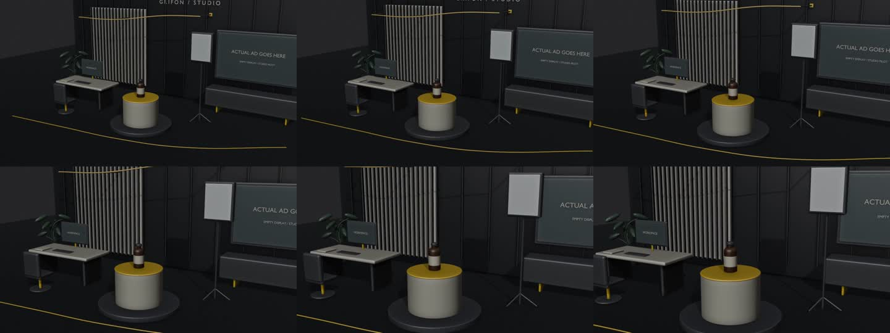

# Website hero film: one Genjutsu test

**Prepared; no generation submitted.** This is the 13-19 second studio beat from the unfinished website film on PR #134.

[Original six-second camera preview](../studio-pilot/shaded-camera-preview.mp4)



[Exact KAPE 01 product reference](../reference-candidates/HERO-IMG-01/A01-product-original.png)

[Exact test spec, prompt and hashes](test-spec.json)

## Proposed test

One Genjutsu Motion Transfer attempt, six seconds, landscape, **480p**. Use the account's single free attempt. Additional generation charge: **USD 0**. Paid attempts: **0**. No retries or paid fallback.

The source contains a camera orbit, not a magical transformation or moving ribbon. Test preservation of that movement, more realistic studio materials/light, and the correct KAPE 01 bottle. Do not promise a movement absent from the reference.

Only the linked video and bottle photo are proposed inputs. Exclude the old polished studio still: it has DEMO 01 packaging and gold-looking lower coffee. Exclude the hand/background from the bottle reference through the exact prompt.

This is external studio production, not an example of what the Grifon app generated. The film still needs real product proof, owner motion, final sound and review.

## Actual preflight

- Parent source: `916f387f`, recovered into isolated branch `codex/hero-film-genjutsu-sample`. Original film/media unchanged.
- FFmpeg full decode: exit 0, 144 frames, 960x540, 24fps, six seconds, no audio. This establishes decoding, not motion quality.
- Visually inspected original product and source sheet. Bottle is small in the wide shot; 480p cannot certify small label text or final website quality.
- Read-only Higgsfield model query on 2026-09-17 reports one shared Genjutsu free attempt at 480p, max 30 seconds. Provider is Higgsfield; hidden engine unknown.
- No upload, generation or paid call. Local-file ingestion remains to be validated through a supported upload path after approval.
- Creative Cloud exists locally; usable After Effects editor/bridge not established. This test does not depend on AE.

## Reproduce source checks

From the worktree, use the installed FFmpeg executable:

```powershell
$motionFfmpeg = 'C:/Users/ADMIN/Desktop/grifon-command/node_modules/ffmpeg-static/ffmpeg.exe'
& $motionFfmpeg -hide_banner -i assets/hero-film/studio-pilot/shaded-camera-preview.mp4 -progress pipe:1 -f null -
# Check LASTEXITCODE = 0 and final frame count = 144.
& $motionFfmpeg -hide_banner -loglevel error -y -i assets/hero-film/studio-pilot/shaded-camera-preview.mp4 -vf 'fps=1,scale=480:-1,tile=3x2' -frames:v 1 assets/hero-film/genjutsu-sample/source-contact.jpg
# Check LASTEXITCODE = 0. These are source frames, not generated results.
Get-FileHash assets/hero-film/studio-pilot/shaded-camera-preview.mp4 -Algorithm SHA256
Get-FileHash assets/hero-film/reference-candidates/HERO-IMG-01/A01-product-original.png -Algorithm SHA256
```

Application, provider routing, skills and tuned prompts unchanged. App build/tests are not applicable to this preparation-only change. JSON/input-hash/diff checks apply; generation quality and user acceptance remain untested.
