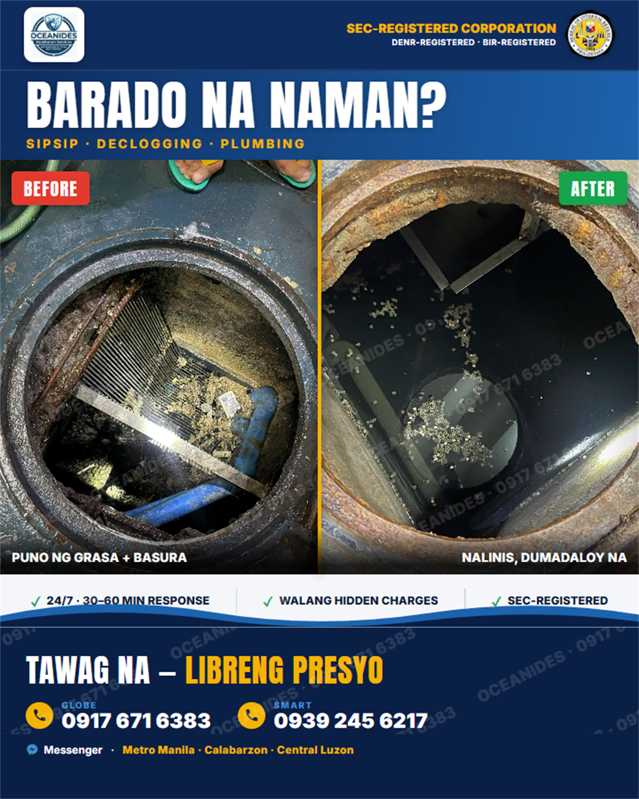
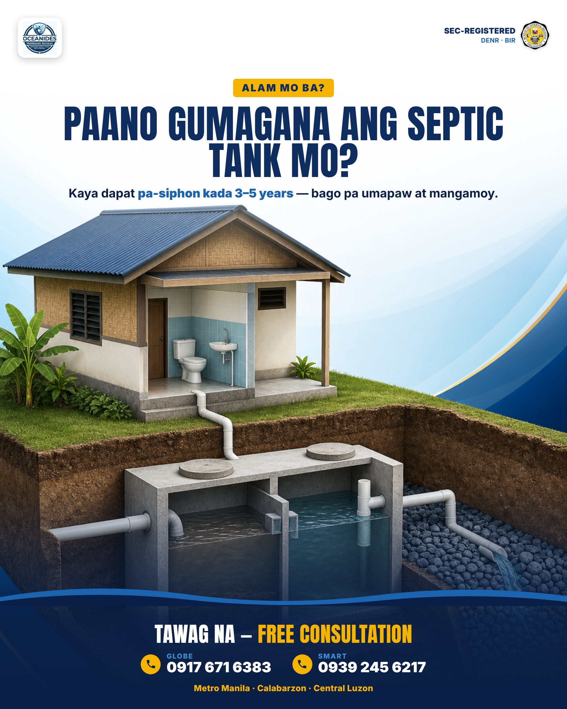
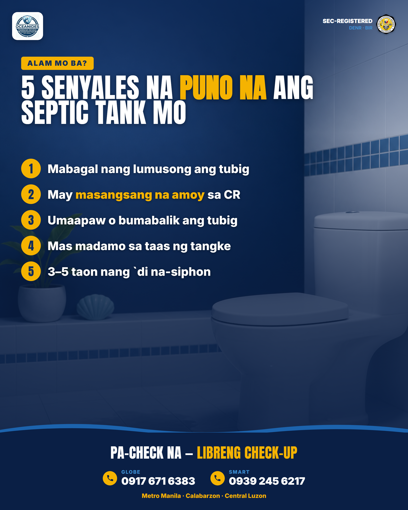
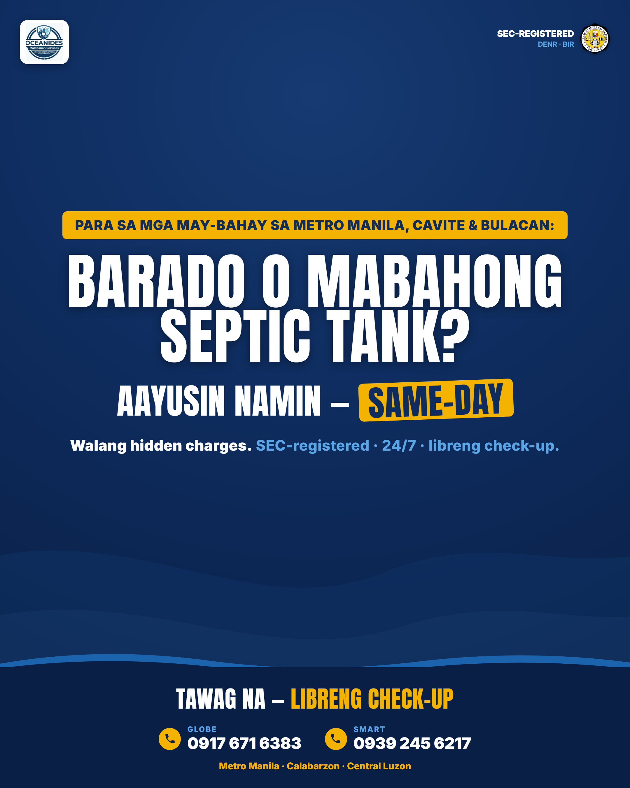
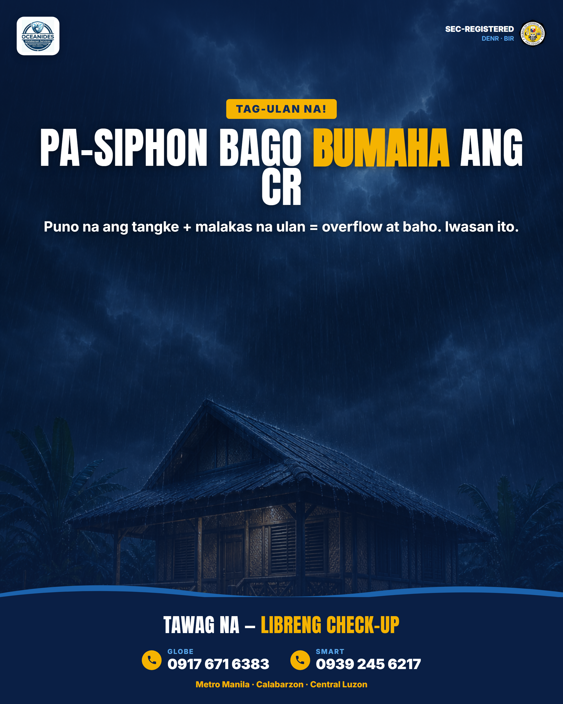
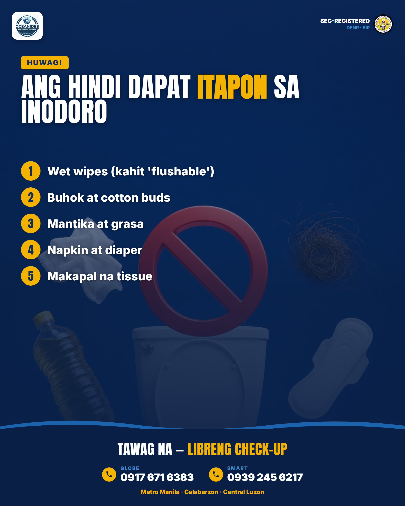
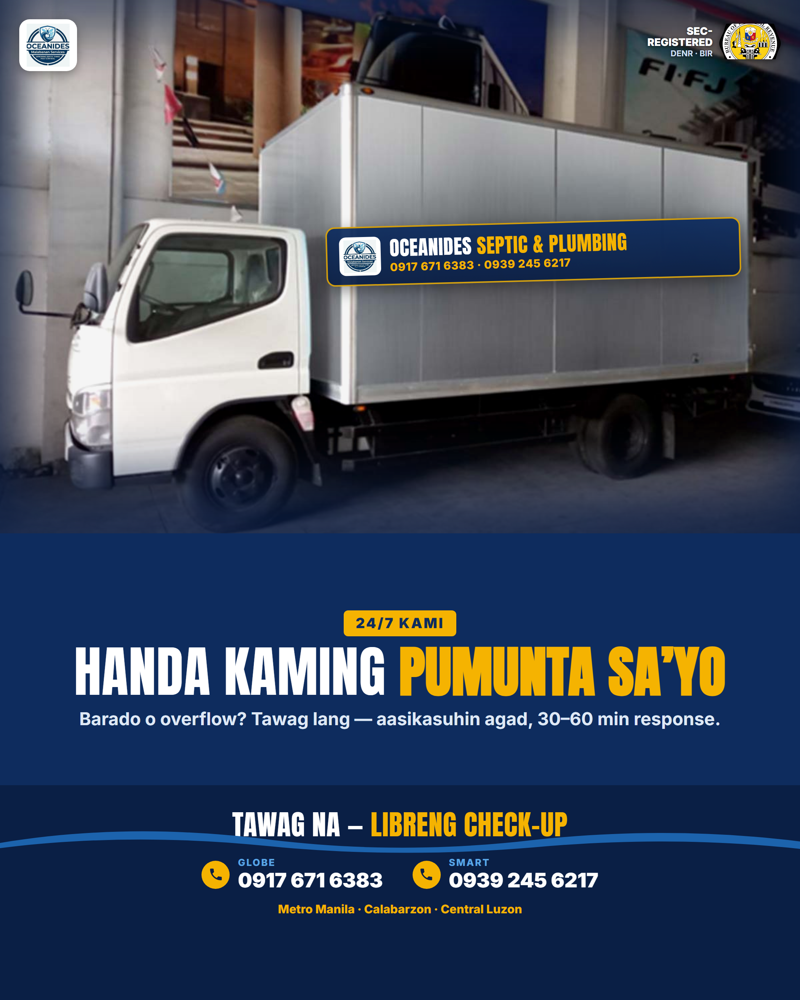

# Oceanides — Ready to Post (Batch 1)

8 posts, 1080×1350 (4:5), rendered @2x. Modern Taglish. SEC/DENR/BIR + contact baked in (theft-proof).
**Standard CTA:** LIBRENG CHECK-UP · **Contact on every post:** Globe 0917-671-6383 · Smart 0939-245-6217 · Messenger.

*Still cleaning (tomorrow): service-areas + offer (were showing a wrong truck) + 5 new posts.*

---

## 1 · Before / After — "Barado na naman?"  (Proof)

> Barado na naman? Umaapaw na ang inodoro? 😤
> Wag mong hintayin lumala — baka mangamoy pa buong bahay. Isang tawag lang, aalis na `yan.
> ✅ 24/7 — 30–60 min response
> ✅ Presyo agad — **WALANG hidden charges**
> ✅ **SEC-registered corporation** (DENR + BIR) — legit, hindi fly-by-night
> Sipsip septic tank · declogging · plumbing. Metro Manila, Calabarzon, Central Luzon.
> 📞 Globe 0917-671-6383 · Smart 0939-245-6217 — o mag-DM. **Libreng check-up!**
> #malabanan #sipsipseptictank #pozonegro #barado #declogging #plumbing #MetroManila #Cavite #Bulacan #Oceanides

---

## 2 · Education — "Paano gumagana ang septic tank"

> Alam mo ba kung paano gumagana ang septic tank mo? 🤔
> Kaya dapat pa-siphon kada 3–5 years — bago pa umapaw at mangamoy. Kapag puno na, wala nang lalim para sa dumi, kaya bumabalik at bumabaho.
> I-check natin `yan bago pa lumala.
> 📞 Globe 0917-671-6383 · Smart 0939-245-6217 — o mag-DM. **Libreng check-up!**
> #malabanan #sipsipseptictank #septictankcleaning #pozonegro #plumbing #MetroManila #Cavite #Bulacan #Oceanides

---

## 3 · Education — "5 senyales na puno na"  (Checklist)

> 5 senyales na PUNO na ang septic tank mo 👇
> 1. Mabagal nang lumusong ang tubig
> 2. Masangsang na amoy sa CR
> 3. Umaapaw o bumabalik ang tubig
> 4. Mas madamo sa taas ng tangke
> 5. 3–5 taon nang `di na-siphon
> May isa man dito? Pa-check na — libre lang.
> 📞 Globe 0917-671-6383 · Smart 0939-245-6217 — o mag-DM. **Libreng check-up!**
> #malabanan #sipsipseptictank #barado #pozonegro #declogging #MetroManila #Cavite #Bulacan #Oceanides

---

## 4 · Niche Callout — "Para sa mga may-bahay"  (Direct-response)

> Para sa mga may-bahay sa Metro Manila, Cavite & Bulacan 📢
> Barado o mabahong septic tank? Aayusin namin — **same-day, walang hidden charges.**
> SEC-registered · 24/7 · libreng check-up.
> 📞 Globe 0917-671-6383 · Smart 0939-245-6217 — o mag-DM.
> #malabanan #sipsipseptictank #barado #declogging #plumbing #MetroManila #Cavite #Bulacan #Oceanides

---

## 5 · Legit / Anti-scam — "3 red flags"  (Trust)

> INGAT sa fly-by-night na malabanan! ⚠️
> 3 red flags:
> 1. Walang permit, hindi SEC-registered
> 2. Ayaw magbigay ng presyo agad
> 3. Personal account lang, walang opisina
> Ang Oceanides? **SEC-registered corporation**, may DENR + BIR, may totoong opisina. Legit.
> 📞 Globe 0917-671-6383 · Smart 0939-245-6217 — o mag-DM. **Libreng check-up!**
> #malabanan #sipsipseptictank #pozonegro #plumbing #MetroManila #Cavite #Bulacan #Oceanides

---

## 6 · Offer / Seasonal — "Tag-ulan prep"  (Urgency)

> Tag-ulan na — pa-siphon na bago bumaha ang CR! 🌧️
> Puno na ang tangke + malakas na ulan = overflow at baho sa loob ng bahay. Iwasan `to habang maaga.
> SEC-registered · same-day · **walang hidden charges.**
> 📞 Globe 0917-671-6383 · Smart 0939-245-6217 — o mag-DM. **Libreng check-up!**
> #malabanan #sipsipseptictank #barado #pozonegro #tagulan #MetroManila #Cavite #Bulacan #Oceanides

---

## 7 · Education — "Huwag itapon sa inodoro"  (Checklist)

> HUWAG mong itapon `to sa inodoro! 🚽🚫
> 1. Wet wipes (kahit 'flushable')
> 2. Buhok at cotton buds
> 3. Mantika at grasa
> 4. Napkin at diaper
> 5. Makapal na tissue
> Ito ang madalas na sanhi ng barado. Kung barado na — tawag lang.
> 📞 Globe 0917-671-6383 · Smart 0939-245-6217 — o mag-DM. **Libreng check-up!**
> #malabanan #declogging #barado #sipsipseptictank #plumbing #MetroManila #Cavite #Bulacan #Oceanides

---

## 8 · Trust — "Handa kaming pumunta sa'yo"  (Real branded van)

> 24/7 kami — handa kaming pumunta sa'yo. 🚚
> Barado o overflow? Tawag lang, aasikasuhin agad — 30–60 min response. SEC-registered, may DENR + BIR, presyo agad, walang hidden charges.
> 📞 Globe 0917-671-6383 · Smart 0939-245-6217 — o mag-DM. **Libreng check-up!**
> #malabanan #sipsipseptictank #septictankcleaning #barado #plumbing #MetroManila #Cavite #Bulacan #Oceanides
