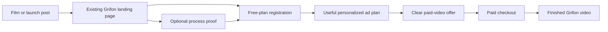

# Grifon hero film and launch research

Reviewed 2026-09-10. Base product: `4acbaef` (merged landing upgrade). Owner: Neil.

## Decision brief

**Build trust in output quality before asking for the free-plan signup.** Keep the accepted living creative studio and gold ribbons. Follow one new bottled-coffee demo product through a real ad plan into two real Grifon outputs: UGC and cinematic. This is the user's chosen direction and a hypothesis to test, not a proven conversion formula.

**Status: research delivered; audiovisual autopsy gate FAILED; final edit brief HOLD.** The one newly approved Gemini request returned JSON but only two qualifying findings, below the existing minimum of three. No retry, model switch, paid auditor, generation, or launch followed. Do not promote the rejected result into the Swipe File's analyzed entries or pattern counts. Final duration and timestamped storyboard remain dependent on a passing audiovisual study.

Read alongside the [production preparation brief](grifon_hero_film_brief.md), [browser evidence](../assets/funnel-swipe/astra-apple-2026-09-10/evidence.md), [independent frame audit](../assets/funnel-swipe/astra-apple-2026-09-10/frame-audit.md), and [attempt ledger](../assets/funnel-swipe/astra-apple-2026-09-10/analysis-attempt.json).

Follow-up: [Higgsfield's Astra production workflows](higgsfield_astra_launch_research.md) reviews 35 post texts and four sampled videos, with an editable-studio and motion-graphics recommendation. It does not clear the audiovisual gate or authorize production generation.

## What was actually researched

| Evidence | Status | What it establishes |
| --- | --- | --- |
| Exact official-X Astra MP4, SHA-256 checked | Verified | Identity of the asset submitted for analysis |
| Astra and Apple PH pages, desktop 1440×900 and mobile 390×844 | Browser observed | Visible hierarchy, navigation, film entry and CTA destinations; individual section coverage is listed in evidence.md |
| Public Vimeo auto-captions | Available, machine-generated | Approximate spoken task sequence, not verified dialogue transcription or music analysis |
| Local sampled frames and independent frame audit | Partial visual evidence | Composition and visible content at named samples; not uninterrupted audiovisual viewing |
| Gemini audiovisual response | Rejected by specificity validator | Hypotheses only; no passed autopsy or pattern corroboration |
| Source brands' conversion results and ad attribution | Unavailable | No causal claims about what raised registrations or purchases |
| Product code and free cost estimator | Read-only verified | Current routing/defaults; not evidence that the two proposed demo ads have been rendered |

No form was submitted, account created, appointment booked, checkout completed, campaign changed, or private analytics retrieved. These references are product-launch journeys; no lead-magnet opt-in sequence is invented for them.

## Astra: story and launch journey

Primary references: [official product article](https://openai.com/index/gpt-6-astra/), [official film post](https://x.com/OpenAI/status/2095595741528125780), and the article's [Vimeo film](https://player.vimeo.com/video/1222553704?h=ee86f55524). The site player reports 163 seconds; matching the X file's approximate duration does not establish identical edits.

The public article puts a large product claim beside demonstrations, comparative evaluations, and external perspectives, then explains access. The header provides a route to try the product. Interpretation: the film attracts attention and makes a capability imaginable; the article gives an interested visitor ways to inspect it. This is a role division, not proof of conversion effectiveness.

The preceding session recorded an official social thread moving from film to positioning, capability evidence, alignment, science, and access, followed by a later rollout reminder. Those observations are inherited evidence: this execution's web fetch of X returned 403. No verified prelaunch teaser schedule or paid distribution map is available. The article and browser observations remain the stronger current evidence.

### Caption-derived story spine — incomplete autopsy

The intervals below belong to the website player's auto-captions, not independently verified cuts in the X film. Summaries are paraphrases.

| Approximate caption interval | Task progression | Candidate storytelling lesson |
| --- | --- | --- |
| 0:04–0:37 | A circle becomes part of a rocket illustration, then a request for a 3D model | Give the viewer something recognizable to follow through changes |
| 0:44–1:04 | Retail presentation and used-table listing tasks enter | Different situations can demonstrate breadth without naming every feature |
| 1:06–1:38 | Rocket game, meal, legal draft and tennis search requests interleave | Recurring tasks can make delegation concrete |
| 1:38–2:16 | Specific corrections to listing, contract and presentation | Refinement matters: the user retains intent and control |
| 2:20–2:31 | Reservation returns; rocket moves toward a printing file | A returning thread can supply a payoff |

Sampled visuals support a room-scale interface, people reacting to work, and a physical-looking rocket near the ending. The independent frame audit confirms the historical/modern transition around 9.1 seconds, staged title assembly across roughly 40.3–42 seconds, a rocket in a printer at 151 seconds, and a physical-looking rocket close-up by 156 seconds. The desktop-app invitation is readable at 159.5 seconds and remains in the sampled 162.8-second frame. These observations do not prove autonomous execution, unedited latency, exact lenses/camera motion, or a causal conversion effect.

**Pending audio/edit questions:** exact opening sound, music changes, where audio bridges cuts, true shot boundaries and hold lengths. The ending's desktop-app invitation is visually confirmed; its exact onset/final-frame hold are not. An end logo by itself is brand closure, not an instruction to act. The rejected model output must not fill these gaps by assertion. Threshold-based FFmpeg scene candidates vary from 29 to 53 in the audit, so the model's 48-shot count is not independently established.

## Apple: product and release journey

Sources: [PH product page](https://www.apple.com/ph/iphone-18-pro/), [PH pricing/configuration page](https://www.apple.com/ph/shop/buy-iphone/iphone-18-pro), and [September 9 announcement](https://www.apple.com/newsroom/2026/09/apple-debuts-iphone-18-pro-and-iphone-18-pro-max/).

The PH page moves through a product reveal, compact highlights, deeper demonstrations, comparisons and shopping information. Pricing remains accessible. The configurator organizes model, finish and storage choices. Interpretation: visitors can explore at different depths while retaining a path toward purchase.

The announcement separates introduction from preorder and availability: September 9, September 12 and September 18 respectively for its stated launch markets. The inspected PH pages still defer availability. Do not turn the global dates into a Philippine launch promise.

The film is optional within the highlights area. Grifon's lesson is to keep the next action available without requiring completion of a film. There is no measured evidence here for an optimal film length, a conversion uplift from animation, or the effects of Apple's press/creator distribution.

## Transfer into Grifon

| Reference mechanism | Grifon recommendation | Boundary | Metric to inspect |
| --- | --- | --- | --- |
| Astra's recognizable idea develops through work | Keep one coffee bottle, label and business intent across input, plan and two outputs | Do not imply voice-controlled or autonomous capabilities absent from Grifon | Viewers correctly describe the workflow |
| Demonstrations sit beside a broad promise | Let actual product output substantiate the promise; provide a separate unembellished process walkthrough | Studio effects are not product output | Output-quality trust; useful first-plan completion |
| Apple supports skim and deep exploration | Hero film gives one journey; separate proof/detail content answers follow-up questions | No wholesale website redesign needed | Film start/completion and free-plan CTA use |
| Pricing/action remains reachable while exploring | Retain the existing free-plan action beside the hero and following proof | No forced video gate or hidden paid-video distinction | CTA click → registration → useful plan |
| Release and availability have different jobs | Reveal only after the actual proof and onboarding path pass; follow with focused demonstrations | No fabricated preorder scarcity or arbitrary countdown | Activated signups and honest expectations |
| Apple compares a new choice to what someone already has | Explain input and effort in familiar business terms | Do not fabricate agency-cost savings, time saved or sales results | Buyer can explain the practical benefit |

Existing house support: [S20](static_ad_swipe_file.md) supports using actual interfaces as proof; [L8](funnel_swipe_file.md) supports repetition of one primary conversion action. Neither establishes a film-duration rule. S32 remains observed across two brands; it is not promoted here. No new P/S/L pattern counts are added from this study. Static-ad evidence is not represented as video-edit evidence.

### Recommended journey

The hero can show a paid result as the destination, provided it plainly identifies what is free. The separate `funnels/grifon-starter` lead magnet is not this path. Do not transplant a webinar, qualification call, invented value stack or guarantee into this SaaS journey.

### Launch sequence — proposed, no publishing authorized

| Stage | Asset and job | Release condition |
| --- | --- | --- |
| Before reveal | Validate both proof ads, film comprehension, registration and first-plan experience | All production gates passed; paid tests separately authorized |
| Reveal day | Website hero film + one announcement leading to the existing free-plan action | Approved film installed through a separate website task |
| Following 1–2 days | One focused demonstration of the UGC output and its actual inputs | Show the same verified sample, with meaningful context |
| Following 3–4 days | Cinematic output demonstration with the same coffee product | Clarify format/tier requirements and any production finishing |
| Following 5–7 days | Short process proof and answers to recurring objections | Use actual feedback; no invented testimonial |

Dates are editorial planning intervals, not an externally announced schedule or statistical recommendation. Do not create automations, send email, post to social or spend on ads from this document.

### Measurement and interpretation

Treat film play/completion as diagnostic. The primary outcome is qualified registration followed by a useful first ad plan; later observe paid conversion and completed videos. Compare like traffic sources and date ranges. A rise after launch does not prove the film caused it.

Proposed release review: five target-like PH business owners unfamiliar with the project view once on a phone. At least four must correctly explain what Grifon does, what is free and what costs money. This is a chosen usability gate, not a prediction or a completed test. Any material misunderstanding that the cinematic wrapper is generated by the app is a blocking defect, regardless of the score.

Telemetry event mapping and consent coverage need a separate implementation review. Current analytics should not be assumed to capture these definitions correctly. Do not mix the known consent/first-party-events question into this research-only diff.

## Paid attempt and stop condition

Approved: one request, unchanged analyzer prompt/configuration, exact file, `gemini-3.8-flash`, no retry, US$1.25 maximum. Current model metadata reported 1,048,576 input and 65,536 output tokens. At verified Standard rates, the conservative full-model-limit estimate was US$1.032192, below the approved cap. No grounding or additional generation tools were attached.

Actual returned usage: 16,321 prompt tokens, 1,975 candidate tokens, 542 thought tokens. At [Google's current Standard rates](https://ai.google.dev/gemini-api/docs/pricing), the estimate is **US$0.0216795**. This is calculated usage, not an invoice or proof of zero additional account charges. Temporary provider upload deletion succeeded. Two failed requests from the preceding session remain separate; their charges are unknown.

The validator reported: `why_it_works has 2 entries (need >= 3)`. No automatic retry was made and no validator/prompt was edited. Raw model output includes a copyrighted transcript and remains ignored in `.tmp/astra/`; the durable report retains paraphrases, hashes and non-sensitive usage evidence instead.

**Remaining decision gate:** a further paid attempt, changed prompt/model or alternate analysis method is not authorized by the consumed one-call spec. Complete the audiovisual evidence under a newly approved scope before locking the edit's timing and sound treatment. Independent public-page research and the production-preparation brief remain useful without pretending this gate passed.
