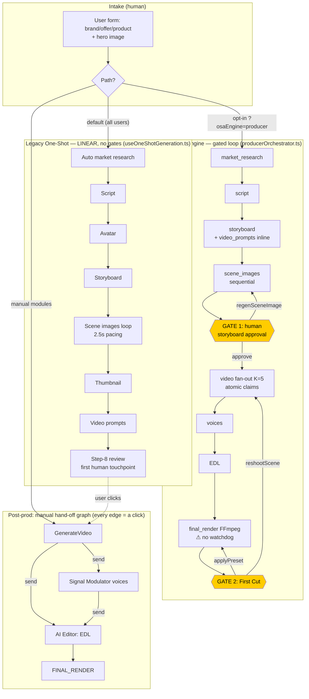
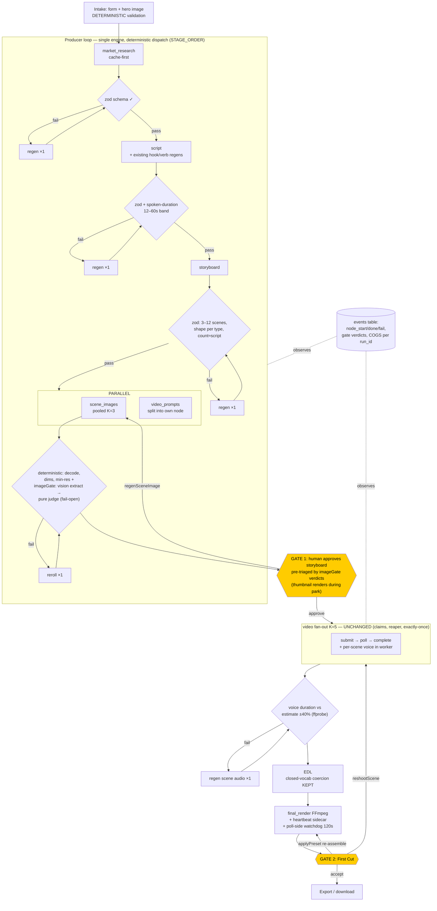

# GRIFON Architecture Review — Loop Engineering vs Graph Engineering

**Date:** 2026-07-23 · **Scope:** audit + target-architecture proposal only. No files modified. Implementation waits for approval.

---

## Context

Neil asked for a review of GRIFON's ad-creation pipeline through the loop-engineering / graph-engineering lens (per Anthropic's building-effective-agents doctrine): classify the current shape, find missing controls, and propose a target architecture on the **existing stack** — no LangGraph/frameworks, no rebuild, deterministic code owns business rules, AI-says-so is not verification.

Three parallel codebase explorations (frontend pipeline, api/ backend, services layer) ground every claim below in real files.

---

## Part 1 — Current Architecture Findings

### 1.1 Verdict: HYBRID — and the shape depends on which path a user takes

There is no single GRIFON pipeline. There are **three generation engines plus a manually-navigated module graph**:

| Path | Shape | Evidence |
|---|---|---|
| **Legacy One-Shot** (DEFAULT for paying users) | Pure **linear**, zero human gates | `hooks/useOneShotGeneration.ts:101` — fixed 6-stage sequence (script → avatar → storyboard → scene images → thumbnail → video prompts) straight to Step-8 review |
| **Producer engine** (opt-in via `?osaEngine=producer`) | **Gated linear loop** with 2 human approval parks + retry loops + bounded fan-out | `services/producerOrchestrator.ts:465` `runProduction()` walking `STAGE_ORDER` (line 298); gates at `:310, 484-490, 510-515` |
| **Manual 8-step wizard** (dev-only, `grifon_dev_unlock`) | Linear + per-step completeness gates + per-stage regenerate loops | `App.tsx:1601-1766`, `guardedNext` pattern in every `components/Step*.tsx` |
| **Post-production modules** | **Branching graph of manual hand-offs** (every edge = a user click) | GenerateVideo → {AI Editor \| Signal Modulator → AI Editor} → FINAL_RENDER via `App.tsx:1473-1531` setters; Research/Offer → Director prefill via localStorage intents (`App.tsx:598-703`) |

**The Producer engine is already the right shape** — a deterministic loop (`for (const {id} of STAGE_ORDER)`) with human parks, `withRetry` (MAX_STAGE_ATTEMPTS=2, `:422`), a bounded-concurrency video fan-out (`pooled(K=5)`, `:1096`) with **atomic per-scene claims** (Postgres RPC `producer_claim_scene`, revision-guarded checkpoints in `api/producer/run.ts`/`advance.ts`, 10-min stale-claim reaper) and cross-device resume. It is the best-engineered node in the codebase and the natural spine.

### 1.2 Per-stage audit (the 8-attribute table)

Legend: **V**=verifier, **R**=retry, **S**=stop condition, **F**=on-failure.

| Stage | Input → Output | Kind | State | V / R / S / F |
|---|---|---|---|---|
| **User intake** | brand/offer/product/audience + hero image | Human + form | App.tsx useState; `wizardSessionStore` (IndexedDB) | V: `guardedNext` field checks · R: n/a · S: fields complete · F: inline error |
| **Market research** (MarketMind) | businessInfo → report | AI (flow:marketmind, `api/gemini/text.ts`) | `researchCacheStore` (localStorage, cache-first) | V: **JSON.parse only, no schema** · R: client `retryWithBackoff` (5×429/503, 2×timeout) · S: parse succeeds · F: 502 to UI banner |
| **Offer/angle gen** (OfferOptimizer) | report → offers/angles | AI (flow:offer-optimizer) | localStorage → Director prefill intent | V: parse-only · R: same · S: parse · F: banner |
| **Script** | businessInfo+angle → Script (hooks, body) | AI (flow:adscript) | App state / run artifacts | V: server `parseAdScriptResponse` + **hook-starvation regen-once + verb-check regen-once** (`api/gemini/text.ts:231,250`) — the only server-side content retries in the codebase · R: 2 stage attempts (producer) · S: hooks non-empty · F: run → error |
| **Storyboard** | script+avatar → Scene[] | AI (flow:storyboard) | run artifacts | V: parse + `Array.isArray` coercion only · R: 2 · S: scenes array exists · F: run → error |
| **Scene images** | storyboard → stills | AI image (`generateSceneImage`) | run artifacts / per-scene | V: "candidate exists" only — **identity/label locks are prompt-instructed, never machine-verified** · R: 2 + user regen · S: image bytes · F: `flagScene`, surfaces at Gate 1 |
| **GATE 1: storyboard approval** (producer only) | images → approval | **Human** | `run.status='review'`, server-checkpointed | V: human eyes · R: `regenSceneImage` loop · S: `approveStoryboard()` · F: parked, resumable |
| **Video render** | prompts+frames → clips | AI providers (Veo/Kling), deterministic dispatch (`routeModel`) | provider handle + `producer_scenes` claims; manual lane: client-held handles in `activeJobStore` (IndexedDB, 6h TTL) | V: provider poll returns URL (external evidence) · R: claim-based exactly-once, expired-handle requeue, Kling one-shot 401 refresh · S: all scenes done/flagged · F: per-scene flag; proceeds if ≥1 rendered |
| **Voices** (Signal Modulator / consolidate) | scenes+script → VO audio | AI (ElevenLabs via `api/voice/consolidate.ts`) | run artifacts | V: none on duration/content · R: 2 batch; sequential per scene so one failure ≠ sunk batch · S: audio per talking scene · F: scene ships silent |
| **EDL** (editing-style selection) | scenes+audio → EditDecisionList | AI (`generateEditDecisionList`) | client | V: **strongest client check** — `EDL_MALFORMED` throw + closed-vocab coercion (SFX_BANK_IDS, formula set, 120-char clamps) mirroring the render zod contract · R: 2 · S: coerced EDL · F: render with defaults |
| **Final assembly** | EDL+clips+VO+music → MP4 | **Deterministic** FFmpeg (`api/_lib/renderFfmpeg.ts`) — silencedetect trims, seeded presets, byte-reproducible, no AI step | 202+jobId, **status sidecar JSON in media bucket** (no DB) | V: zod on request (richest schema, `api/render/final.ts`); sidecar `done` · R: 2 via orchestrator · S: signed URL · F: `failed` sidecar — **but a died job stays `processing` forever (no watchdog)** |
| **GATE 2: First Cut** (producer only) | MP4 → accept/preset/reshoot | **Human** | run artifacts (`presetId`, `takesUsed`) | V: human · R: `applyPreset` (re-assemble only), `reshootScene` (full re-run, allowance-bounded) · S: user accepts · F: parked |
| **Export/publish** | AllData → zip bundle / download | Deterministic code | — | V: none · R: n/a · S: download · F: console-only on export fail |
| **Brand consistency** | — | Prompt-instructed only (IDENTITY_LOCK, APPEARANCE_LOCK in tuned prompts) | — | **No machine check anywhere in the main chain** |
| **Quality scoring** | — | `strategicAudit` = in-band self-critique (same generation grades itself — flagged for replacement in services/CLAUDE.md); **Omni believability gate** (`api/_lib/omniGate.ts`) is the ONE real AI-verifies pattern: Gemini vision extracts facts → deterministic `judgeGate()` decides → fails open. Exists only on the Omni edit branch | — | — |
| **Cost/usage tracking** | — | Deterministic: layered rate limits + monthly/daily meters (`api/_lib/quota.ts`), 402 quota wall, COGS console-JSON (`modelCosts.ts` tag:'cogs') | Supabase `rate_limits` RPC | Fail directions deliberate: RL fail-open w/ in-memory backstop; credits fail-closed; plan defaults to free |

### 1.3 What's already GOOD (preserve, don't touch)

- **Deterministic final render** — FFmpeg with ground-truth silencedetect trims, seeded byte-reproducible presets. No AI in assembly. Exactly right.
- **Producer scene queue** — atomic claims, revision guards, stale reaper = no-double-spend on the most expensive stage.
- **Deliberate fail-direction doctrine** — credits fail-closed, rate-limit fail-open-with-backstop, plan-defaults-free.
- **omniGate pattern** — AI as *perception*, pure function as *judge*, fail-open on paid artifacts. This is the template to clone, not replace.
- **Gate 1 before video spend** — the single highest-ROI control in the system.
- **EDL closed-vocabulary coercion** — deterministic repair instead of re-prompting.

---

## Part 2 — Problems and Missing Controls

1. **AI output enters the pipeline unverified.** Zero `responseSchema`/zod on any Gemini JSON output, client or server. All parsers (`api/_lib/prompts.ts`: `parseAdScriptResponse`, `parseStoryboardResponse`, etc.) do `cleanJson()` + bare `JSON.parse` + `Array.isArray` coercion. Malformed output → 502, no repair loop.
2. **The default engine has no gates.** Legacy One-Shot runs research→prompts with zero human or machine checkpoints; users pay for video before anyone verifies the storyboard. The gated engine exists but is opt-in.
3. **Scene-image identity is never machine-checked.** IDENTITY_LOCK / APPEARANCE_LOCK live in prompts only. A drifted avatar or garbled product label flows into a $0.50–1.00 video render undetected.
4. **Render jobs can die silently.** `api/render/final.ts` runs via `waitUntil`; if it exceeds 300s or crashes, the sidecar stays `processing` forever — client polls until the 48h cron reaps it. No heartbeat, no watchdog.
5. **No server-side retry/backoff on transients.** Only Kling 401-refresh (once) and the two adscript in-flow regens. Everything else defers to the client; `withRetry` in the orchestrator hot-loops with no backoff.
6. **Three engines, three state stores.** producer_runs (server), wizardSessionStore + activeJobStore (IndexedDB), oneShotDraft (localStorage). The manual video lane holds provider handles client-side only — close the tab on a non-producer run and job state is device-locked.
7. **Observability is `console.*` only.** No request-id propagation, no per-run cost roll-up, no node-level fail-rate data, no error reporter. The COGS logs can't be joined to a run.
8. **In-band self-critique masquerades as QA.** `strategicAudit` — the model grading its own output inside the same response — is the exact anti-pattern the brief warns about (already flagged in services/CLAUDE.md).
9. Minor: `api/gemini/image.ts` lacks the model allowlist `text.ts` has; SSRF guard is hostname-literal (DNS-rebind gap, self-documented); stale docs (`verifySupabaseToken`, `flow.ts` don't exist).

---

## Part 3 — Recommended Target Architecture

### Design thesis

**Do not build a graph runtime.** The Producer loop (`STAGE_ORDER` + `runStage` switch + `pooled()`) IS the runtime; a new node = one array entry + one case. The work is to (a) make it the only engine, (b) put a deterministic verifier at every AI→code boundary with ONE bounded repair loop each, (c) add the missing watchdog, (d) make state and cost observable. AI keeps exactly two jobs: **generation** and **perception for gates** (omniGate pattern). AI never decides routing, retries, or spend.

### 3.1 Mermaid — CURRENT (default path = legacy One-Shot)



**No machine verification exists on any AI edge above** — every arrow out of an AI node is `JSON.parse` or "bytes exist."

### 3.2 Mermaid — TARGET (Producer loop as the single engine)



### 3.3 Node inventory (responsibility · verifier · retry · stop · failure)

| Node | Who | Verifier (external evidence) | Retry | On final failure |
|---|---|---|---|---|
| market_research | AI | NEW zod `MarketResearchReportSchema` (fields downstream actually reads) | 2 attempts + 1 schema-regen | fail-closed → run error |
| script | AI | NEW zod in `parseAdScriptResponse` + deterministic spoken-duration band (`utils/spokenDuration.ts`) | 2 + existing regens, ≤4 model calls total | fail-closed |
| storyboard | AI | NEW zod in `parseStoryboardResponse`: 3–12 scenes, per-type shape, scene-count ≈ script lines ±1 | 2 + 1 regen | fail-closed |
| video_prompts (NEW node, split from storyboard) | AI | zod: type enum, one prompt/scene | 2 | **degrade** to `scene.imagePrompt` fallback (existing logic) — never kills run |
| scene_images | AI image, `pooled(K=3)` | Deterministic: decode + dims ±2% + min-res 704px. NEW `imageGate` (omniGate clone): vision extracts `{personPresent, matchesReference, labelLegible}` → pure judge → **fail-open**, flag only | 2 + 1 check-driven reroll (≤3/scene) | flag → Gate 1 triage |
| GATE 1 | Human | Human, pre-triaged by gate verdicts | user-driven regen | parked, resumable |
| thumbnail (NEW producer node) | AI | decode + dims | 2 | best-effort absent |
| video | Providers | Provider poll URL; claims unchanged | claim machinery unchanged | per-scene flag; proceed if ≥1 |
| voices | AI (ElevenLabs) | NEW ffprobe duration vs estimate ±40% in `api/voice/consolidate.ts` | 2 batch + 1/scene | ship silent (fail-open) |
| edl | AI | KEEP closed-vocab coercion; ADD keepSegments ⊆ clip bounds (clamp, never regen) | 2 | render with defaults |
| final_render | **Deterministic** | sidecar done + NEW heartbeat/watchdog | 2 | fail-closed with jobId |
| GATE 2 | Human | Human | preset/reshoot loops (allowance-bounded) | parked |

### 3.4 Routing & branching rules

- **Deterministic (code owns — all already exist, keep):** `routeModel()` scene→provider dispatch, `pickSceneDuration()`, `GATE_BEFORE` constant, seeded `resolvePreset()`, `isUgcPro` style overrides, hook-morph reference-image plumbing.
- **AI judgment (bounded):** content of research/script/storyboard/prompts/EDL-within-vocab; one-word classifiers with deterministic fallback parses; gate *perception* only.
- **New rule:** on zod failure → deterministic coercion first (clamp/drop/default); regen only if artifact is unusable; regen is **verbatim re-prompt** (tuned prompts untouched — a repair-suffix needs Neil's sign-off, Q2).
- **AI never decides:** which stage next, whether to retry, whether to spend.

### 3.5 Parallelism (dependency-checked)

DO: scene_images fan-out K=3 · video_prompts ∥ scene_images (both depend only on storyboard) · thumbnail during Gate-1 park · per-scene voice inside video worker (pending Q6) · end-frame ∥ start-frame per scene.
DON'T: edl ∥ voices (EDL consumes audioOverlays) · research ∥ script (hard dependency).

### 3.6 Revision loops — where, and where NOT

**Belongs:** text zod-fail regen (~$0.002–0.02) · image check reroll (~$0.04 — **highest-leverage loop in the system**: catches a bad image before the ~$0.50–1.00 video it would poison) · voice duration regen (cents).
**Never build:** auto-reroll of paid video on AI quality opinion (Gate 2 human `reshootScene` is that loop) · multi-round critique-and-improve on prose (the strategicAudit lesson) · any loop without a deterministic pass/fail predicate.
**Global budget rule:** no node exceeds 2× its base model-call count via loops.

### 3.7 Shared state

`producer_runs`/`producer_scenes` becomes the single run spine. Legacy One-Shot is **retired, not retrofitted** (Phase 5). Manual wizard stays on wizardSessionStore (dev-only). Schema additions (idempotent):

```sql
alter table producer_runs  add column if not exists engine text default 'producer';
alter table producer_runs  add column if not exists cost_usd numeric not null default 0;
alter table producer_runs  add column if not exists heartbeat_at timestamptz;
alter table producer_scenes add column if not exists gate_verdict jsonb;
alter table public.events  add column if not exists run_id text;
create index if not exists events_run_id_idx on public.events(run_id);
```

### 3.8 Deterministic vs AI-judgment — fail directions

- Request validation / auth / credits: **fail-closed** (existing doctrine, keep).
- Quality gates on paid artifacts: **fail-open with flag** (omniGate doctrine, extend).
- New AI gates: **only** scene-image identity/label gate (imageGate — clearly worth ~$0.002/image vs the video spend it protects). Explicitly rejected: script/storyboard LLM judge, final-render vision QA (FFmpeg is deterministic; ffprobe suffices). Optional Phase 6, data-gated: talking-scene believability flag at First Cut.
- Gate verdicts logged to `gate_verdict` so precision is *measured offline* before any gate is ever allowed to trigger auto-rerolls.

### 3.9 Human approval points

Keep exactly the two producer gates. **No script gate** (breaks one-click; script defects are cheap regens) — instead show the hook line read-only on the Gate-1 screen. Optional tier feature later: auto-approve Gate 1 = `storyboardApproved: true` at run creation, zero new machinery (Q5).

### 3.10 Retries, timeouts, watchdog — concrete numbers

- `withRetry`: add jittered backoff 2s + rand(0–2s) (today it hot-loops).
- Text: 2 attempts + 1 schema-regen. Images: 2 + 1 reroll, K=3, 55s client abort (existing). Video: claim machinery unchanged, 10-min reaper stays. Voices: 2 batch + 1/scene. Render: 2 attempts, 300s ceiling.
- **Render watchdog:** (1) `runRender` heartbeats the sidecar (`updatedAt`) between pipeline steps via an `onStep` callback into `renderFinalVideo`, max ~20s cadence; (2) `render/final/poll.ts` — `processing` + `updatedAt` > **120s** stale → overwrite sidecar `failed:watchdog_stalled`; absolute backstop at job age > **330s**. Poll-driven = no new cron, no new function. (3) Orchestrator's existing `withRetry` re-fires once. Worst case: 2 renders ≈ 9 min instead of stuck-forever.
- Terminal states stay `done | error | review(parked)`; every failure path lands in one within bounded attempts — no unbounded loop anywhere.

### 3.11 Observability (current stack only)

1. `api/_lib/runEvents.ts` (new): service-role inserts into existing `public.events` — `node_start/node_done/node_fail/check_fail/gate_park/gate_approve/watchdog_kill` + `run_id`.
2. Request-id: `api/_lib/requestId.ts`; `x-request-id` echoed in responses and every log line; client `proxyCall` sends `x-request-id` + `x-run-id` during producer runs.
3. Cost roll-up: `logModelUsage` gains optional `runId` → COGS event rows → SQL view `sum(estUsd) group by run_id` → denormalized into `producer_runs.cost_usd` on completion.
4. Day-one SQL dashboard: fail rate per node, watchdog kills, gate precision, cost per finished ad. Alerting deferred.

### 3.12 Estimated effects

- **Speed:** pre-Gate-1 wall time −40–50% (image fan-out + prompt parallelism); end-to-end **−20–30%** (provider render dominates, already parallel).
- **Cost:** +2–5% text spend (regens + gates, ~$0.01–0.05/run) — noise vs $1–4 video COGS; offset by pre-video image catches, watchdog killing duplicate renders, fewer whole-run abandons. Net **−5–10% per finished ad**.
- **Quality/reliability:** malformed-JSON 502s → auto-repaired or structured 422; identity failures pre-triaged before the human gate; zero permanently stuck renders; per-node fail-rate data for the first time.

### 3.13 Risks of over-complication — what NOT to build

- No DAG runtime, no LangGraph/ADK/Agents-SDK, no queue service, no state-machine library. `STAGE_ORDER` + switch + `pooled()` is the whole runtime.
- No server-side orchestrator migration (client-driven + server claims dodges Vercel ceilings; cross-device resume already mitigates the open-tab trade-off).
- No AI routing/planning, ever. No generic verifier framework — one zod schema per parser, inline next to the prompt it checks. No new API endpoints where avoidable (32 functions deployed; watchdog rides poll.ts, gates ride _lib).
- Biggest real risk: **gate false-positives eroding trust in flags** → mitigated by fail-open + `gate_verdict` logging to measure precision before gates gain any authority.

---

## Part 4 — Phased Migration (each phase shippable; legacy engine preserved until Phase 5)

| Phase | Content | Files |
|---|---|---|
| **P1 — Truth at the boundaries + watchdog** (no success-path behavior change) | zod on 4 flow parsers + marketmind; coerce→regen-once ladder; `withRetry` backoff; render heartbeat + poll watchdog; requestId | `api/_lib/prompts.ts` (parser bodies only — prompt text untouched), `api/gemini/text.ts`, `api/render/final.ts`, `api/render/final/poll.ts`, `api/_lib/renderFfmpeg.ts`, `api/_lib/renderJob.ts`, `api/_lib/requestId.ts`†, `services/producerOrchestrator.ts` |
| **P2 — Observability spine** | runEvents; events.run_id; COGS+runId; x-run-id propagation; cost view + `producer_runs.cost_usd` | `api/_lib/runEvents.ts`†, `api/_lib/modelCosts.ts`, `services/geminiService.ts` (transport only — fair game per CLAUDE.md), `supabase/events.sql`, `supabase/producer_runs.sql` |
| **P3 — Parallelism** | video_prompts node split; scene_images pooled(3); thumbnail node during Gate-1 park; per-scene voices (after Q6) | `services/producerOrchestrator.ts`, `services/producerDeps.ts`, `components/OneShotAd/*`, tests |
| **P4 — Image gate + bounded rerolls** | `imageGate.ts` (omniGate clone for stills); `imageChecks.ts`; wire into scene_images/regen/reshoot; `gate_verdict`; Gate-1 UI shows verdicts | `api/_lib/imageGate.ts`†, `utils/imageChecks.ts`†, `api/gemini/image.ts`, `services/producerOrchestrator.ts`, `supabase/producer_runs.sql` |
| **P5 — Engine consolidation** | close parity gaps (avatar auto-cast per Q1, thumbnail done in P3); flip default to producer; legacy behind flag 2–4 weeks of telemetry; then delete `useOneShotGeneration.ts` | `components/OneShotAd/index.tsx`, `hooks/useOneShotGeneration.ts` (retire), `App.tsx` |
| **P6 — optional, data-gated** | talking-scene believability flag at First Cut; server-held job state for manual GenerateVideo lane | build only if P4/P5 telemetry justifies |

Note: P1/P2 touch `api/` + `services/` → build-gate + `verify-changes` apply; parser changes sit next to TUNED content → `surgical-edit` discipline; each phase = its own branch/PR (defreezer rule: commit early, push often).

---

## Part 5 — Questions for Neil (materially change the design)

1. **Engine endgame:** Is Producer confirmed as the single engine? Which legacy parity gaps are must-haves — specifically avatar **auto-cast** (producer locks avatar at intake; legacy can generate it mid-run)?
2. **TUNED-prompt boundary:** On schema failure, regen is verbatim today. May a regen append a short structured repair suffix (touches tuned prompt surface), or verbatim-only?
3. **Fail direction after retries** on script/storyboard: hard error (current) or degrade to a manual-review handoff?
4. **Gate spend + ranking:** ~$0.01–0.05/run for the image gate OK? Which field failure hurts most — identity drift, garbled product label, or composition — to rank judge rules?
5. **Auto-approve Gate 1** as a future fully-auto tier feature, or is the storyboard gate sacred for everyone?
6. **Voice consolidation:** any cross-scene coupling (shared seed/stitching) that forbids per-scene pipelining inside the video worker?
7. **Vercel headroom:** confirm plan tier / function-count constraint (text.ts's 12-function Hobby comment vs 32 deployed), and any observed `waitUntil` job drops (bears on watchdog aggressiveness).
8. **Events volume:** +50–100 telemetry rows per run acceptable, or gate to producer-engine runs only at first?

---

## Part 6 — Verification plan (when implementation is approved)

- Per phase: `npm run build` (build-gate Stop hook) + `npm run test` (vitest) green.
- P1: unit tests for each zod schema (valid/invalid/coerced fixtures); simulate stalled render sidecar → poll returns `watchdog_stalled`; regression test (`RUN_REGRESSION=1`) still passes hook-starvation path.
- P2: fire a producer run in dev → verify events rows carry run_id and COGS sums match console logs.
- P3: producer run wall-clock before/after; scene image ordering/aspect unchanged (drawPlan snapshots green).
- P4: `judgeGate`-style unit tests on imageGate verdicts; gate verdicts visible on Gate-1 screen; measure precision from `gate_verdict` before any auto-reroll authority.
- P5: 2–4 weeks A/B telemetry (fail rate, cost/run, completion rate) legacy vs producer before deletion.
- Smoke tests via `smoke-tester` subagent per `verify-changes`.
