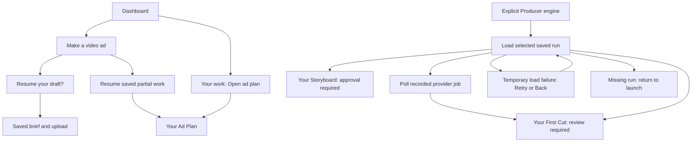

# One-Shot recovery: feature map and verification

Use this map when a customer reports lost work, the wrong screen after return,
unexpected generation, or a missing Retry action. It covers recovery on return;
it does not describe an always-running production service.

## Start here

From the repository root, with installed dependencies and Playwright Chromium:

```powershell
npm.cmd run verify:recovery -- --list
npm.cmd run verify:recovery -- --flow saved-run-error
npm.cmd run verify:recovery
```

The first command lists the supported flows. A selected flow runs at **375px and
1280px**; the full command runs all nine scenarios, eighteen browser cases.
Use the evidence directory printed by the command, not a previous run's report.
The runner writes a readable summary, machine-readable results, and browser
evidence. Unselected flows are **NOT RUN**, never implied passes.

These commands exercise the real App, One-Shot components, service adapters and
browser persistence with local media and simulated network responses. The auth
fixture substitutes the account boundary; it is not a real sign-in test. The
dedicated server uses dummy configuration, does not load local environment files,
and does not expose the live API handlers. Port 5173 must be free; the runner
refuses to reuse another server. Do not stop an unrelated process to make it pass.

## Customer paths



The default engine is selected with `/app?osaEngine=steps`. Producer is opt-in
with `/app?osaEngine=producer`; the choice persists in localStorage. These URLs
select an engine, not a saved run. Production use still requires the customer's
own account and saved work. Fixtures supply those prerequisites during tests.
Do not enter the developer Director wizard to reproduce a consumer recovery bug.

## Choose the failing flow

| Flow ID | Customer entry and expected destination | Test setup and observed boundary |
| --- | --- | --- |
| `draft` | Dashboard → Make a video ad → Resume your draft? → Resume. Same brief, price, offer and product upload. | Types a brief and uploads a local image, waits for IndexedDB, closes the page, opens another page in the same browser context. Only the mocked upload-description call is expected. |
| `partial-plan` | Reopen One-Shot → RESUME → Your Ad Plan. Saved script remains; unavailable scenes are explicit. | Runs the actual default-engine chain through script persistence, holds the next image response, closes the page. Returning must not restart generation. |
| `saved-plan` | Dashboard → Your work → Open ad plan → Your Ad Plan. Saved script, scenes, presenter and thumbnail remain. | Seeds a completed Testimonial session, then clicks the real dashboard action. Does not prove the entire generation pipeline. |
| `storyboard` | Reopen Producer → Your Storyboard. Customer approval is still required. | Seeds a storyboard checkpoint; reloads and checks the gate, image, script and zero generation submissions. |
| `first-cut` | Reopen Producer → Your First Cut. Customer review is still required. | Seeds a completed checkpoint with local video; reloads, verifies playable media and zero new submissions. |
| `recorded-job` | Reopen Producer during video work → resume polling → Your First Cut. | Seeds earlier stages, then exercises actual submit → record handle → reload → poll → final-render adapters against the stateful fixture. The same scene handle is polled; scene submission count stays one. |
| `saved-run-error` | Reopen Producer with a temporary saved-run failure → visible error with Retry and Back. Retry loads the same run. | Injects HTTP 503, checks that the active run reference survives Back and return, clears the failure, retries into Your Storyboard with no new production. |
| `polling-error` | Producer final-render polling fails → visible Retry → Your First Cut after recovery. | Seeds completed scene videos and injects polling failure. Existing bounded final-render retries can submit a new final render; this is **not** a no-resubmission guarantee for final rendering. Scene videos and run identity remain. |
| `missing-run` | Producer's saved run no longer exists → launch screen. | Returns 404 for the saved run; clears the stale reference without generation or permanent loading. |

The executable selection source is [recovery-flows.json](../tools/recovery-flows.json).
The test implementations are
[default-engine recovery](../tests/e2e/oneshot-legacy-recovery.spec.ts) and
[Producer recovery](../tests/e2e/oneshot-recovery.spec.ts). The runner checks the
expected test identities and viewports; missing or skipped coverage cannot pass.

## Follow the code

| Responsibility | Files and useful symbols |
| --- | --- |
| Consumer routing and restoring saved fields | [App.tsx](../App.tsx): `resumeSession`, `restoreFinishedAd`, `directorMode`; [Dashboard.tsx](../components/Dashboard.tsx): `onResumeFinishedAd`. A normal customer restores into consumer review. |
| Engine selection, cold-draft prompt and brief editing | [OneShotAd/index.tsx](../components/OneShotAd/index.tsx): `useProducerEngine`, `resume`; [LaunchScreen.tsx](../components/OneShotAd/LaunchScreen.tsx); [oneShotDraft.ts](../utils/oneShotDraft.ts): `hydrateOneShotDraft`, `saveOneShotDraft`. |
| Default-engine stage execution and persisted work | [useOneShotGeneration.ts](../hooks/useOneShotGeneration.ts); [wizardSessionStore.ts](../services/wizardSessionStore.ts): `getSession`, `setSession`; App state sinks. |
| Consumer saved-plan view | [ReviewScreen.tsx](../components/OneShotAd/ReviewScreen.tsx). Restoring a plan is distinct from requesting video generation. |
| Producer rehydration, Retry and customer gates | [ProducerFlow.tsx](../components/OneShotAd/ProducerFlow.tsx): `ACTIVE_RUN_KEY`, saved-run effect, `resume-error`, `handleRetry`; [StoryboardGateScreen.tsx](../components/OneShotAd/StoryboardGateScreen.tsx); [FirstCutScreen.tsx](../components/OneShotAd/FirstCutScreen.tsx). |
| Producer state transitions and adapter boundary | [producerOrchestrator.ts](../services/producerOrchestrator.ts): `runProduction`; [producerDeps.ts](../services/producerDeps.ts): `realProducerDeps`; [producerRunService.ts](../services/producerRunService.ts): `loadRun`, scene claim/record operations. |
| Server persistence and job ownership | [api/producer/run.ts](../api/producer/run.ts), [api/producer/advance.ts](../api/producer/advance.ts). Browser tests simulate these responses; they do not execute the database implementation. |
| Test backend and local media | [legacyRecovery.ts](../tests/e2e/legacyRecovery.ts), [oneshotRecovery.ts](../tests/e2e/fixtures/oneshotRecovery.ts), [recovery.webm](../tests/e2e/fixtures/recovery.webm). Stateful request records survive page reloads within each test. |

## Read a result honestly

- **PASS** overall: every expected selected case passed at both viewports and the
  browser runner exited successfully. An individual flow can pass while another
  flow's assertion fails; the overall result still fails. This is evidence for
  the fixture conditions only.
- **FAIL**: read the reason and browser evidence. A failed assertion is an
  observed mismatch, not automatically a diagnosed product defect. A busy port,
  missing browser, malformed report or missing test is a verification/setup
  failure. Diagnose before changing product code.
- **NOT RUN**: that flow was not selected. Missing proof for a selected flow is
  a failure. A green selected flow does not certify the rest of One-Shot.

Inspect the actual child exit code, test identity and current run's evidence.
Do not infer success from a reassuring log line. Reproduce a suspected defect
before fixing it, then demonstrate the relevant check fails the broken behavior
and passes the fix. Keep independent review for changes requiring judgment.

## Boundaries that remain

Closing a page in the same browser context exercises preserved browser storage;
this is not a device migration, browser crash or cleared-storage recovery test.
Submitted provider jobs may continue after the browser closes. Producer needs
the browser to reopen to poll recorded handles and advance subsequent stages.
The default engine preserves partial work without automatic continuation.
Storyboard approval and First Cut remain customer gates.

The suite does not certify live provider billing, database concurrency, real
auth, creative quality, successful production deployment, or an entire pipeline
finishing while the browser is closed. Request counts describe the test backend.
Do not enable paid/live switches to resolve a failure in this fixture suite.

When a route or test changes, update the corresponding map row and executable
selection together. This is a feature reference, not a second resume document;
current delivery results and remaining work belong in [NOW.md](../NOW.md).
