# Static Ad Swipe File

The compounding database of **static image ad** patterns worth stealing —
the still-image counterpart to `workflows/viral_swipe_file.md` (which is
*video*-only). Every reference ad gets a decoded entry (layout + the
persuasion lever it runs on + what Grifon can lift), patterns accumulate in the
index, and template proposals for **Image Ads Gen** (`generateAdCreatives` in
`services/geminiService.ts`) live as **Gated Proposals** until Neil approves.
Maintained by `grifon-creative-director` (visual DNA) + `grifon-cmo` (offer/lever
logic) when Neil drops a static ad to learn from. Feeds the
`grifon-ad-strategist` playbook (warm-retarget upsell angle).

**Ingest loop:** the **`static-autopsy`** skill drives it —
`tools/analyze_ad_image.mjs` has Gemini vision decode the ad and commits a
compressed copy of the source to `assets/ad-swipe/E<NN>-<brand-slug>.jpg`
(≤1080px / ~≤300KB JPEG), so the reference survives the cafe-PC defreezer. Each
entry links its image on the line under the heading (``, relative from `workflows/`).
**Backfill rule (E1–E17):** a re-encountered ad that already has an entry does NOT
get a duplicate — attach its image to the existing entry via
`--ingest-only --entry E<n>` (no new entry, no Pattern bump).

**RESUME (next session, Opus 4.8 per Neil 2026-07-12):** batch **E51–E81 DONE** —
breadth-first ingest of 8 high-relevance SaaS / AI / fintech / marketing brands
(OpenAI, Meta for Business, Google Gemini, Alex Hormozi, Sabri Suby, Stripe, Wise,
Meta), 3–4 distinct concepts each, via 8 parallel `/static-autopsy` subagents.
**Headline outcome: S20 Product-UI-as-hero crossed the independent-brand bar (20 across
7 brands) → drafted GP-5** (Product-UI-as-Hero / Prompt-to-Outcome family, + new S32
prompt-to-outcome tableau, S33 gamified card). Also newly cross-brand: **S30
geo-localized (6 brands — strongest Grifon port: EN/Taglish/Bisaya)**, S15 stat-stack (7),
S16 borrowed authority (6), S8 audience callout (7). Next E-number = **E82**.
Remaining in `Downloads\AD FILES` (⚠ dies on reboot — re-download from Meta Ad Library
if wiped), all **lower Grifon relevance / off-niche** — ingest only if more breadth is
wanted: Julie Balsamo nutrition (15), The Dodo (7), Rich Casual Creative (5),
olliebearman (3), Sorav Jain (2), Aarohi (2) + singles (Fenty, hiessence, NEW MOON,
Ovie, GEL BALL, rheagoenka). Deeper tails of the already-ingested brands exist too but
are single-brand depth (low marginal value). **Next action is Neil's:** review GP-5
(and the thickened GP-1/GP-2) for approval — no tuned-prompt edits without his sign-off.
**Tool note:** the specificity gate mislabelled 3 honest native-surface product mockups
as S7 (E60, E72, +1) — consider relaxing the gate's S7/why_it_works heuristic.

**Cafe-PC rule:** commit every update immediately
(`swipe(static): add <slug>`). Uncommitted work dies with the reboot.

**The trust line (non-negotiable, both skills' hard constraint):** we steal
*structure and lever*, never the lie. No fake DMs, no fake countdowns, no
invented stats, no manufactured scarcity. Bryan's #1 objection is "just another
AI tool that lies" — trust is the brand asset. Real guarantee, real cohort cap,
real proof, or it doesn't ship.

## Pattern Index

Status: `observed` (counting) → `proposed` (≥3 corroborations / in a Gated
Proposal) → `applied` (shipped as an Image Ads Gen template or CMO playbook).

| ID | Pattern | Corroborations | Status |
| --- | --- | --- | --- |
| S1 | **Risk-reversal headline / guarantee** — the promise IS the guarantee ("kick-off in 5 days OR all your money back"; "TRY RISK-FREE"; "30-day money-back"). Removes the buy-risk at the headline, not the fine print. | 9 (E1, E2, E3; E11, E26-var Grüns; E12, E17, E32, E33-var IM8) | proposed |
| S2 | **Authority portrait hero** — founder cut-out, confident pose, gold rim-light on black; the *person* is the proof when there's no physical product. | **15 across 4 brands — hardening 2026-07-12** (E1–E4 Gadzhi; E46, E47, E49, E50 Kylie; E67, E69, E70 Sabri Suby; E63–E66 Hormozi — founder-as-proof is niche-agnostic: fitness-guru, agency-founder, celebrity all work) | observed |
| S3 | **Ticket / tier comparison** — Free (dull, glass) vs paid (gold, glowing) cards side by side; anchoring makes the upgrade obvious. | 2 (E3, E2-partial) | observed |
| S4 | **Offer-stack checklist** — gold/green ✅ list of what they GET (calls, templates, bonuses) + guarantee tag. Reciprocity + commitment. | **6 across 5 brands — cross-niche 2026-07-12** (E2, E3 Gadzhi; E40 IM8; E63 Hormozi value-stack; E54 OpenAI numbered 1–8 task list; E57 Meta for Business checklist) | observed |
| S5 | **Gold-on-black SaaS palette** — `#FFCC00`-class gold + near-black, glassy cards, gold lozenge "VIP/PRO" badge, gold gradient CTA bar. (Already Grifon's palette.) | 5 across 2 brands (E1–E4 Gadzhi; E63 Hormozi gold-on-black value-stack; E65-var Hormozi gold-on-near-black) | observed |
| S6 | **CTA-bar color A/B test** — same creative shipped with gold / green / blue "Learn more" bars across the set; they're testing button color, not just creative. | 3 (E1 gold, E2 green, E4 blue) | observed |
| S7 | **Fake-DM / manufactured interaction / manufactured scarcity** — "pre-approved," blurred meeting invite, "selecting a few people," staged AMA-sticker Q&A dressed as organic. **ANTI-PATTERN for Grifon** — recorded so we copy the *layout* (cohort offer, AMA-reply format) but never the fabrication. | 3 (E4, E1-urgency; E19 Grüns fake-AMA) | observed (do-not-replicate) |
| S8 | **Hyper-specific audience callout** — name the exact buyer in the hook ("If you own a *[niche]* doing *[revenue]*"; "on GLP-1"; "Women 40+"; "Postpartum…"). Self-identification + specificity (Sabri Suby dream-buyer). ONE template → N variants off a swapped variable. | **16 across 7 brands** (E5 service; E8/E11, E19, E20, E25, E26 Grüns; E13, E37 IM8; E43 Cursor; E67 Sabri "16 hrs/day"; E65/E66 Hormozi "$1M+"/"$10M"; E76/E77 Wise "Clients overseas?") | **proposed — strongest pattern, drives GP-2** |
| S9 | **Anti-design text-only pattern interrupt** — flat solid bg, centered white sans, zero imagery/logo/CTA button; reads as a personal note, not an ad. **Contradicts S5 + Grifon's cinematic brand** — adopt the copy mechanic; test the bare visual only as a deliberate experiment. | **7 across 5 brands — crossed ≥3 2026-07-12** (E5 service; E24 Grüns; E51 OpenAI testimonial; E79–E81 Meta security PSAs; E57 Meta for Business notebook flat-lay) | observed (brand-conflict) |
| S10 | **Value-first lead magnet (TOF)** — gives a free asset ("Scaling Roadmap", "FREE Starter Kit") to a cold dream-buyer. Top-of-funnel; the opposite end from the E1–E4 bottom-funnel upsell. | **5 across 4 brands — cross-niche 2026-07-12** (E5 service; E12, E40 IM8; E73 Stripe "READ OUR GUIDE" pricing guide; E57 Meta for Business "3 hacks") | observed |
| S11 | **Trend-hijack** — ride a live cultural wave so the ad feels like the moment, not a pitch (GLP-1 / Ozempic). Grifon's wave is **"AI"**. | **15 across 6 brands — the AI category itself now in-file 2026-07-12** (E7, E8, E10, E29 Grüns; E14, E16, E37 IM8; E18, E45 Cursor; E59–E62 Google Gemini — AI product riding the live World-Cup wave; E65 Hormozi "generic AI vs your custom AI"; E57 Meta for Business "the AI behind Advantage+") | observed |
| S12 | **Pattern-interrupt hook** — curiosity/novelty/apology/gross-out that doesn't read as an ad ("We NEVER do this", "WE'RE SO SORRY", "RABBIT POOPS?", "We're back."). | **9 across 5 brands — crossed ≥3 2026-07-12** (E6, E7, E21, E24 Grüns; E65 Hormozi trading-card, E66 Hormozi broken-chain metaphor; E69 Sabri Memoji; E80 Meta color-noun; E62 Gemini banana-jacket character) | observed |
| S13 | **Mascot / recall device** — a repeated motif (gummy bear) carries instant brand ID; E23 upgrades it from motif to *actor* (mascot golfing in the buyer's world). Grifon's mark + gold light-sweep is the under-used equivalent. | 5 across 4 brands (E6–E11, E23 Grüns; E69 Sabri Memoji; E62 Gemini character; E79/E80 Meta logo-lockup recall) | observed |
| S14 | **Full-canvas color A/B** — test the *whole background* color (green/yellow/blue/beige), not just the CTA. Extends S6. | **6 across 5 brands — now cross-NICHE** (E6–E11, E21 Grüns; E31 IM8; E44 Cursor; E75/E77 Wise full-canvas forest/lime; E64 Hormozi flat purple canvas) | observed |
| S15 | **Stat-stack proof** — numerals as proof, stacked ("21 vitamins. 20 cal. 1 net carb."; "60+ ingredients"). | **16 across 7 brands — crossed the independent-brand bar 2026-07-12** (E8, E10, E23, E26 Grüns; E14, E31, E33, E34, E37, E38 IM8; E63 Hormozi non-round stack; E68 Sabri "3,227 reviews"; E71 Stripe "75%"; E77 Wise "74% instant"; E53/E54 OpenAI) | observed |
| S16 | **Borrowed authority** — social proof by association (celebrity / sports partnership: Inter Miami CF; Lisa Rinna campaign). Grifon = client logos / testimonials / "trusted by N PH businesses." | **18 across 6 brands — cross-niche confirmed 2026-07-12** (E15, E32–E36, E40 IM8; E22 Grüns; E46–E50 Kylie; E68/E70 Sabri (Google + Forbes borrowed); E71 Stripe co-brand lockup; E81 Meta govt-agency; E56 Meta for Business verified-badge; E51/E53 OpenAI named founder) | observed |
| S17 | **"Imagine…" future-pace + objection-handling** — paint the after-state, defuse the fear ("Imagine your GLP-1 journey, without the side effects"). | 1 (E16 IM8) | observed |
| S18 | **Style axis: premium-editorial vs flat-graphic** — IM8 (crimson, serif, lifestyle photography, restraint) vs Grüns (loud color-block, mascot, discount). **Grifon = the premium lane** (cinematic gold/black). | brand-level (Grüns flat; IM8 premium; Cursor + Kylie all-premium; +Stripe all-premium fluid-gradient benchmark; +OpenAI runs the axis WITHIN one campaign — E51 minimal-anti-design ↔ E53 premium-editorial, identical Sebastian Korts testimonial copy; +Wise spans both poles — E75/E77 flat-graphic ↔ E78 premium-photo) | observed |
| S19 | **Placement / multi-ratio + safe-zone** — ship one creative as 4:5 (feed) + 1:1 + 9:16 (stories/reels), keeping text in the 9:16 central ~60% safe band; more ratios = more Andromeda inventory. See the Placement strategy section. | cross-set observation (now standard across every brand; +Wise E75–E78 and +Google Gemini E59–E62 both ship 1:1 + 9:16 master pairs; +Meta E79/E81 localized 1:1 + 9:16 — multi-ratio + safe-zone is universal practice) | observed |
| S20 | **Product-UI-as-hero** — the actual product interface (a real screen/control, not a screenshot collage) is the ad's hero image; the feature demo IS the creative. Honest proof — fits the trust line. Grifon analog: One-Shot composer / wizard UI as the hero. | **20 across 7 brands — CROSSED the independent-brand bar 2026-07-12** (E18, E41–E43, E45 Cursor; E68 Sabri fake-SERP; E76–E78 Wise; E59–E62 Google Gemini; E52–E54 OpenAI; E71/E72 Stripe; E55/E58 Meta for Business — honest "show the real interface" proof, fits the trust line) | **proposed — drives GP-5** |
| S21 | **Native-format camouflage** — the ad dresses as organic platform UI (IG story AMA sticker, Close-Friends badge, caption cards, handle overlay) to bypass banner blindness. Slides into S7 the moment the interaction is faked — Grifon version uses REAL community questions only. | **11 across 5 brands — crossed the independent-brand bar 2026-07-12** (E19, E27 Grüns; E34, E35, E39 IM8; E67/E68/E70 Sabri (NEWS badge / Google SERP / Forbes card — the DECEPTIVE kind, layout-only); E52 OpenAI in-app moment; E55/E56 Meta for Business native chrome) | observed |
| S22 | **Category-king flex** — publicly acknowledge copycats/doubters to frame the brand as the original ("we see you, copycats."; "We hereby accept your apology."). Late-stage play — only works once you ARE the category leader. | 3 across 3 brands (E22 Grüns; E68 Sabri multi-retailer dominance + E70 "fastest-growing agency"; E71 Stripe category-king by association) | observed |
| S23 | **Real-scarcity nostalgia drop** — limited-edition collab with a legacy childhood brand (Grüns × Popsicle Firecracker), run as a full campaign system (flavor graphic + UGC + meme + text-only sellout apology). Scarcity is REAL (sold out, no restock) — passes the trust line. | 1 (E27 campaign, Grüns) | observed |
| S24 | **Format-enemy positioning** — villainize the incumbent *format/ritual*, not a competitor brand ("STOP CHOKING DOWN GRASS IN A GLASS. Measure. Blend. Gag. Scrub."; "STOP PUNISHING YOURSELF WITH POWDERS."). Grifon's enemy: the ₱30K agency retainer / DIY all-nighter. | **9 across 4 brands — now cross-NICHE** (E28, E29-var Grüns; E31, E34, E38, E39 IM8; E42 Cursor; E75 Wise "skip the airport queue" + E78 "STOP SPENDING LIKE A TOURIST" — enemy = the FX/exchange ritual) | observed |
| S25 | **Uncanny meme creative** — toys/dolls/hand-drawn doodles ARE the whole ad (Barbie split-meme, marker-doodle pack shot). Feed-native, cheap, honest (nobody mistakes a doll for a fake testimonial). | 3 across 2 brands (E29, E30 Grüns; E69 Sabri Memoji-as-hero) | observed |
| S26 | **Taboo/crude register** — bodily-function, profanity, and anatomical hooks matched per segment ("RABBIT POOPS?", "DON'T GHOST YOUR BALLS.", "F*CK YOU, HAIR LOSS"). Strong scroll-stop, brand-safety risk; off Grifon's premium register — the *mechanic* (name the unspoken pain bluntly) ports, the words don't. | 3 (E20, E21, E30 — one brand, below the independent-brand bar) | observed |
| S27 | **Wealth-contrast price anchor** — someone who could afford anything *chose* the cheap-per-day option ("GIANNIS COULD AFFORD ANYTHING. HE CHOSE A $2.61/DAY DRINK."). Collapses "premium = expensive" and reframes price as a daily cost. Grifon: "Agencies charge ₱30K/mo. Grifon is ₱XX/day." | 2 across 2 brands (E35 IM8 "Giannis $2.61/day"; E70 Sabri "$50 & a laptop → $74M Shark") | observed |
| S28 | **Illustrated transformation timeline** — staged before→during→after strip with NAMED stages or months (BEFORE→RITUAL→RESET; JULY→AUGUST→SEPTEMBER); process-framing beats binary before/after. ⚠️ Implied body-claims are a trust gray zone (E37 flagged implausible) — Grifon ports it with REAL artifacts only (BRIEF→GRIFON→LAUNCHED). | 2 (E31-var, E37 — one brand) | observed |
| S29 | **Founder-signature endorsement stack** — first-person quote + "xo," + handwritten signature turns the ad into a personal recommendation, not corporate copy; the sign-off substitutes for a CTA. Honest when the endorsement is real (it's her brand). Extends E24's signed-note device ("— Grüns") from announcement to product ad. Grifon analog: real client quote + signature, or "— Neil/Zam" signed notes. | 2 (E47, E48 + their FR/IT campaign beats — one brand) | observed |
| S30 | **Geo-localized master creative** — ONE master creative shipped with translated copy per market (EN/FR/IT observed), photography and layout identical; the language is the variable, not the design. The placement analog of S14's color A/B. Grifon analog: EN/Taglish/Bisaya swaps on one template — near-free variants via `captureToPng`. | **6 across 6 brands — crossed the independent-brand bar 2026-07-12** (E47/E48 Kylie; E52 OpenAI Hindi; E62 Gemini Arabic; E74 Stripe French Atlas; E77 Wise per-market proof-pill; E79/E81 Meta Hindi — language is the only variable; strongest Grifon port: EN/Taglish/Bisaya, near-free via `captureToPng`) | observed |
| S31 | **Texture-macro sensory hero** — a macro shot of the product's physical texture (the squeeze, the drip, the swatch) is the focal proof; it SHOWS the sensory promise instead of claiming it. Physical-product-native; Grifon's analog is the crisp UI-detail close-up (pairs with S20). | 2 across 2 brands (E48 Kylie squeeze; E78 Wise breakfast-table sensory flat-lay) | observed |
| S32 | **Prompt-to-outcome tableau** — the AI-native specialization of S20: show the exact INPUT prompt + its RENDERED output together as the creative (prompt pill → result card / notification / generated asset). Honest, and it teaches the user what to type. Grifon analog: One-Shot brief → the generated ad, shown side by side. | 4 across 2 brands (E59, E60, E61 Google Gemini; E52 OpenAI chat-pill) | observed |
| S33 | **Gamified character / trading card** — frame the founder / the product / a feature as a collectible RPG card (level badge, stars, stat-bars, gem). High-novelty scroll-stopper; pairs with Grifon's avatar tooling. | 1 (E65 Hormozi) | observed |

## Gated Proposals

*Image Ads Gen template changes awaiting Neil. Editing `generateAdCreatives`
touches the **TUNED** `services/geminiService.ts` (locked per `services/CLAUDE.md`)
— neither skill applies this autonomously. Approve → surgical edit + vitest +
verify.*

### GP-1 — Add a "SaaS Offer / Upsell" template family to Image Ads Gen

**Why:** Image Ads Gen ships exactly 3 templates today — `Press Clip`,
`Benefit Anatomy`, `Split-Screen` (`services/geminiService.ts:2440`) — all
**physical-product** angles (they assume a device/product on screen; "screen
must face the viewer," "labels pointing to product features"). A
**software/service** offer has nothing to photograph: the hero is the *promise,
the guarantee, and the person*. This family covers the warm-retarget **Free→Pro→
Business** upsell that has no creative template today. Decoded from E1–E4 below.

**Funnel slot:** warm retargeting (registered-but-not-upgraded), CMO Priority #2
(Free→Pro) and #1 (Business/Autopilot). Distinct from cold free-signup ads.

**Proposed templates** (each = CMO angle + CD visual recipe):

**1. `Guarantee Hero`** *(from E1)* — risk-reversal as the headline.
- **CMO angle:** headline = the outcome fused to the guarantee. Pattern:
  "*<dream outcome> in <real timeframe> — or <real reversal>*." `hookLogic` =
  Risk-reversal + Authority. Guardrail: reversal must be a real, honored policy;
  timeframe must be deliverable.
- **CD recipe:** founder/avatar cut-out centered, confident pose, **gold
  rim-light + radial spotlight on `bg-zinc-950`**; gold lozenge brand badge over
  chest line; headline in white Inter ExtraBold with the guarantee clause in
  `#FFCC00`; gold-gradient pill CTA. Portrait sourced from the wizard **Avatar**
  / uploaded founder photo (Zam/Neil for Grifon's own ads).

**2. `Ticket Compare`** *(from E3)* — anchoring via tier contrast.
- **CMO angle:** two/three cards — current tier (dull) vs target tier (gold).
  Target card lists what they GET (outcome verbs, not features) + the guarantee
  line. `hookLogic` = Anchoring + Commitment-consistency. Guardrail: every line
  must be a real tier benefit; no unlimited promises (hard constraint).
- **CD recipe:** stacked glassy ticket cards (notched edges), free card
  `bg-zinc-900/80 border-white/10` muted, paid card gold border + gold glow
  `shadow-[0_0_20px_rgba(255,204,0,0.4)]` + gold "PRO/VIP" lozenge; headline
  "CHOOSE WHAT YOU WANT"; gold CTA bar.

**3. `Offer Stack Checklist`** *(from E2)* — reciprocity + guarantee.
- **CMO angle:** headline = the guarantee ("I'll give all your money back
  if…"); ✅ list of what they GET (calls, templates, bonuses); close with the
  penny-back tag. `hookLogic` = Reciprocity + Risk-reversal. Guardrail: bonuses
  listed must actually exist.
- **CD recipe:** smaller portrait top, gold/`#FFCC00` check rows on black, each
  row white Inter; guarantee tag in a gold-glow text line; gold CTA bar. (Note
  E2 shipped a **green** CTA bar — wire CTA-bar color as a variant field, S6.)

**4. `Authority Promise`** *(replaces E4's fake-DM)* — the clean, honest version.
- **CMO angle:** one face + one outcome headline, MrBeast-clean (3–6 words). If
  scarcity is used it's a **real** cohort cap ("12 seats this cohort"), never a
  fabricated DM. `hookLogic` = Authority + (optional real) Scarcity.
- **CD recipe:** large founder portrait, arms-wide/open pose, big gold
  `AI`-lozenge-style logotype, single white+gold headline, gold CTA bar. No
  mock UI, no fake invite (that's the E4 anti-pattern, S7).

**Build scope / open decisions (for the gated task):**
- `templateType` enum gains 4 values **or** a `family: "product" | "saas-offer"`
  selector so the generator picks the right set (cleaner than 7 flat types).
- New input needs: **guarantee text**, **tier names + what-you-get per tier**,
  **authority/founder image source**. Decide: derive from existing `UplinkData`
  (`originalPrice`/`offerPrice`/`keyFeatures`) or extend `UplinkData` + the
  `AdVariant` schema in `types.ts` (schema change → vitest under `tests/unit/`).
- Keep the existing `CRITICAL VISUAL RULE` for product templates; SaaS family
  swaps it for an **APPEARANCE/PORTRAIT rule** (founder faces viewer, consistent
  identity).
- All four inherit the **trust guardrail** in the prompt so the model cannot
  emit fake DMs, fake countdowns, or invented numbers.

### GP-2 — Add a "Niche Callout" text-only template to Image Ads Gen

**Why:** E5 (Sabri Suby / King Kong) — a minimalist self-ID callout that's a
long-running winner. Cheapest creative to produce (pure typography; arguably no
image model needed) and the **highest-leverage for Grifon**: spin one template
into N PH-niche variants for Bryan's sub-segments (coffee shop, salon, e-com
seller, real-estate, resto, online coach). **Funnel slot:** cold TOF lead magnet
— CMO Priority #3 (free-signup from cold traffic).

- **CMO angle:** copy = "If you run a *[specific PH niche]* *[doing $X / real
  qualifier]*, we built *[the free asset]* for you." Fill the niche variable per
  ad set. `hookLogic` = Specificity + Self-identification + pattern-interrupt.
  This *already* matches our copy rules ("write to ONE person"; "if the hook
  fits any SaaS, rewrite"). Guardrail: the qualifier and the free asset must be
  real.
- **CD decision (flag, decide at build):** the flat-navy anti-design (S9)
  **conflicts with DESIGN.md** (cinematic gold-on-black; "if it could belong to
  any brand it's wrong"). Two ships: **(i) Grifon-cinematic** — `bg-zinc-950`,
  white Inter, the niche + qualifier in `#FFCC00`, subtle gold glow (on-brand,
  recommended default); **(ii) bare pattern-interrupt** — flat dark, no brand,
  white text only (off-brand by design, run purely as a scroll-stop A/B).
  Recommend ship (i) default + (ii) as the variant.
- **Build scope:** smallest of any template — a typography-only generator that
  can skip the image model entirely. New `callout` family (or a type in
  `saas-offer`) + `niche` / `qualifier` / `leadMagnet` inputs. Same TUNED gating
  as GP-1.

### GP-3 — "Product Graphic" family (flat-graphic, Grüns-style)

**Why:** E6–E11 (Grüns). Flat brand-color canvas + bold display hook + product
hero + mascot motif + discount roundel + ✅ benefit checklist + scarcity bar. The
*loud / value* energy. E8 maps almost exactly onto the existing **Benefit
Anatomy** template — so GP-3 partly *upgrades* what's already there.
- **CMO:** hook types = curiosity pattern-interrupt (S12), trend-hijack (S11),
  audience callout (S8), stat-stack (S15). Guardrail: stats real; no fake
  scarcity; FDA/claim-style lines only if true (Grifon: no fake proof, ever).
- **CD:** flat brand-color background (color is an A/B variable, S14), condensed
  bold type as hero, product/asset hero, **Grifon mark as recall motif** (S13),
  reusable discount-roundel + scarcity-bar components. ⚠️ This is the *loud* lane
  — off Grifon's premium brand; reserve for value/discount offers, default to
  GP-4 for brand consistency.
- **Build:** same `captureToPng` pipeline; product shot from `generateSceneImage`
  (text-free) + graphic text overlay. Family `product-graphic`.

### GP-4 — "Premium Lifestyle" family (IM8-style) — Grifon's natural lane

**Why:** E9, E12–E17 (IM8 + Grüns-premium). Premium photoreal lifestyle/product-
in-light + restrained type + benefit chips + a single gold CTA + optional
social-proof strip. This is the lane Grifon's cinematic gold/black already lives
in — highest brand fit.
- **CMO:** hooks = audience callout (S8), "Imagine…" future-pace (S17), pain-state
  (E17), trend-hijack (S11), borrowed authority (S16). Outcome-framed, never
  feature-listed.
- **CD:** `generateSceneImage` makes the premium lifestyle/product shot (text-
  free — its strength), then `captureToPng` overlays: headline with a **gold→
  transparent scrim for guaranteed contrast** (fixes IM8's readability wobble),
  benefit chips, ONE gold `#FFCC00` CTA (fixes IM8's drifting CTA colors), Grifon
  corner motif. Family `product-lifestyle`. Multi-ratio + safe-zone aware (S19).
- **Note:** GP-4 and GP-1 (SaaS upsell) share the *exact* architecture
  (text-free background + branded overlay) — build GP-1 and GP-4 reuse the same
  composite path.

### GP-5 — "Product-UI-as-Hero / Prompt-to-Outcome" family for Image Ads Gen

**Why:** **S20 crossed the independent-brand bar hard on 2026-07-12 — 20 corroborations
across 7 brands** (Cursor, Sabri Suby, Wise, Google Gemini, OpenAI, Stripe, Meta for
Business), plus the AI-native specialization **S32 prompt-to-outcome tableau** (Gemini +
OpenAI). Every current template (GP-1..GP-4) treats the hero as a *person*, a *product
shot*, or *text* — none show **the software doing the thing**. For a tool whose
deliverable IS the creative, the most-corroborated winning pattern in the file is: make
the actual interface / the prompt→output the hero. It is also the **most trust-safe**
family — it shows real proof, so it can never drift into an S7 fabrication.

**Funnel slot:** consideration → conversion (warm + mid-funnel); the "how it actually
works / here's the real output" proof creative. Pairs with GP-1's offer copy.

**Proposed templates** (each = CMO angle + CD visual recipe):

**1. `Prompt→Outcome`** *(from E59 "FOR TIMELY GOALS", E52 OpenAI chat-pill, S32)* —
- **CMO angle:** sell the concrete prompt + its result, not "AI-powered." Headline slot
  "FOR [BENEFIT] GOALS" or a first-person prompt; show the exact input a real buyer would
  type. `hookLogic` = specificity + product-demo. Guardrail: the shown output must be a
  real capability, and don't imply one-shot instant when it's multi-step (E60 caution).
- **CD recipe:** near-black canvas; a white Grifon prompt-pill (the real composer input)
  → its rendered result (a generated ad card / a notification) directly below; Grifon
  lockup at base. Localizable (S30) — the pill text is the only variable.

**2. `Feature-in-Native-Surface`** *(from E72 Stripe Payment-Link-in-chat, E55 IG feed
mockup, E58 glassmorphic lead-form)* —
- **CMO angle:** drop Grifon's own output inside the surface where it lives (a feed
  mockup, a chat, an inbox), one arrow/label to the payoff. `hookLogic` = context +
  product-UI-as-hero. Guardrail: it must be Grifon's OWN interface/output — never a faked
  third-party DM or testimonial (that is the S7 line, and S21's deceptive cousin).
- **CD recipe:** `captureToPng` composites the generated ad into a native IG/feed card
  (real like/comment chrome), or a chat bubble carrying a Grifon-made asset; hand-drawn
  arrow → the CTA; premium gold/black frame.

**3. `Glassmorphic Output Card`** *(from E53 OpenAI "Growth Roadmap" card, E58)* —
- **CMO angle:** pair a real named-customer quote (or the benefit headline) with a
  frosted UI card that SHOWS the deliverable (a roadmap, a generated storyboard, a
  numbered task list). `hookLogic` = social proof + tangible-output. Guardrail: the card
  must depict a real Grifon output; quote must be a real customer.
- **CD recipe:** premium lifestyle photo base (`generateSceneImage`) → frosted
  semi-transparent card overlay (`captureToPng`) holding a crisp Grifon UI detail; gold
  `#FFCC00` accents; Grifon corner motif. Shares GP-1/GP-4's text-free-bg + overlay path.

**Note:** GP-5 reuses the GP-1/GP-4 composite path (text-free background + branded
overlay); the new asset is a **library of real Grifon UI/output plates** to composite.
Editing `generateAdCreatives` touches the **TUNED** `services/geminiService.ts` — Neil
approves, then surgical edit + vitest + verify. **Strong sibling:** S30 geo-localized
master creative (6 brands) — every GP-5 template should ship EN/Taglish/Bisaya variants
off one master, near-free via `captureToPng` (fold into the build, not a separate GP).

## Cross-Vertical Pattern Map

These patterns are **not** about supplements or coaching — they're portable
persuasion templates. The same engine + the family selector spins variants for
any Grifon vertical. This is the reusable map (and the answer to "can we apply
this to Grifon / personal brand / SaaS / services / app / real estate").

| Pattern | Grifon translation across verticals |
| --- | --- |
| **Audience callout** (S8) | SaaS: "For PH coaches who hate posting." · Real estate: "For agents doing 2+ closings/mo." · Services: "For salons booked solid but invisible online." |
| **Trend-hijack** (S11) | Ride **"AI"**: "Your AI marketing team for the price of one boosted post." Personal brand: "I replaced my agency with AI — here's the system." |
| **"Imagine… without [pain]"** (S17) | "Imagine launching a winning ad — without the ₱30K agency or the all-nighter." (app / services / personal brand identical) |
| **Benefit anatomy / checklist** (S4, S15) | Outcome ✅ list (never feature-list): "Ad script ✓ Storyboard ✓ Voiceover ✓ Caption ✓ — one sitting." Real estate: listing-feature checklist. |
| **Borrowed authority** (S16) | Client logos, "trusted by N PH businesses," a testimonial card. Personal brand: "as seen on / N followers." |
| **Risk-reversal / free starter** (S1, S10) | Free plan, "try risk-free," 30-day guarantee (GP-1 Guarantee Hero). |
| **Pain-state hook** (E17) | Name Bryan's bleeding neck: "The end of 'I spent ₱15K on ads and got 2 sales.'" |

## Placement & Aspect-Ratio Strategy

Shipping one creative in multiple ratios is deliberate **placement optimization**,
not indecision (Neil's observation, 2026-06-20). Each placement has a native
shape; give only one ratio and the platform auto-crops the rest, chopping the
headline/CTA. Fix = supply the right ratio per placement (Meta **placement asset
customization**).

| Ratio | Placement | Why |
| --- | --- | --- |
| **4:5** (1080×1350) | Feed (default) | Tallest in-feed = most thumb-stopping real estate, often lower CPM |
| **1:1** (1080×1080) | Feed / Explore | Universal, never cropped oddly |
| **9:16** (1080×1920) | Stories / Reels / TikTok | Full-screen immersive |

**9:16 safe zone:** top ~14% (header) and bottom ~20–35% (caption + CTA + icon
rail) are covered by UI — keep all text/product in the central **~60% safe band**.

**Build implication:** because templates render via `captureToPng`, exporting all
three ratios is nearly free — re-render the same React card at each canvas size
with safe-zone padding tokens. **Bake safe-zone awareness in from GP-2; multi-ratio
export turns Grifon from "makes an image" into "makes a placement-ready ad set."**
More ratios also = more inventory for Andromeda to retrieve against. Logged to the
`grifon-ad-strategist` playbook.

## Entries

Append newest at the top. Each entry's second line is its committed image
(``) — E1–E17 backfill their
image link as they're re-encountered via `--ingest-only`.

> **Batch 2026-07-12 (E51–E81) — high-relevance SaaS / AI / fintech / marketing brands.**
> Breadth-first ingest (8 independent brands, best 3–4 distinct concepts each) from the
> AD FILES Meta Ad Library stash. Headline outcome: **S20 Product-UI-as-hero crossed to
> 7 independent brands** (Cursor, Sabri Suby, Wise, Google Gemini, OpenAI, Stripe, Meta
> for Business) → drives new **GP-5**. Also notable: the tool's specificity gate
> mislabelled 3 honest native-surface product mockups as **S7 (fake-DM/manufactured)** —
> E60, E72 rejected on eyeball review; NONE count toward S7 (tool-gate note below).

### 2026-07-12 — E81 Meta "अपने स्थानीय साइबर अपराध जागरूकता संसाधन यहाँ देखें" (fb-ad-library, big-tech / consumer + Meta AI)
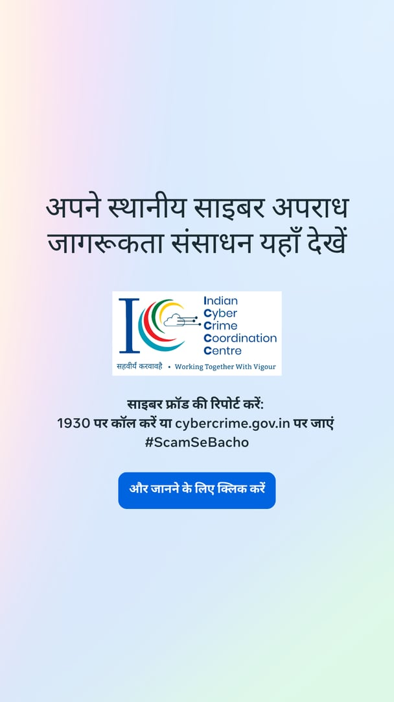
**Why swiped:** Meta-served scam-prevention ad that borrows an entire government agency's authority (India's I4C) instead of its own — a distinct trust lever from E79/E80's product-security angle. · **Format:** 9:16, text-only-callout w/ logo
**Layout:** top→bottom, centered symmetric: 2-line Hindi headline → boxed official I4C logo (mid) → report instructions + bold helpline `1930` + `cybercrime.gov.in` + `#ScamSeBacho` → blue pill CTA. Focal point = centered I4C logo + the "1930" number.
**Copy (verbatim):** "अपने स्थानीय साइबर अपराध जागरूकता संसाधन यहाँ देखें" (See your local cybercrime-awareness resource) — "साइबर फ्रॉड की रिपोर्ट करें: 1930 पर कॉल करें या cybercrime.gov.in पर जाएं #ScamSeBacho" — CTA "और जानने के लिए क्लिक करें".
**Visual DNA:** full multi-hue pastel gradient bg (peach→lavender→sky→mint; tool logged one slice `#EBF3FC`) · CTA FB-blue `#0066DA` · text `#1C1E21`; I4C multicolor monogram in a white card. Noto Sans Devanagari + Arial. Register: flat-graphic / anti-design.
**Levers:** borrowed authority ("Indian Cyber Crime Coordination Centre" logo + gov domain) · direct-utility helpline ("1930 पर कॉल करें") · localized campaign hashtag (#ScamSeBacho).
**Weaknesses / trust flags:** no Meta/WhatsApp branding — a user can't tell Meta served it (only the govt logo). Legit borrowed authority (real agency/helpline), not a fabricated badge; note the brand-attribution gap. `brand_visible` (re: Meta) = false. Low-persuasion PSA (tripped GENERIC_OUTPUT twice — accurate for a thin-persuasion notice; content eyeball-verified).
**So What for Grifon:** borrowed-authority via a recognized third-party institution + a single memorable action token (number/hashtag). CMO playbook note; not a GP family.
**Patterns:** corroborates S16 (third-party govt-agency authority), S30 (Hindi geo-local, local `1930` token), S9 (anti-design ground); new candidate none; contradicts none.

### 2026-07-12 — E80 Meta "Review linked devices on WhatsApp" (fb-ad-library, big-tech / consumer + Meta AI)
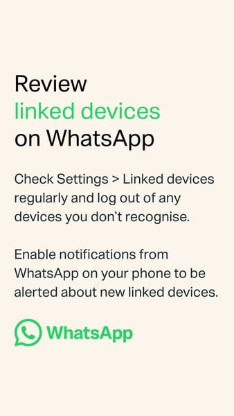
**Why swiped:** WhatsApp's cream two-tone security-awareness template — a distinct visual system from the blue Meta passkey family (color-coded headline + brand-recall logo lockup). · **Format:** 9:16, text-only-callout
**Layout:** top→bottom, left-aligned stack: two-color 3-line headline (top third) → two body paragraphs (center) → green WhatsApp phone-glyph + wordmark lockup (bottom). Focal point = the green-highlighted "linked devices".
**Copy (verbatim):** "Review **linked devices** on WhatsApp" — "Check Settings > Linked devices regularly and log out of any devices you don't recognise." + "Enable notifications from WhatsApp on your phone to be alerted about new linked devices." — no CTA (logo lockup only).
**Visual DNA:** warm cream ground (~`#F5EFE6`; tool `#FAF5EF`) · WhatsApp green `#25D366` accent (highlights the key noun + logo) · text `#111111`. Grotesque, bold headline vs regular body. Register: minimal / anti-design (mimics a native OS security notice).
**Levers:** security reassurance ("log out of any devices you don't recognise") · frictionless utility with explicit nav path ("Check Settings > Linked devices") · color-block attention (key noun in green against black).
**Weaknesses / trust flags:** no CTA button — relies on self-navigation; very plain, easy to scroll past. None fabricated.
**So What for Grifon:** the transferable idea = two-tone color-coded headline (accent color carries the key noun) on a warm off-white ground — a legible alternative to gold-on-black for a "utility-notice" register. CMO/CD note; not a GP family.
**Patterns:** corroborates S9 (anti-design, flat ground, reads as a note), S13 (WhatsApp logo lockup as recall anchor); color-coded-noun headline touches S12 (pattern-interrupt via color); new candidate none; contradicts none.

### 2026-07-12 — E79 Meta "पासकी बनाएं / अपने खाते को सुरक्षित रखने के लिए" (fb-ad-library, big-tech / consumer + Meta AI)
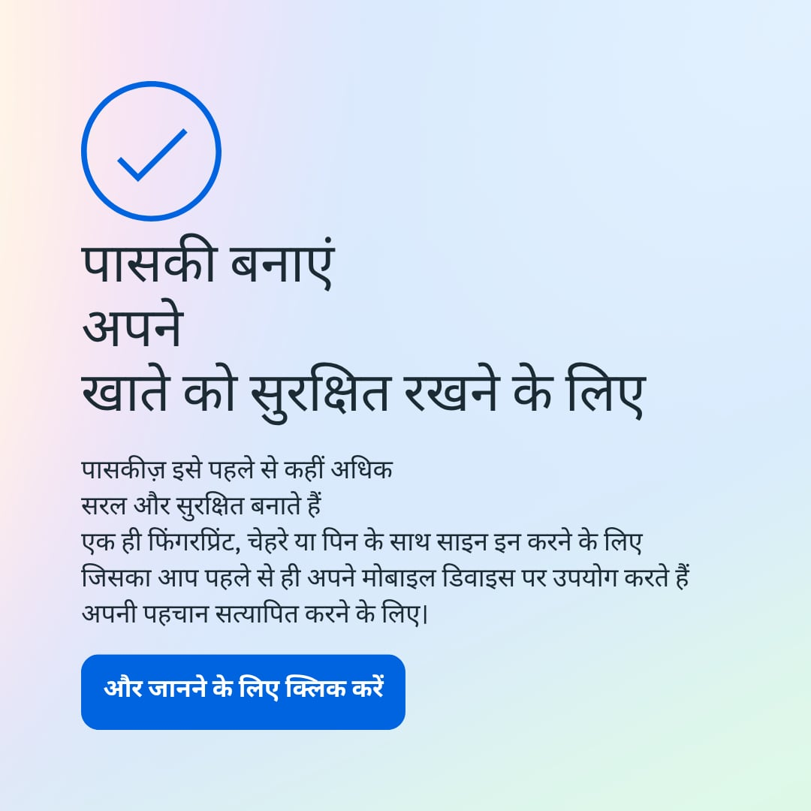
**Why swiped:** Meta's global "create a passkey" security master-creative, fully localized to Hindi — clean anti-design account-security template (also ships 9:16). · **Format:** 1:1, text-only-callout
**Layout:** top→bottom, left-aligned: blue outline checkmark icon → bold 3-line Devanagari headline → 5-line body block → blue pill CTA bottom-left; generous right-side negative space. Focal point = the bold headline.
**Copy (verbatim):** "पासकी बनाएं / अपने / खाते को सुरक्षित रखने के लिए" (Create a passkey to keep your account secure) — body "एक ही फिंगरप्रिंट, चेहरे या पिन के साथ साइन इन करने के लिए…" — CTA "और जानने के लिए क्लिक करें".
**Visual DNA:** multi-hue pastel gradient (peach→lavender→sky→mint; tool slice `#DCEEFC`) · CTA + icon FB-blue `#0062D2` · text `#1C1E21`. Noto Sans Devanagari, bold→regular. Register: minimal / anti-design.
**Levers:** friction reduction ("एक ही फिंगरप्रिंट, चेहरे या पिन" — one fingerprint, face, or PIN) · security reassurance · leverages an existing habit ("जिसका आप पहले से ही…उपयोग करते हैं").
**Weaknesses / trust flags:** no Meta/Facebook wordmark anywhere (`brand_visible: false`) — relies on the blue check + FB-blue palette for implicit recall; text-heavy, no face/device. Low-persuasion PSA (tripped GENERIC_OUTPUT twice — accurate; eyeball-verified). None fabricated.
**So What for Grifon:** value = the localized-master-creative pattern (one fixed layout + icon + CTA style, only the language swaps). CMO note for PH/Taglish geo-variants; not a new GP family.
**Patterns:** corroborates S30 (geo-localized master creative, Hindi copy), S9 (anti-design text-only); loosely S13 (checkmark as brand-recall stand-in); new candidate none; contradicts none.

### 2026-07-12 — E78 Wise "STOP SPENDING LIKE A TOURIST" (fb-ad-library, fintech / cross-border transfer)
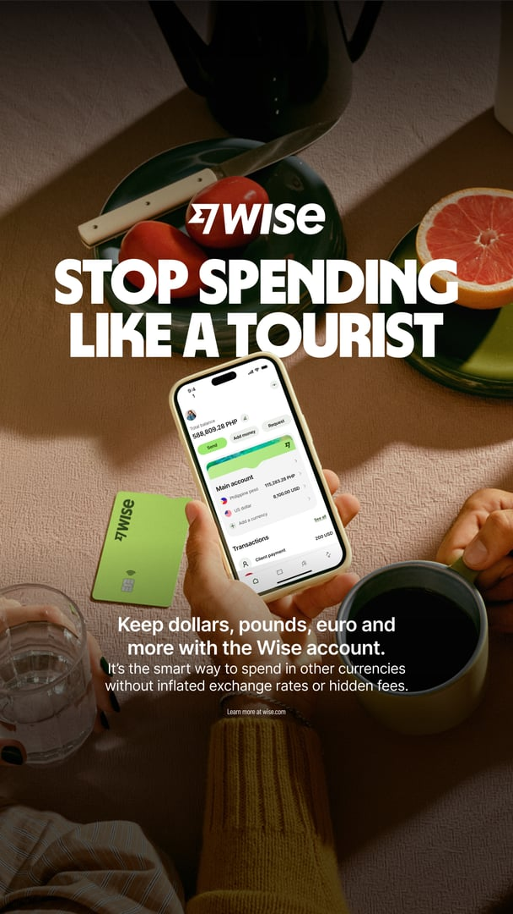
**Why swiped:** The premium-photography pole of Wise's style axis — a warm texture-macro sensory hero (grapefruit, coffee, table) framing a live product-UI phone. Deliberate S18 contrast against the flat-graphic entries. · **Format:** 9:16 (+1:1 sibling), lifestyle
**Layout:** top→bottom — top-down breakfast-table flat-lay (kettle, plated tomatoes+knife, sliced grapefruit) → Wise logo + bold white headline centered upper-half → hand holding phone (Wise app balances) center, green card left, coffee mug right → body over a warm knit base → text CTA. Focal point = the phone screen. `safe_zone_ok_9x16: true`.
**Copy (verbatim):** "STOP SPENDING LIKE A TOURIST" / "Keep dollars, pounds, euro and more with the Wise account." / "It's the smart way to spend in other currencies without inflated exchange rates or hidden fees." / on-screen "Total balance 588,809.28 PHP", "US dollar 8,100.00 USD", "Client payment 200 USD" — CTA "Learn more at wise.com".
**Visual DNA:** warm earthy browns `#3D261C` shadow/table · white black-weight uppercase headline+body · brand green `#9FE870` (the true Wise token; the photographed card reads lighting-shifted ~`#25C974`). Heavy uppercase display. Register: premium-editorial photography.
**Levers:** S31 texture-macro sensory hero (grapefruit/coffee/fabric = tactile, lived-in) · S20 product-UI-as-hero (real multi-currency balances make utility tangible) · S12/S24 pattern-interrupt callout ("STOP SPENDING LIKE A TOURIST" villainizes the tourist-FX ritual).
**Weaknesses / trust flags:** none deceptive. Phone balances are a standard product mockup; on-screen UI small at feed size.
**So What for Grifon:** establishes the "premium-photo" pole for a style-axis A/B (S18) vs Wise's flat-graphic ads; sensory-flat-lay + centered product-UI is a reusable lifestyle layout. Same "villainize the old way" hook as E75, photographic register.
**Patterns:** corroborates S31 (texture-macro sensory hero — 2nd brand after Kylie), S20 (product-UI-as-hero), S24/S12 (format-enemy / pattern-interrupt), S18 (premium end of the axis — direct contrast to E75); new candidate none; contradicts none.

### 2026-07-12 — E77 Wise "INTERNATIONAL PAYMENTS, NO DELAYS" (fb-ad-library, fintech / cross-border transfer)
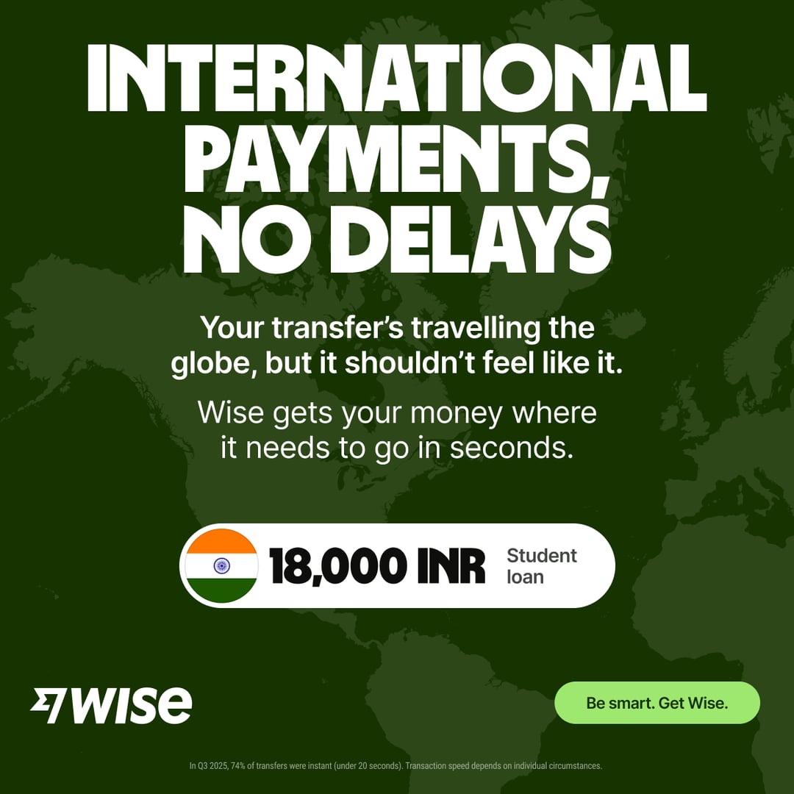
**Why swiped:** A geo-localized master creative whose single variable is a swappable transaction pill (flag + currency + amount + use-case), letting Wise localize per market from one layout. · **Format:** 1:1 (+9:16 sibling)
**Layout:** top→bottom — 3-line bold white headline over a faint tone-on-tone world map → two-line then two-line white subhead → central white pill "🇮🇳 18,000 INR — Student loan" → Wise logo bottom-left, lime CTA pill bottom-right → tiny disclaimer. Focal point = headline + the transaction pill. `safe_zone_ok_9x16: true`.
**Copy (verbatim):** "INTERNATIONAL PAYMENTS, NO DELAYS" / "Your transfer's travelling the globe, but it shouldn't feel like it." / "Wise gets your money where it needs to go in seconds." / pill "18,000 INR Student loan" / disclaimer "In Q3 2025, 74% of transfers were instant (under 20 seconds)…" — CTA "Be smart. Get Wise." (lime pill).
**Visual DNA:** forest bg `#163300` + faint map · lime CTA `#9FE870` · white headline/pill · black pill accent. Bold uppercase headline → regular body. Register: flat-graphic.
**Levers:** S30 geo-localized master creative (flag + "18,000 INR" + "Student loan" = per-market swap slot) · S8 audience (localizes to Indian tuition-payers) · S15 stat-stack ("74% of transfers were instant").
**Weaknesses / trust flags:** the "18,000 INR Student loan" pill is a simulated example transaction (illustrative, disclosed by context); the "74% instant" figure is **brand-stated** with its own hedge — treat as claim, not independently verified. Map graphic near-invisible on dim screens.
**So What for Grifon:** directly feeds a Grifon S30 geo-localized template — one master layout with a variable "proof pill" (flag/currency/amount/use-case) swapped per market; high-leverage for localized Image Ads Gen variants.
**Patterns:** corroborates S30 (geo-localized master creative), S15 (stat-stack), S8 (segment callout), S14 (full-canvas brand color); new candidate — "micro-transaction preview pill" (simulated flag+currency+amount+category chip to make a digital service feel concrete); contradicts none.

### 2026-07-12 — E76 Wise "GET PAID ACROSS BORDERS" (fb-ad-library, fintech / cross-border transfer)
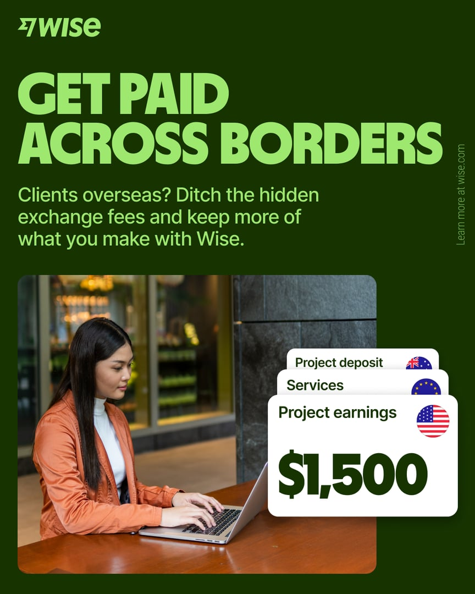
**Why swiped:** Audience-callout headline fused with product-UI card overlay on a real lifestyle photo — the cleanest S8+S20 combo in the set. · **Format:** 4:5 (+9:16 sibling), lifestyle
**Layout:** top→bottom — Wise logo top-left → huge two-line lime headline → three-line lime subhead → bottom-half photo of a woman in orange blazer on a laptop, with three stacked white UI cards (Project deposit/AU · Services/EU · Project earnings/US) cascading lower-right, biggest reading "$1,500". Focal point = the "$1,500" card. CTA rotated vertically on the right margin.
**Copy (verbatim):** "GET PAID ACROSS BORDERS" / "Clients overseas? Ditch the hidden exchange fees and keep more of what you make with Wise." — CTA "Learn more at wise.com" (vertical text).
**Visual DNA:** forest bg `#14320A` · lime headline `#9FE870` · white UI cards · orange-jacket accent `#D97443` (the one warm note tying photo to canvas). Bold uppercase → regular body. Register: premium-editorial photo + flat UI cards.
**Levers:** S8 hyper-specific audience callout ("Clients overseas?" targets freelancers with overseas clients) · S20 product-UI-as-hero (stacked multi-currency cards demo the flow without copy) · concrete-number proof ("$1,500").
**Weaknesses / trust flags:** the "$1,500 / Project earnings" cards are a simulated UI mockup (standard product illustration, not a real receipt). Vertical CTA easy to miss; photo generic, leans on the card overlay.
**So What for Grifon:** high-value Image Ads Gen layout — "UI-card-cascade over lifestyle photo" (flags + concrete amount = instant multi-currency story). CMO: niche-callout opener ("Clients overseas?") as a scroll-qualifier for freelancer segments.
**Patterns:** corroborates S8 (audience callout), S20 (product-UI-as-hero), S15 (concrete-stat proof); new candidate — "stacked multi-currency UI cards to visualize a global payment flow"; contradicts none.

### 2026-07-12 — E75 Wise "SET UP WISE BEFORE YOU TOUCHDOWN" (fb-ad-library, fintech / cross-border transfer)
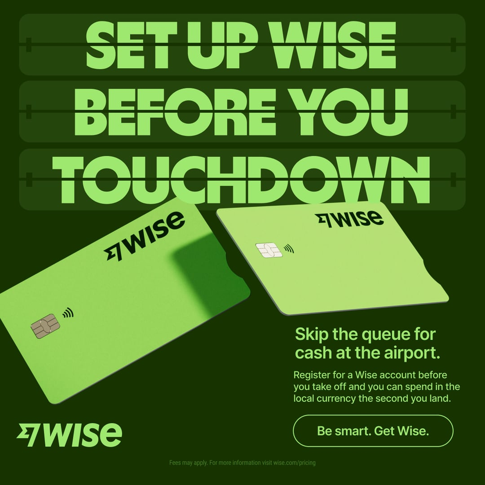
**Why swiped:** Full-canvas flat-graphic color-block with split-flap airport-board typography that *becomes* the travel context — pure bold-fintech house style. · **Format:** 1:1 (+9:16 sibling), product-hero
**Layout:** top→bottom — three-line lime headline set inside dark split-flap "board" slats (top ~45%) → two lime Wise cards floating at opposing diagonal angles (center) → benefit copy + outlined pill CTA bottom-right → Wise logo bottom-left → fine-print disclaimer. Focal point = the headline board + the two cards.
**Copy (verbatim):** "SET UP WISE BEFORE YOU TOUCHDOWN" / "Skip the queue for cash at the airport." / "Register for a Wise account before you take off and you can spend in the local currency the second you land." — CTA "Be smart. Get Wise." (outlined pill, dark fill `#142F16` / lime outline).
**Visual DNA:** forest-green bg `#142F16` · lime brand accent `#9FE870` (cards) · white secondary text. Heavy black uppercase display (Wise Sans-style) → regular body. Register: flat-graphic, high-polish (3D card renders).
**Levers:** S24 format-enemy — "Skip the queue for cash at the airport." villainizes the airport-exchange ritual · future-pace convenience ("spend in the local currency the second you land.") · contextual-metaphor styling (split-flap board mimics the travel environment).
**Weaknesses / trust flags:** none deceptive. Outlined pill CTA fills dark and low-contrasts; fine print near-illegible on the dark canvas.
**So What for Grifon:** Image Ads Gen candidate — "context-mimicry typography" (style the headline as an object native to the use-case) layered on S14 full-canvas brand color. CMO hook: villainize the ritual the product replaces.
**Patterns:** corroborates S24 (queue-as-enemy — 4th brand), S18 (polished flat-graphic axis), S14/S20 (full-canvas color + product-as-hero cards); new candidate — "contextual-metaphor / environment-mimicry typography"; contradicts none.

### 2026-07-12 — E74 Stripe "Créez votre société aux États-Unis en quelques clics" (fb-ad-library, B2B SaaS / fintech payments)
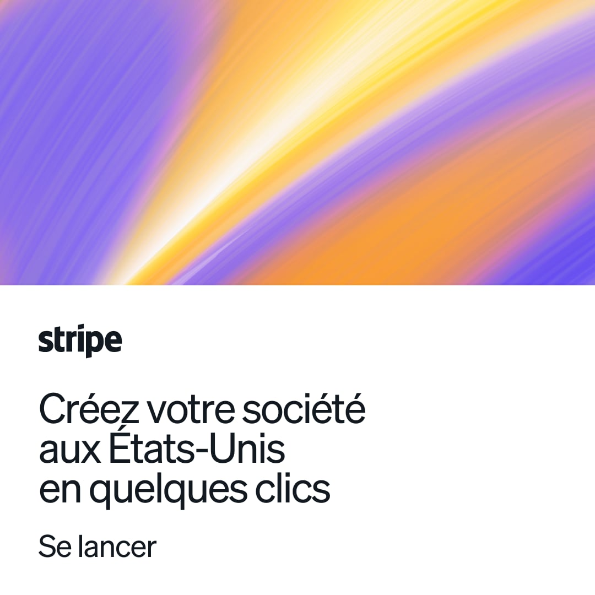
**Why swiped:** Fully localized (French) master creative for Stripe Atlas — same brand system, translated headline + native CTA + region-agnostic gradient. · **Format:** 1:1, text-only-callout
**Layout:** symmetric horizontal split: top half = diagonal purple/orange/yellow light-streak gradient; bottom half = clean white with black `stripe` wordmark → left-aligned 3-line black headline → "Se lancer" text-link CTA bottom-left.
**Copy (verbatim):** "Créez votre société aux États-Unis en quelques clics" (Create your company in the US in a few clicks) — CTA "Se lancer" (Get started).
**Visual DNA:** signature Stripe gradient `#635BFF` purple + `#FF9E00` orange (top) · white bg (bottom) · text `#0A2540`. Soehne/Helvetica bold headline → medium CTA. No imagery (gradient only). Register: premium-editorial.
**Levers:** S30 geo-localized master creative (French copy for French-speaking founders incorporating in the US) · frictionless promise ("en quelques clics") · institutional-trust aesthetic via the signature brand gradient.
**Weaknesses / trust flags:** none. No social proof / pricing on-canvas; abstract gradient doesn't explain "incorporation" to cold audiences.
**So What for Grifon:** CMO/localization playbook — one master layout, swap headline + CTA per language while keeping the brand gradient constant (maps to Taglish variants). The gradient-top / white-bottom split is a clean, product-free template.
**Patterns:** corroborates S30 (geo-localized master creative — French Atlas variant), S18 (premium style axis); new candidate — tool proposed "abstract brand-gradient split"; **folded into S18** (layout variant of the premium axis, not a distinct lever), not a new S-ID; contradicts none.

### 2026-07-12 — E73 Stripe "How to build an effective pricing strategy" (fb-ad-library, B2B SaaS / fintech payments)
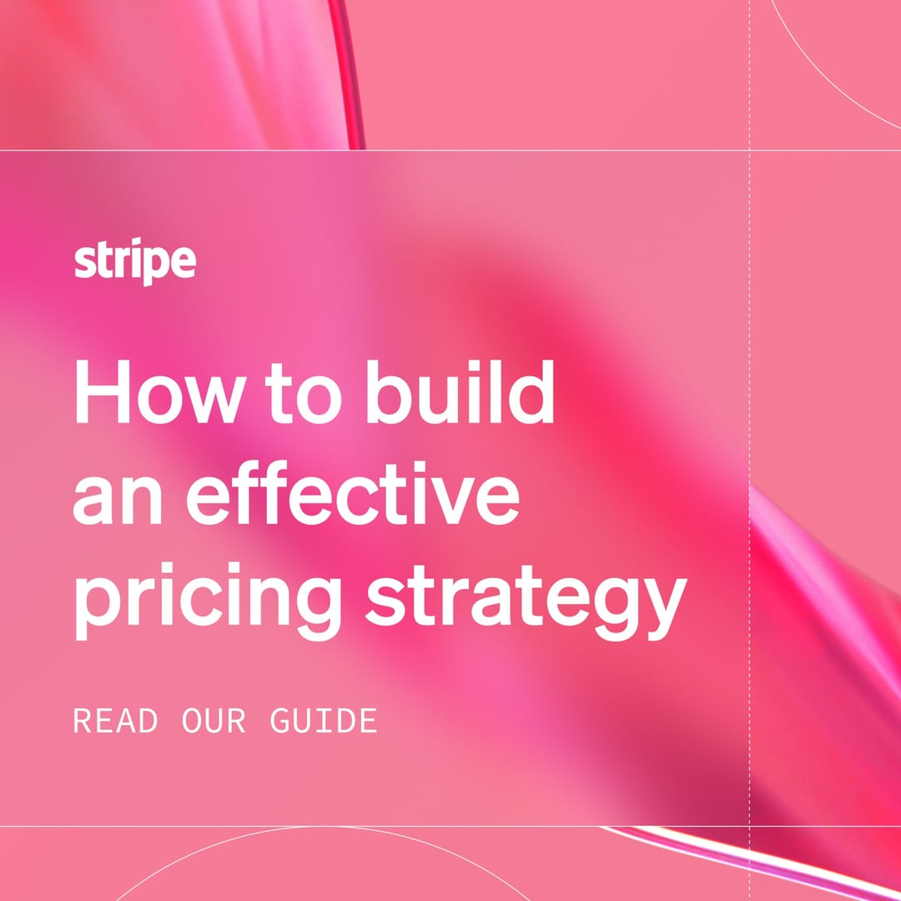
**Why swiped:** Text-only, full-bleed editorial lead magnet — top-of-funnel value bait in Stripe's premium fluid-gradient aesthetic, zero product shown. · **Format:** 1:1, text-only-callout
**Layout:** `stripe` wordmark upper-left → large 3-line white headline centered-left → letter-spaced "READ OUR GUIDE" CTA bottom-left. Full-bleed abstract pink fluid gradient with thin white accent lines. Heavy negative space.
**Copy (verbatim):** "How to build an effective pricing strategy" — CTA "READ OUR GUIDE".
**Visual DNA:** coral-pink fluid-gradient bg `#E35185` · white text. Helvetica/Soehne, mixed-case headline + all-caps tracked CTA. No imagery. Register: premium-editorial, asymmetric, heavy negative space.
**Levers:** S10 value-first lead magnet (TOF — "READ OUR GUIDE") · premium style axis (abstract gradient + clean type command authority with no product) · pain-point targeting (pricing strategy = core B2B SaaS anxiety).
**Weaknesses / trust flags:** none. No visual of the guide itself, which can lower perceived value of the download.
**So What for Grifon:** CMO + Image Ads Gen "Lead-Magnet / Editorial" template — brand wordmark + how-to headline naming a known pain + low-friction "read the guide" CTA on a full-bleed brand gradient. Cheap to produce (no product render), reusable for Grifon TOF offers.
**Patterns:** corroborates S10 (value-first lead magnet — clean SaaS instance), S18 (premium-editorial axis, Stripe's signature gradient); leans S9-adjacent (text-only but too designed to be true anti-design); new candidate none; contradicts none.

### 2026-07-12 — E72 Stripe "Create a link. Sell anywhere." (fb-ad-library, B2B SaaS / fintech payments)
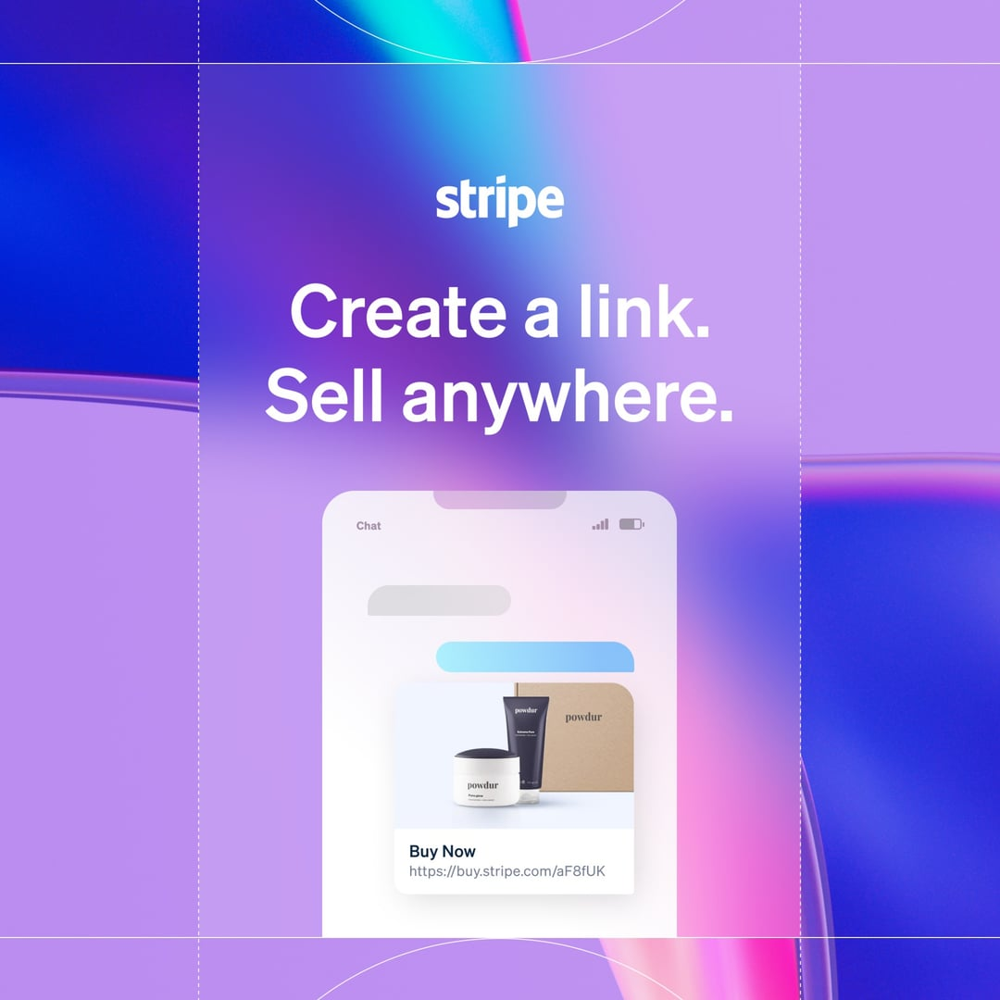
**Why swiped:** Purest product-UI-as-hero play in the set — the actual feature (a Stripe Payment Link shared in a chat) IS the creative, no stat or testimonial needed. · **Format:** 1:1, product-hero
**Layout:** centered vertical stack: white `stripe` wordmark (top-center) → bold 2-line white headline → smartphone mockup showing a "Chat" thread with a Payment Link preview card (powdur product image, "Buy Now", real-looking URL). Heavy negative space; purple/blue gradient.
**Copy (verbatim):** "Create a link. Sell anywhere." — in-card CTA "Buy Now" + `https://buy.stripe.com/aF8fUK`.
**Visual DNA:** purple/blue gradient `#8F00FF`→`#0029FF` · white text/logo · chat-bubble accent `#8CE0FF`. Bold rounded headline vs regular UI text. Register: premium-editorial, heavy negative space.
**Levers:** S20 product-UI-as-hero (Payment Link preview card with concrete URL `https://buy.stripe.com/aF8fUK`) · value-prop headline clarity ("Create a link. Sell anywhere.") · specific URL makes the abstract feature tangible.
**Weaknesses / trust flags:** mockup is a stylized vector illustration, not a real screenshot — reads slightly less authentic. **Tool auto-tagged S7 (fake-DM/manufactured, ANTI) — REJECTED on eyeball review:** this is a legitimate product-demo mockup of a chat, not a manufactured testimonial or deceptive social proof. Does NOT count toward S7.
**So What for Grifon:** strong template for Image Ads Gen "Feature-in-Context" — center the product's actual output inside a native surface (chat/DM/inbox) as the hero. Exactly Grifon's S18/S20 lane (product screen = hero) → feeds GP-5.
**Patterns:** corroborates S20 (product UI as the primary creative), S18 (premium chromatic-gradient axis); new candidate none; contradicts the S7 auto-tag (no manufactured social proof).

### 2026-07-12 — E71 Stripe "Carousell cuts false positives by 75% with Stripe" (fb-ad-library, B2B SaaS / fintech payments)
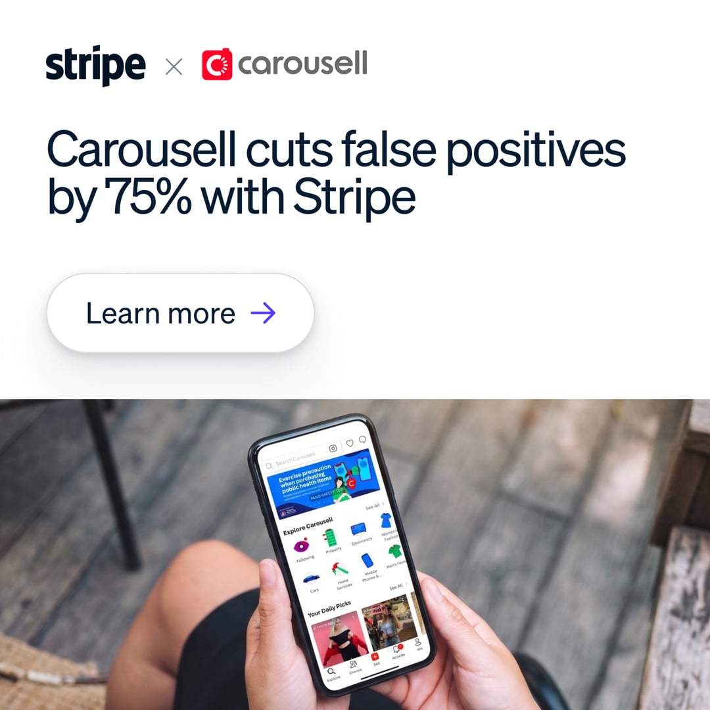
**Why swiped:** Co-branded customer case study that fuses a hard stat with the client's live product UI as proof — the premium B2B "logo + number" template. · **Format:** 1:1, product-hero
**Layout:** top→bottom: `stripe × carousell` co-brand lockup (top-left) → bold navy 2-line headline → white pill "Learn more →" CTA → bottom-half first-person lifestyle photo of hands holding a phone running the Carousell app. Focal point = "cuts false positives by 75%".
**Copy (verbatim):** "Carousell cuts false positives by 75% with Stripe" — CTA "Learn more" (→).
**Visual DNA:** white bg · navy text `#0A2540` · Stripe purple `#635BFF` (arrow only — the CTA pill FILL is white with navy text) · Carousell-red accent `#FF2636`. Soehne/Helvetica, bold→regular. Register: premium-editorial, asymmetric white/photo split.
**Levers:** S15 stat-stack proof ("cuts false positives by 75%" is the hero) · S16 borrowed authority ("stripe × carousell" co-branding) · S20 contextual product-UI grounds the abstract benefit.
**Weaknesses / trust flags:** phone-screen UI too small to read; the "75%" stat has no on-canvas source/attribution (typical case-study convention, not a fabrication).
**So What for Grifon:** CMO + Image Ads Gen "Customer Proof" template — co-brand lockup + one quantified outcome headline + client-app-in-hand photo (swap Carousell for a Grifon customer + their result).
**Patterns:** corroborates S15 (stat-stack — the 75% is the hero), S16 (borrowed authority via co-brand lockup), S20 (client app UI as proof); flexes S22 (category-king by association); new candidate none; contradicts none.

### 2026-07-12 — E70 Sabri Suby "Meet the $74 million Shark behind Australia's fastest-growing ad agency" (fb-ad-library, B2B / direct-response marketing agency)
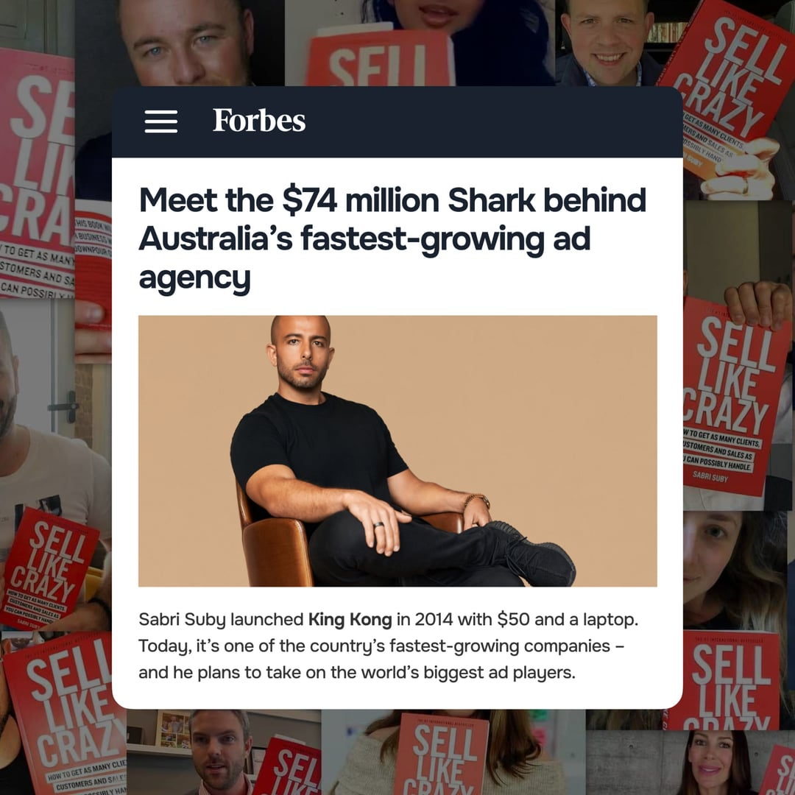
**Why swiped:** A mock Forbes article card floated over a collage of real readers — borrowed authority + underdog wealth-contrast + social proof stacked in one frame. · **Format:** 1:1, native editorial mockup
**Layout:** top→bottom — navy Forbes header bar (hamburger + wordmark) → bold black headline → centered studio portrait of Suby in a leather chair on warm beige → editorial caption → behind the white card, a full-bleed collage of dozens holding the red "Sell Like Crazy" book. Focal point = the Suby portrait inside the card.
**Copy (verbatim):** "Meet the $74 million Shark behind Australia's fastest-growing ad agency" / "Sabri Suby launched King Kong in 2014 with $50 and a laptop. Today, it's one of the country's fastest-growing companies…" — no CTA.
**Visual DNA:** Forbes header `#182430` · white card · headline `#121212` · portrait beige `#D5BCA8` · collage book red `#D12B2C`. Helvetica/Arial bold → regular; Forbes Georgia-style wordmark. Register: premium-editorial.
**Levers:** S16 borrowed authority (Forbes logo + mobile-article layout) · S21 native-format camouflage (disguised as a Forbes screenshot) · S2 authority-portrait (confident seated founder) · S22 category-king flex ("Australia's fastest-growing ad agency") · S27 wealth-contrast anchor ("$50 and a laptop" vs "$74 million Shark") · reader collage = mass social proof.
**Weaknesses / trust flags:** **manufactured editorial endorsement — Forbes branding used as ad layout; savvy users may flag as sponsored.** We lift the underdog-to-empire structure, NEVER fake a real publication's endorsement Grifon can't stand behind. No on-image CTA.
**So What for Grifon:** the "underdog-to-empire" money-contrast (tiny start → huge now) is a high-leverage CMO founder-story angle; template gated with a hard trust caveat (no fake-publication endorsements).
**Patterns:** corroborates S16 (Forbes-borrowed authority), S21 (editorial camouflage), S2 (founder portrait), S22 (category-king), S27 (wealth-contrast anchor — 2nd brand after E35); new candidate — "underdog-to-empire narrative contrast"; contradicts none.

### 2026-07-12 — E69 Sabri Suby "SELL LIKE CRAZY" (Memoji) (fb-ad-library, B2B / direct-response marketing agency)
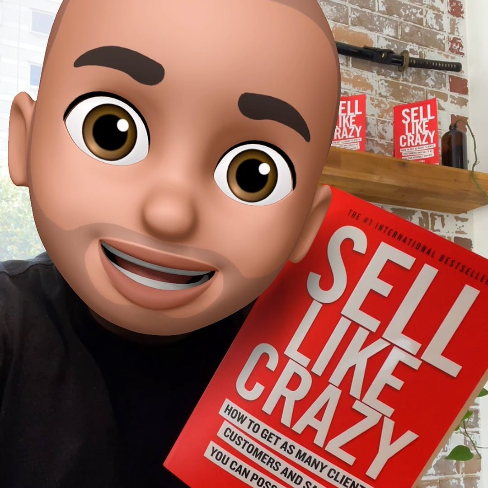
**Why swiped:** An oversized 3D Memoji of the founder holding his own book — uncanny pattern-interrupt that keeps brand recall while looking nothing like a B2B ad. · **Format:** 1:1, avatar-portrait hybrid
**Layout:** huge stylized Memoji face fills left+center foreground, smiling → bright red "SELL LIKE CRAZY" book angled on a diagonal in the right foreground → rustic brick wall behind with a wooden shelf (two more copies, a dark bottle, a mounted katana). Focal point = the avatar's face + the red cover.
**Copy (verbatim):** "THE #1 INTERNATIONAL BESTSELLER" / "SELL LIKE CRAZY" / "HOW TO GET AS MANY CLIENTS / CUSTOMERS AND S…" (lower cover text cropped in-source) — no CTA.
**Visual DNA:** cover red `#E31B23` · white cover text · avatar tee/katana `#1A1A1A` · avatar skin `#C68B67` · shelf wood `#8C5A3C`. Impact/Arial Black caps on cover. Register: raw-ugc (avatar over real photo).
**Levers:** S25 uncanny meme (non-human 3D avatar disrupts the feed) · S12 pattern-interrupt (oversized Memoji head is abnormal for B2B) · S13 mascot/recall (the Memoji is a recurring Sabri/King Kong recall device) · S2 authority-portrait (founder likeness + own bestseller as proof).
**Weaknesses / trust flags:** none fabricated. Craft flags: lower cover value-prop is cropped; cartoon avatar may dent perceived professionalism for high-ticket corporate buyers.
**So What for Grifon:** cheapest-to-produce pattern-interrupt in the set — an "avatar-as-founder" treatment (platform-native 3D avatar replacing a real headshot) is a portable scroll-stopper and a natural fit for Grifon's avatar tooling.
**Patterns:** corroborates S25 (uncanny), S12 (pattern-interrupt), S13 (mascot/recall), S2 (founder authority); new candidate — "avatar-as-founder" (stylized platform-native avatar replaces real photography while holding brand identity); contradicts none.

### 2026-07-12 — E68 Sabri Suby "Sell Like Crazy: How to Get As Many Client…" (fb-ad-library, B2B / direct-response marketing agency)
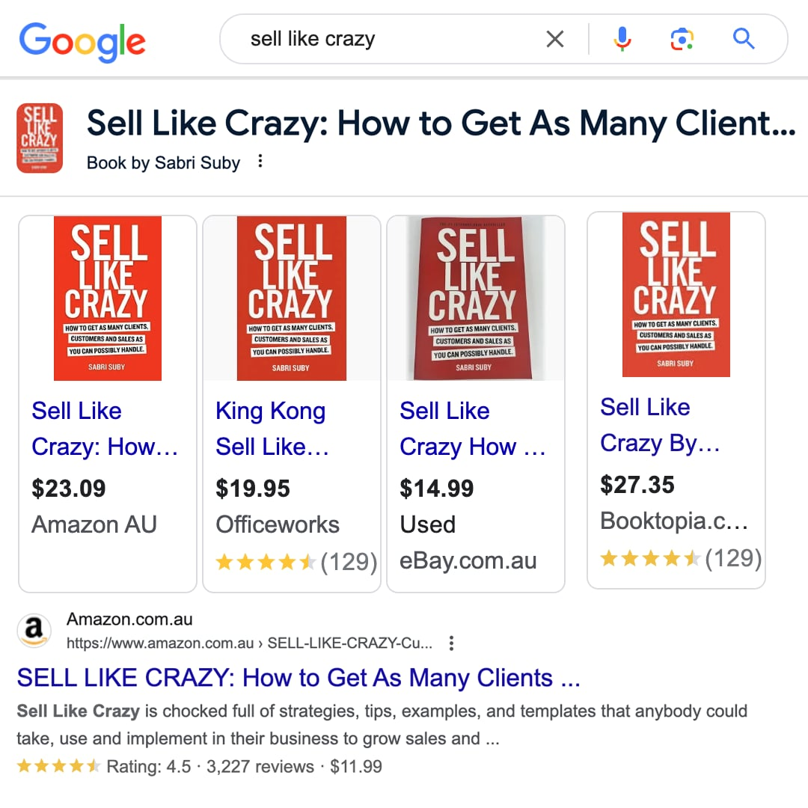
**Why swiped:** A fabricated Google SERP is the entire creative — search-UI-as-hero proving category dominance via multi-retailer availability + review volume. · **Format:** 1:1, simulated-UI screenshot
**Layout:** top→bottom — Google logo + search bar ("sell like crazy") → knowledge-panel header "Book by Sabri Suby" → a 4-card Shopping carousel of red book covers with prices/retailers → organic Amazon snippet with stars at the base. Focal point = the row of bright red book covers.
**Copy (verbatim):** query "sell like crazy" · "Sell Like Crazy: How to Get As Many Client…" · retailer stack "$23.09 Amazon AU / $19.95 Officeworks / $14.99 Used eBay.com.au / $27.35 Booktopia" · "Rating: 4.5 · 3,227 reviews · $11.99" — no CTA.
**Visual DNA:** white ground · product-hero red covers `#D12421` · link-blue `#1A0DAB` · Google blue `#4285F4`. Roboto/Arial UI, mixed case. Register: minimal-anti-design (pixel-honest UI mimicry).
**Levers:** S20 product-UI-as-hero (the SERP itself is the creative; red covers the focal mass) · S21 native-format camouflage (mimics an organic search page) · S16 borrowed authority (Google + Amazon + Officeworks + Booktopia) · S15 stat-stack ("3,227 reviews · 4.5" + four price points) · S22 category-king flex (listed everywhere = mainstream demand).
**Weaknesses / trust flags:** curated/staged results cherry-picking positive listings + high review counts; savvy users may feel manipulated once they clock it's a screenshot. No buy-CTA.
**So What for Grifon:** template candidate — a "SERP-simulation" layout that renders any Grifon-client product as a search-results page (multi-retailer + review stack). Note as a gated Image Ads Gen proposal (needs ≥3-ad corroboration before promoting); pairs with CMO proof-stacking.
**Patterns:** corroborates S20 (UI-as-hero — this is S20's 2nd independent brand), S21 (search-page camouflage), S16 (platform-borrowed trust), S15 (review/stat stack), S22 (multi-retailer dominance); new candidate — "SERP-simulation creative"; contradicts none.

### 2026-07-12 — E67 Sabri Suby "I WAS WORKING 16-HOURS PER DAY, 6 DAYS PER WEEK. BUT STILL STRUGGLED TO GET CLIENTS." (fb-ad-library, B2B / direct-response marketing agency)
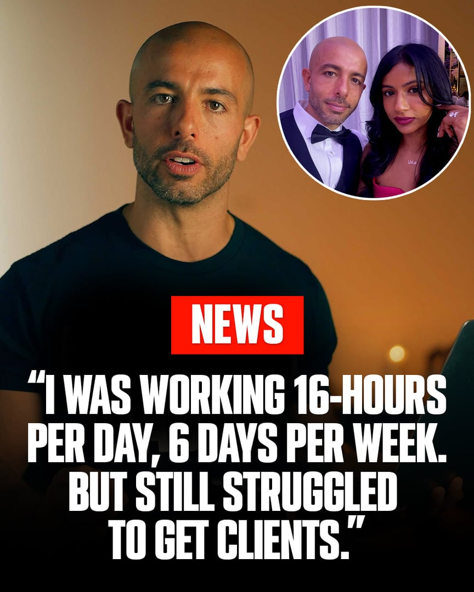
**Why swiped:** Dream-buyer pain quote weaponized as fake editorial "NEWS" — Sabri's signature hyper-specific audience callout in native-camouflage dressing. · **Format:** 4:5, authority-portrait / manufactured-news
**Layout:** top→bottom — dominant warm-lit portrait of Suby (black tee, direct gaze) fills left/center; circular inset top-right shows him tuxedo'd beside a partner (the "after"); red `NEWS` badge under his chin; heavy white condensed quote block owns the lower third. Focal point = the red NEWS badge + quote below it.
**Copy (verbatim):** "I WAS WORKING 16-HOURS PER DAY, 6 DAYS PER WEEK. BUT STILL STRUGGLED TO GET CLIENTS." / badge "NEWS" — no on-image CTA (relies on the caption).
**Visual DNA:** news badge `#FF0000` · white text · tee/shadow `#0B0C10` · warm skin/rim `#D4A373`. Condensed black caps (Bebas/Impact feel). Register: native-format-camouflage.
**Levers:** S8 hyper-specific audience callout ("16-HOURS PER DAY, 6 DAYS PER WEEK… struggled to get clients" quantifies the dream-buyer's exact pain) · S21 native-format camouflage (red "NEWS" badge mimics IG gossip/news accounts) · S2 authority-portrait · wealth-contrast via inset (leans S27/S28).
**Weaknesses / trust flags:** **manufactured news format — fake "NEWS" badge frames a personal quote as editorial reporting**; can read as clickbait to skeptical B2B. Copy the pain-quote layout; never fake a news outlet. No brand logo/CTA on-image.
**So What for Grifon:** the S8 pain-quote-as-headline over a founder portrait is a directly portable Image Ads Gen headline pattern for Bryan/Olivia SMB avatars (Taglish "16 oras kada araw pero walang client" energy). Feeds CMO playbook.
**Patterns:** corroborates S8 (quantified dream-buyer pain), S21 (NEWS-badge camouflage — 3rd brand), S2 (founder hero); new candidate — "contrast-inset storytelling" (main struggle portrait + small high-status circular inset = before/after without a split-screen); contradicts none.

### 2026-07-12 — E66 Alex Hormozi "It's time for a new network." (fb-ad-library, B2B / business-education & offers)
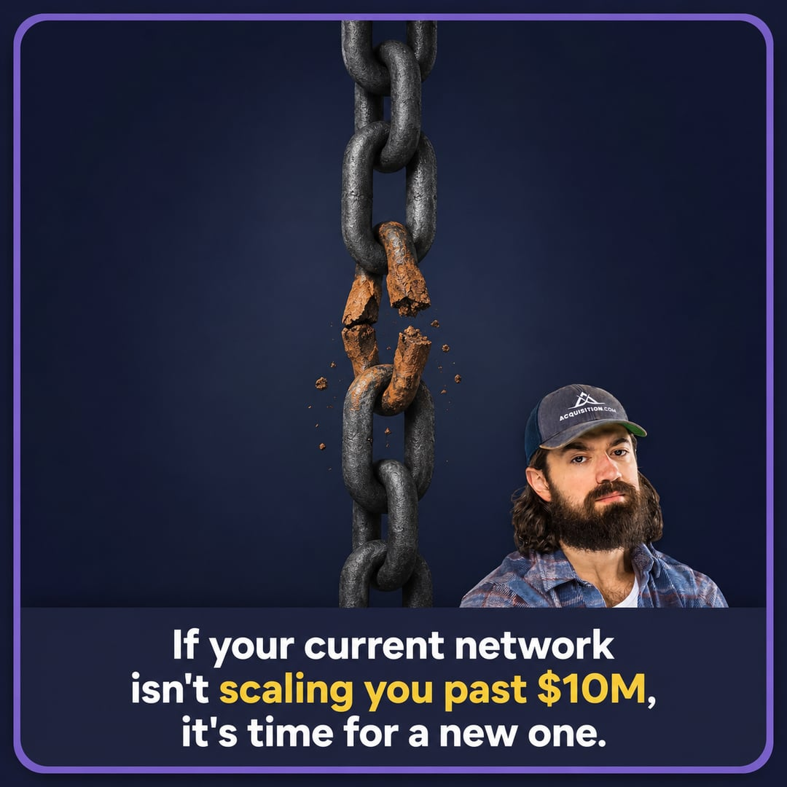
**Why swiped:** Conceptual visual-metaphor hook — a rusted, crumbling chain link literalizes "your weak network," instant comprehension before a word is read. · **Format:** 1:1, conceptual-metaphor / authority-portrait
**Layout:** heavy black chain hangs down the vertical center-axis, its middle link rusted and shattering with debris mid-air → Hormozi cutout in the bottom-right quadrant, serious gaze, ACQUISITION.COM cap → dark-blue banner across the bottom fifth holds the hook, "scaling you past $10M" in gold. Focal point = the broken rusted link. Asymmetrical balance.
**Copy (verbatim):** "If your current network isn't scaling you past $10M, it's time for a new one." ("scaling you past $10M" in gold) — no on-canvas CTA.
**Visual DNA:** navy bg `#121930` · gold accent text `#FBC02D` · white primary · rust metaphor accent `#8D5B4C`; thin purple rounded frame. Bold Montserrat-ish, mixed case. Register: premium-editorial photo-manipulation + photographic cutout.
**Levers:** conceptual metaphor (broken chain = weak link in your network) · S8 hyper-specific revenue filter ("past $10M") · S2 authority-portrait trust anchor · gold color-highlight steering the eye to the qualifying number.
**Weaknesses / trust flags:** none; no on-image CTA; leans on Hormozi recognition for the portrait's authority weight.
**So What for Grifon:** CD playbook — "literal metaphor + one-line hook + bottom banner" is a reusable Image Ads Gen concept-frame (visualize the customer's problem object, not the product). Lower direct SaaS-template value than E63/E65; keep as a creative-recipe reference.
**Patterns:** corroborates S8 ("$10M" revenue callout), S2 (founder anchor), S12-adjacent (metaphor as pattern-interrupt); new candidate — "conceptual metaphor hook" (a physical object literalizing a business problem); contradicts none.

### 2026-07-12 — E65 Alex Hormozi "Your custom AI is here." (fb-ad-library, B2B / business-education & offers)
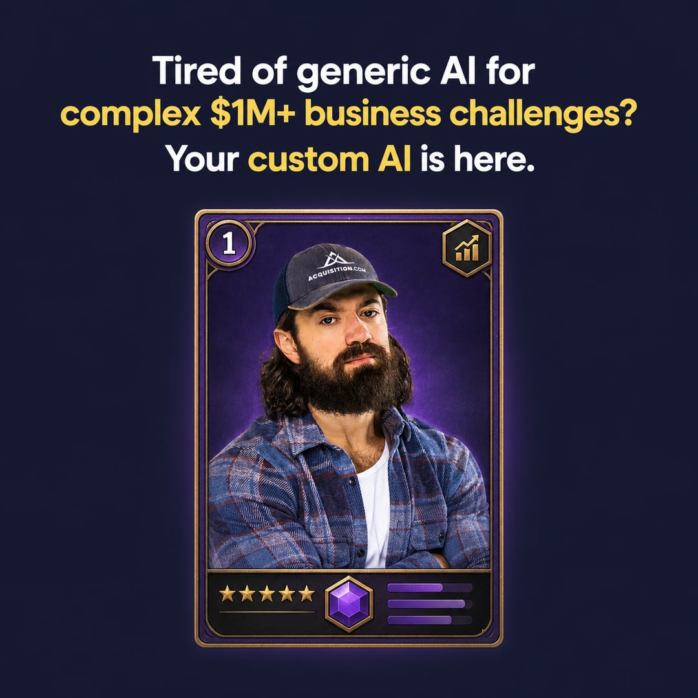
**Why swiped:** Rare, high-novelty pattern-interrupt — the founder rendered as a collectible RPG/trading card, hijacking the "AI" trend in a B2B feed. · **Format:** 1:1, gamified-card / authority-portrait
**Layout:** centered 3-line headline (yellow-highlighted middle line) → single gold-bordered trading card dead-center: Hormozi portrait inside, level "1" badge top-left, gold growth-chart hex top-right, 5 gold stars bottom-left, purple gem center, 3 purple stat-bars bottom-right. Symmetrical single-focus. Focal point = the card.
**Copy (verbatim):** "Tired of generic AI for complex $1M+ business challenges? Your custom AI is here." ("complex $1M+ business challenges" and "custom AI" in yellow) — no on-canvas CTA.
**Visual DNA:** navy bg `#121124` · gold card border `#DFB76C` · purple gem+bars `#7B3FE4` · white text. Bold sans, mixed case. Register: premium-editorial with game-UI ornamentation.
**Levers:** trading-card pattern-interrupt (level/stars/stat-bars = scroll-stopper) · S11 AI trend-hijack ("generic AI" vs "your custom AI") · S8 hyper-specific audience callout ("$1M+ business challenges" = lead-filter) · S2 authority-portrait as the card's hero.
**Weaknesses / trust flags:** none; no on-image CTA to route the next step; gamified skin may alienate ultra-conservative enterprise buyers.
**So What for Grifon:** strongest single new-template candidate of the batch — a "Gamified Character Card" layout for Image Ads Gen (frame a founder / the Grifon app / a feature as a collectible card with level, stars, stat bars). Pairs with Grifon's S11 AI-trend angle. Worth a GP-family proposal if it recurs ≥3×.
**Patterns:** corroborates S12 (pattern-interrupt hook), S11 (AI trend-hijack — Grifon's core axis), S8 ("$1M+" audience callout), S2 (founder as hero); new candidate — "gamified character/trading card" layout; contradicts none.

### 2026-07-12 — E64 Alex Hormozi "BUILD THE OFFER THAT FEELS LIKE A NO-BRAINER" (fb-ad-library, B2B / business-education & offers)
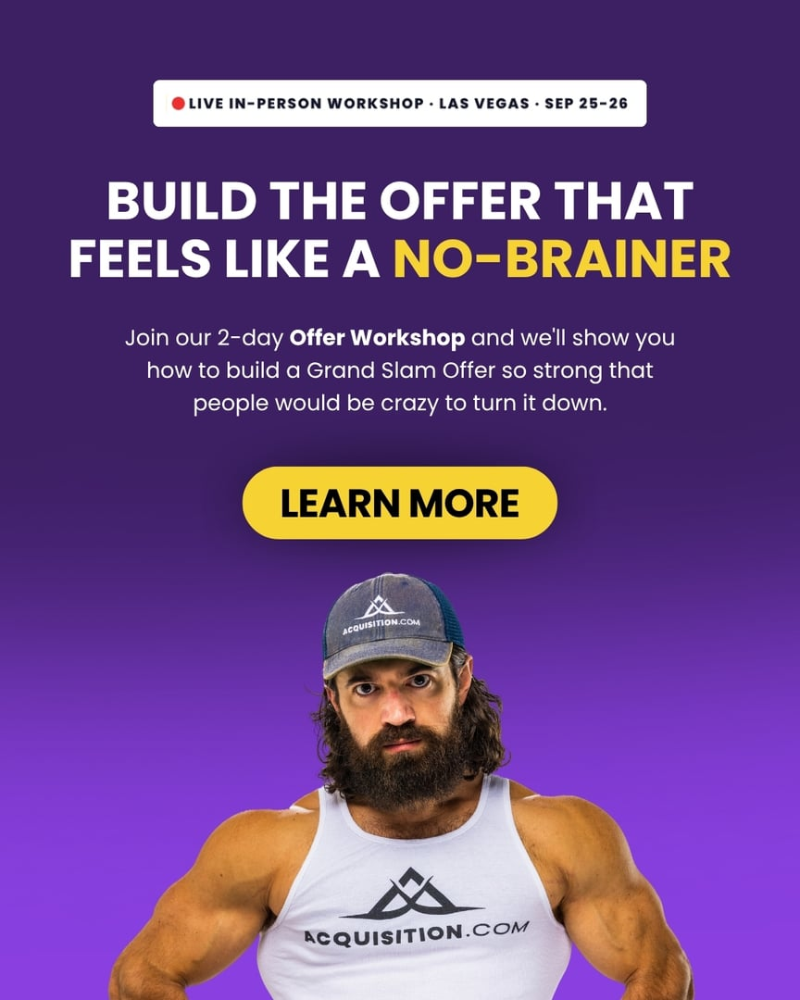
**Why swiped:** Clean authority-portrait event ad — muscular founder as living proof + a date-stamped in-person workshop hook. · **Format:** 4:5, authority-portrait / event
**Layout:** white pill event-badge ("LIVE IN-PERSON WORKSHOP · LAS VEGAS · SEP 25-26") → black-weight headline upper-third with "NO-BRAINER" in yellow → 3-line body → filled yellow "LEARN MORE" pill (center) → large Hormozi cutout fills the bottom half against a purple gradient, ACQUISITION.COM on cap + tank. Focal point = his direct gaze.
**Copy (verbatim):** "BUILD THE OFFER THAT FEELS LIKE A NO-BRAINER" / "Join our 2-day Offer Workshop and we'll show you how to build a Grand Slam Offer so strong that people would be crazy to turn it down." — CTA "LEARN MORE" (yellow pill `#F7D139`).
**Visual DNA:** purple gradient `#5A2D82`→`#8A3FFC` · yellow `#F7D139` CTA+accent · white text. Montserrat-ish black weight, all-caps headline. Register: flat-graphic. Branded apparel doubles as logo placement.
**Levers:** S2 authority-portrait (branded apparel = walking logo) · event scarcity/specificity (fixed city + dates) · "no-brainer / crazy to turn it down" ease-of-outcome trigger · high-contrast yellow-on-purple CTA pop.
**Weaknesses / trust flags:** none; relies on pre-existing Hormozi recognition (cold audiences may not connect the physique to business education). One campaign cluster with the Vegas-workshop big-type variants; E64 is the cleanest authority-portrait representative.
**So What for Grifon:** CMO/CD playbook — the date-stamped event-badge + single filled CTA on a flat-color canvas is a reusable Image Ads Gen layout for any Grifon live/webinar push. Founder-as-proof only ports if Grifon anchors on a recognizable face.
**Patterns:** corroborates S2 (founder cutout as sole anchor), S14/S6-adjacent (full-color flat canvas + single high-contrast CTA); new candidate — "branded-apparel-as-logo placement"; contradicts none.

### 2026-07-12 — E63 Alex Hormozi "Everything inside Vantage." (fb-ad-library, B2B / business-education & offers)
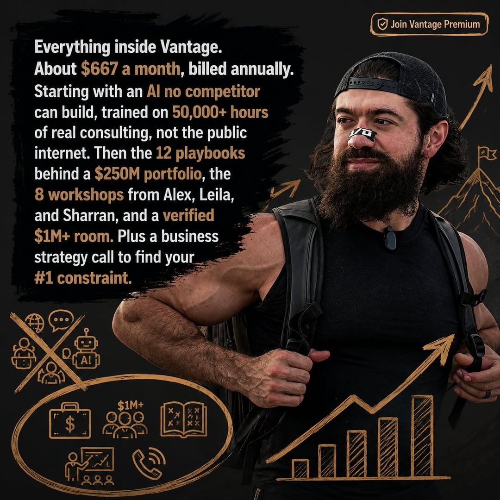
**Why swiped:** Textbook Hormozi value-stack — enumerates every offer component + a hard price, in a premium gold-on-black frame. Directly reinforces GP-1. · **Format:** 1:1, authority-portrait / offer-stack
**Layout:** outlined "Join Vantage Premium" ghost-badge top-right → left-half black brush-stroke block holds the white+gold value copy → hand-drawn gold icon cluster (briefcase/$1M+ room/playbook/strategy-call) bottom-left → founder cutout dominates the right half with hand-drawn gold mountain, arrows, and an upward bar-chart. Focal point = Hormozi's portrait; copy reads first on the left.
**Copy (verbatim):** "Everything inside Vantage. About $667 a month, billed annually. Starting with an AI no competitor can build, trained on 50,000+ hours of real consulting… Then the 12 playbooks behind a $250M portfolio, the 8 workshops from Alex, Leila, and Sharran, and a verified $1M+ room. Plus a business strategy call to find your #1 constraint." — CTA "Join Vantage Premium" (outlined gold pill).
**Visual DNA:** bg `#121212` · gold accent `#D59F4E` · white text; hand-drawn gold "chalkboard" doodles over premium photo. Bold-to-regular sans, mixed case. Register: premium-editorial.
**Levers:** S4 offer-stack enumeration ("12 playbooks… 8 workshops… verified $1M+ room… strategy call") · S15 stat-stack proof (all non-round: "50,000+ hours", "$250M portfolio", "$667 a month") · S2 authority-portrait · price-upfront value-anchor + lead-filter.
**Weaknesses / trust flags:** none — every number is a checkable claim, no manufactured scarcity/DMs. Minor: no filled CTA button (only a ghost badge).
**So What for Grifon:** strong signal for the GP-1 SaaS Offer/Upsell "value-stack" family — enumerated deliverables + one hard price + gold-on-black premium skin. CMO: the "non-round specific number" stacking ports directly to Grifon's plan-ladder copy.
**Patterns:** corroborates S4 (offer components enumerated — 3rd brand), S15 (dense stat-stack), S5 (gold-on-black premium palette — 2nd brand after Gadzhi), S2 (founder hero); new candidate — "hand-drawn chalk/doodle overlay on premium photography"; contradicts none.

### 2026-07-12 — E62 Google Gemini App "غيّر قصة شعري لقصة شعر النجوم" (fb-ad-library, AI / consumer AI assistant)
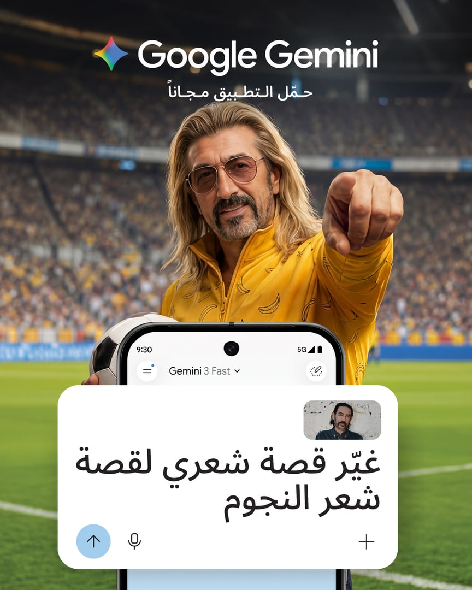
**Why swiped:** The geo-localized (Arabic) master-creative variant — swaps the flat template for a scroll-stopping character (banana-print-jacket blonde man pointing at camera) + a real phone mockup showing the in-app prompt + result. · **Format:** 4:5, product-hero
**Layout:** symmetric, deep DOF — Google Gemini logo top-center over Arabic subhead → hero character in bright yellow banana jacket pointing at viewer, holding a ball → photorealistic phone mockup lower-half ("Gemini 3 Fast", white prompt card with the Arabic prompt + a small "before" portrait). Focal point = the pointing man in yellow.
**Copy (verbatim):** "Google Gemini" / "حمّل التطبيق مجاناً" (Download the app for free) / "غيّر قصة شعري لقصة شعر النجوم" (Change my hairstyle to a star's hairstyle) / "Gemini 3 Fast" — CTA "حمّل التطبيق مجاناً" (text CTA).
**Visual DNA:** hero-accent yellow `#F4C430` · white card · stadium grass `#4CAF50` · icon accent `#4285F4` · text `#1A1A1A`. Google Sans Arabic, bold→regular. Register: premium-editorial composite. Yellow-on-green = instant contrast.
**Levers:** S20 product-UI-as-hero (the phone mockup with the prompt) · S11 trend-hijack (stadium + ball tap regional football fervor) · cost-reversal "download free" removes friction · scroll-stopping color contrast · character/recall device.
**Weaknesses / trust flags:** none fabricated. The generated character reads slightly uncanny, which can undercut "realistic photo editing" credibility.
**So What for Grifon:** two adds beyond E59–E61 — (1) geo-localized master creative (one template, localized language + regional trend); (2) a memorable character/mascot as the pattern-interrupt over a flat UI card. CMO: pair "free" cost-reversal with a bold hero character when the flat template needs more stopping power.
**Patterns:** corroborates S20, S11, S30 (Arabic localization of the same campaign), S13 (banana-jacket character), mild S1 (free-download cost-reversal); new candidate none; contradicts none.

### 2026-07-12 — E61 Google Gemini App "KNOW THE HISTORY FEEL THE DRAMA" (fb-ad-library, AI / consumer AI assistant)

**Why swiped:** The text-utility (information, not image-gen) variant of the same campaign — a glassmorphic prompt card with a live blue cursor over a cinematic sports photo. Sells a "get answers" use case without any generated visual payoff. · **Format:** 1:1, product-hero
**Layout:** low-angle cleat-striking-ball action photo fills the frame → bold white "KNOW THE HISTORY / FEEL THE DRAMA" across the top third → large translucent dark glass card center-bottom holding the prompt with a blinking blue cursor (focal point) → Google Gemini lockup inside the card base.
**Copy (verbatim):** "KNOW THE HISTORY" / "FEEL THE DRAMA" / "Break down the history and key rivalries of the U.S. Soccer National Team|" (trailing cursor) — no CTA.
**Visual DNA:** white primary text · translucent card `#1E2E24` · cursor accent `#4285F4` · grass green `#557C16`. Heavy black headline (Impact-like) → regular prompt sans. Register: premium-editorial. Real sports photo (no gen).
**Levers:** S20 product-UI-as-hero (glass card + blue cursor simulates the live Gemini input) · S11 trend-hijack (USMNT history/rivalries to catch fans) · the live-typing cursor mimics an active session and pulls the eye to the value prop.
**Weaknesses / trust flags:** no CTA button.
**So What for Grifon:** confirms the transferable device — a translucent prompt card + blinking cursor over a relevant editorial photo = "the app is thinking about YOUR topic." Cheap to template (stock/brand photo + prompt overlay), no gen required.
**Patterns:** corroborates S20 and S11 (same campaign DNA as E59/E60 — multi-execution consistency is itself the signal); new candidate none (rolls into E59's "prompt-to-outcome" candidate); contradicts none.

### 2026-07-12 — E60 Google Gemini App "GET IN THE GAME" (fb-ad-library, AI / consumer AI assistant)
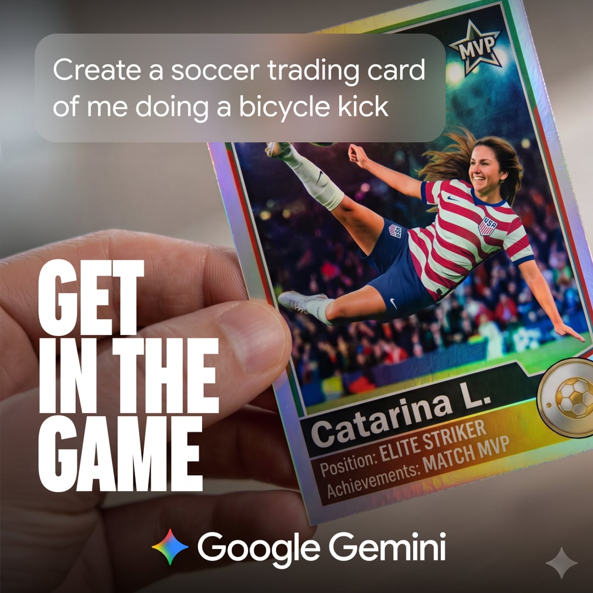
**Why swiped:** Personalization / self-insertion lever ("of ME doing a bicycle kick") and a physical-digital bridge (AI output shown as a real trading card held in a hand) that makes software output feel tangible and collectible. · **Format:** 1:1, product-hero
**Layout:** asymmetric — real hand holds a holographic foil trading card angled center-right (focal point) → grey prompt bubble top-left → massive stacked white "GET IN THE GAME" bottom-left → Google Gemini lockup bottom-center.
**Copy (verbatim):** "GET IN THE GAME" / "Create a soccer trading card of me doing a bicycle kick" / "Catarina L." · "Position: ELITE STRIKER" · "Achievements: MATCH MVP" · "MVP" badge — no CTA.
**Visual DNA:** white text · dark card ground `#1E252B` · USA-jersey red stripe `#E21C34` · logo accent `#4285F4`. Heavy bold headline vs clean sans prompt bubble. Register: clean-tech-meets-physical-nostalgia. Imagery: AI-generated card composited into a real hand.
**Levers:** S20 product-UI-as-hero (prompt bubble demos how to interact) · personalization/self-insertion ("of me") · nostalgia (foil border + MVP badge borrow physical-card culture).
**Weaknesses / trust flags:** mild — staged prompt bubble implies one-shot real-time generation of a polished card that in practice is multi-step. **Tool auto-tagged S7 (fake-DM/manufactured, ANTI) — REJECTED on eyeball review:** authentic first-party product UI demoing the app's own capability, not a deceptive manufactured DM/social-proof. Does NOT count toward S7. Possible viewer confusion: does Gemini print physical cards? (No.)
**So What for Grifon:** the personalization angle is transferable — Grifon could show "put the CLIENT's product/face into [aspirational scene]" as the demoed prompt; the physical-object-in-hand bridge makes generated assets feel premium.
**Patterns:** corroborates S20 (generated output as hero), S11 (soccer-trend hijack by an AI product); new candidate — "physical-digital bridge" (AI-generated asset shown as a held physical object); contradicts the S7 auto-tag (legit product demo, not manufactured ANTI).

### 2026-07-12 — E59 Google Gemini App "FOR TIMELY GOALS" (fb-ad-library, AI / consumer AI assistant)
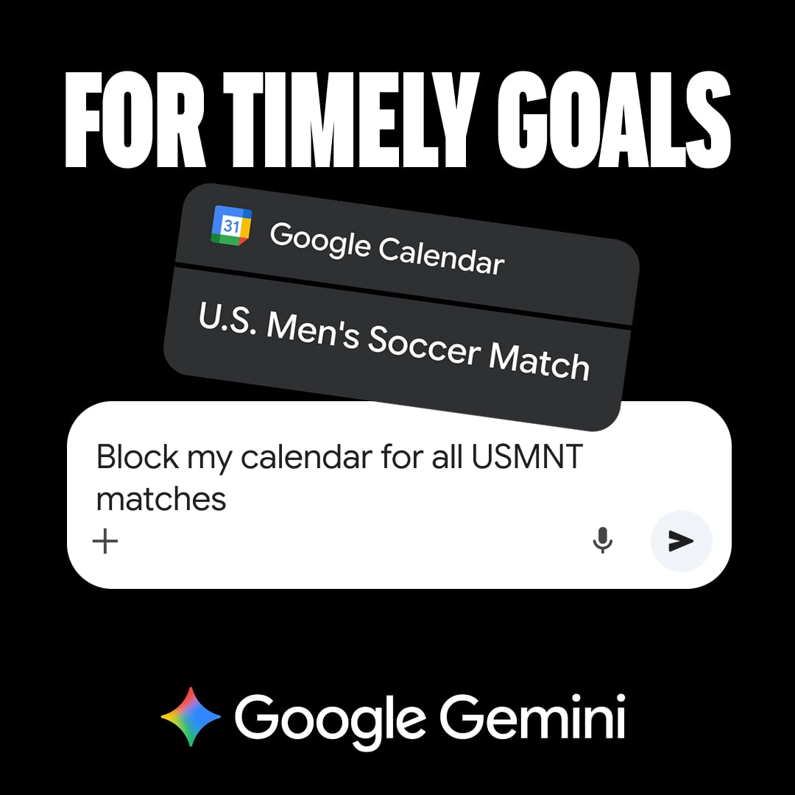
**Why swiped:** Cleanest example of the "FOR ___ GOALS" black-canvas template — turns an abstract AI capability (agentic calendar automation) into a single legible prompt→outcome tableau. · **Format:** 1:1, product-hero
**Layout:** giant condensed white headline "FOR TIMELY GOALS" on pure black → dark-grey Google Calendar notification card ("U.S. Men's Soccer Match") overlapping → white Gemini prompt pill (focal point) → centered Google Gemini lockup at base.
**Copy (verbatim):** "FOR TIMELY GOALS" / "Block my calendar for all USMNT matches" / "U.S. Men's Soccer Match" — no CTA.
**Visual DNA:** bg `#000000` · headline + prompt-pill white · notification card `#202124` · logo accent `#4285F4`. Heavy condensed sans + Google Sans, high weight contrast. Register: minimal / anti-design.
**Levers:** S20 product-UI-as-hero (simulated Gemini prompt box + the resulting Calendar notification are the primary visuals) · S11 trend-hijack ("USMNT matches" makes the utility feel timely) · actionable prompt-education (shows the exact phrase to type) + ecosystem trust-transfer (borrows Google Calendar's recognizability).
**Weaknesses / trust flags:** no explicit CTA button; relies on the viewer decoding "USMNT."
**So What for Grifon:** the "FOR ___ GOALS" black-canvas + app-UI-card is a directly clonable Image Ads Gen template — headline slot "FOR [BENEFIT] GOALS" + a prompt-pill showing Grifon's own exact input. CMO: sell the concrete prompt + its outcome, not the abstract "AI-powered" claim → feeds GP-5.
**Patterns:** corroborates S20 (product UI is the hero), S11 (AI product hijacking a live sports trend — mirrors Grifon's own "AI" lane); new candidate — "prompt-to-outcome visualization" (prompt pill visually connected to its rendered result); contradicts none.

### 2026-07-12 — E58 Meta for Business "Capture leads fast." (fb-ad-library, B2B / social-ads platform)
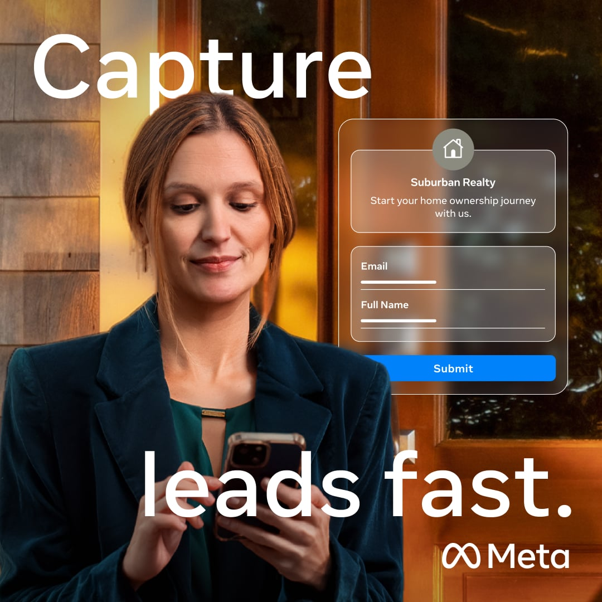
**Why swiped:** Product-UI-as-hero done as a glassmorphic lead-form overlay on a lifestyle shot, with a vertical-specific mock brand ("Suburban Realty") to make the abstract feature concrete for a named niche. · **Format:** 1:1, product-hero
**Layout:** woman in dark-teal blazer on a phone, left; glassmorphic Instant-Form card overlaid right (house icon → mock brand → Email/Full Name fields → blue Submit). Headline split "Capture" (top-left) / "leads fast." (bottom-center). Meta logo bottom-right.
**Copy (verbatim):** "Capture leads fast." / form "Suburban Realty" — "Start your home ownership journey with us." / "Email" / "Full Name" — CTA "Submit" (pill `#007FFF`).
**Visual DNA:** white headline + UI borders · Submit `#007FFF` · teal blazer `#0A3C46` · warm door-glow bg `#D97D24`. Bold-to-regular sans, mixed case. Register: premium-editorial with glassmorphic UI overlay.
**Levers:** S20 product-UI-as-hero (glassmorphic lead form showing Email/Full Name/Submit) · value-first benefit headline ("Capture leads fast." states the advertiser's exact goal) · vertical-specific mock ("Suburban Realty" makes it relevant to real-estate advertisers).
**Weaknesses / trust flags:** none. Minor: the subject's head slightly interrupts the split headline.
**So What for Grifon:** Image Ads Gen template — "float a glassmorphic product-UI card over a lifestyle subject, headline states the literal outcome, mock brand names the niche"; swap the form for Grifon's own UI and localize the mock brand per vertical → feeds GP-5.
**Patterns:** corroborates S20 (Instant Forms UI rendered as the creative); new candidate none; contradicts none.

### 2026-07-12 — E57 Meta for Business "3 hacks to guide the AI behind Advantage+ creative:" (fb-ad-library, B2B / social-ads platform)
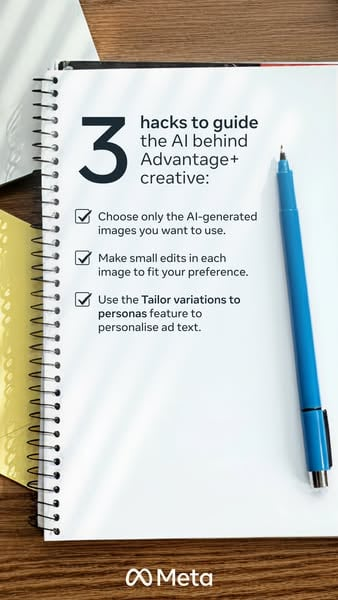
**Why swiped:** Analog pattern-interrupt — a physical spiral-notebook flat-lay used to explain an AI feature, with a listicle number hook + actionable checklist. Anti-design in a feed of gradients. · **Format:** 9:16, flat-lay / anti-design
**Layout:** top-down flat-lay of a white spiral notebook on brown wood; yellow sticky note peeking left, blue pen along the right. Big black "3" top-left, headline, then three checkmark items. Meta logo bottom on the wood. Focal point = the large "3".
**Copy (verbatim):** "3 hacks to guide the AI behind Advantage+ creative:" / "Choose only the AI-generated images you want to use." / "Make small edits in each image to fit your preference." / "Use the **Tailor variations to personas** feature to personalise ad text." — no CTA.
**Visual DNA:** notebook page white · text `#1C2B33` · blue pen `#0084FF` · wood `#8B5A2B` · yellow sticky `#F4D03F`. Black-to-regular sans, mixed case. Register: minimal / anti-design.
**Levers:** S10 value-first education ("provides '3 hacks'" — give-before-ask TOF) · S11 AI trend-hijack ("the AI behind Advantage+") · analog pattern-interrupt (physical notebook explaining a digital tool) · S4 actionable checklist (checkmark = step-by-step recipe) · low-friction listicle hook (big "3").
**Weaknesses / trust flags:** none. No on-creative CTA — relies on platform click-through.
**So What for Grifon:** strong TOF format — "N hacks to guide the AI behind [Grifon feature]" as a notebook/flat-lay lead magnet — value-first, AI-native, cheap to template. The analog-object-for-digital-concept device is the fresh part.
**Patterns:** corroborates S10 (value-first lead magnet), S4 (offer-stack checklist), S9 (anti-design text-only interrupt), S11 (trend-hijack "AI"), S12 (pattern-interrupt); new candidate — "analog-digital juxtaposition" (physical tactile objects to explain a technical digital concept); contradicts none.

### 2026-07-12 — E56 Meta for Business "Expanding our strategy with the reach objective…" (fb-ad-library, B2B / social-ads platform)
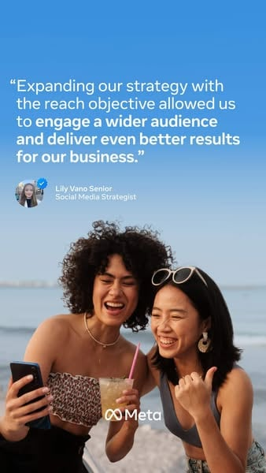
**Why swiped:** Feature-specific testimonial: the quote names the exact product feature ("reach objective") instead of generic praise, and borrows platform-native authority via a verified checkmark. · **Format:** 9:16, lifestyle / testimonial
**Layout:** top ~45% = bold white quote on solid blue (`#1877F2`), then a small circular author avatar with blue verified badge + name/title. Bottom ~55% = warm beach photo of two women laughing. Meta logo bottom-center. Focal point = the white quote.
**Copy (verbatim):** "Expanding our strategy with the reach objective allowed us to engage a wider audience and deliver even better results for our business." — Lily Vano Senior, Social Media Strategist — no CTA on-creative.
**Visual DNA:** Facebook-blue bg `#1877F2` · white text · warm beach accent `#D9A05B`. Bold-to-regular sans, mixed case. Register: premium-editorial, aspirational.
**Levers:** feature-specific social proof ("highlights 'the reach objective' rather than generic success") · native authority cue (blue verified checkmark) · aspirational-lifestyle emotional payoff (beach = the "better results").
**Weaknesses / trust flags:** mild — "Lily Vano Senior, Social Media Strategist" is an **unverifiable persona (no company named); the verified badge is a design element, not proof.** Steal the *structure* (name the feature in the quote), not the implied endorsement. No CTA.
**So What for Grifon:** CMO testimonial rule — the quote must name the specific mechanism the customer used ("the [feature] let us [specific outcome]"), not "great results." Directly portable to real Grifon customer quotes.
**Patterns:** corroborates S16 (verified-badge credibility cue), S2 (named strategist persona), S21 (native verified-badge UI); new candidate none; contradicts none.

### 2026-07-12 — E55 Meta for Business "Drive sales directly to your online store." (fb-ad-library, B2B / social-ads platform)
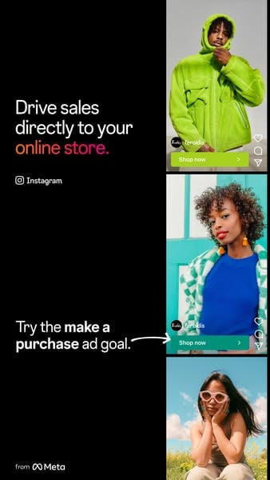
**Why swiped:** Split-screen "text-panel + stacked native mockups" layout that shows an SMB advertiser the exact end-result of an ad goal, with a hand-drawn arrow doing the visual pointing. · **Format:** 9:16, product-hero
**Layout:** left half = white headline on solid black (`#000000`) with a hand-drawn arrow; right half = vertical stack of 3 colorful Instagram ad mockups each with a green "Shop now" CTA bar. Focal point = the middle mockup's "Shop now" button the arrow points at. Meta/Instagram branding bottom-left.
**Copy (verbatim):** "Drive sales directly to your online store." / "Try the **make a purchase** ad goal." — CTA "Shop now" (green bar `#009B74`/`#88D41E`).
**Visual DNA:** left bg `#000000` · white primary text · coral gradient on "online store." `#FF4E50` · green CTA bars. Bold-to-regular sans, mixed case. Register: premium-editorial, high-contrast color-blocking.
**Levers:** S20 product-UI-as-hero (Instagram feed mockups with "Shop now" buttons) · S21 native-format camouflage (native like/comment icons + CTA bars) · directional cueing (hand-drawn arrow from copy → the CTA).
**Weaknesses / trust flags:** none. Minor: split-screen divides attention between copy and mockups.
**So What for Grifon:** port the "show the actual generated ad inside a native feed mockup, with an arrow to the CTA" device to sell Grifon's own output — a demo-the-result frame that suits a tool whose deliverable IS the ad → feeds GP-5.
**Patterns:** corroborates S20 (real IG interface mockups as the primary creative), S21 (native chrome to camouflage the mockup); new candidate none; contradicts none.

### 2026-07-12 — E54 OpenAI "All your tasks done in one place" (fb-ad-library, AI / consumer + enterprise AI assistant)
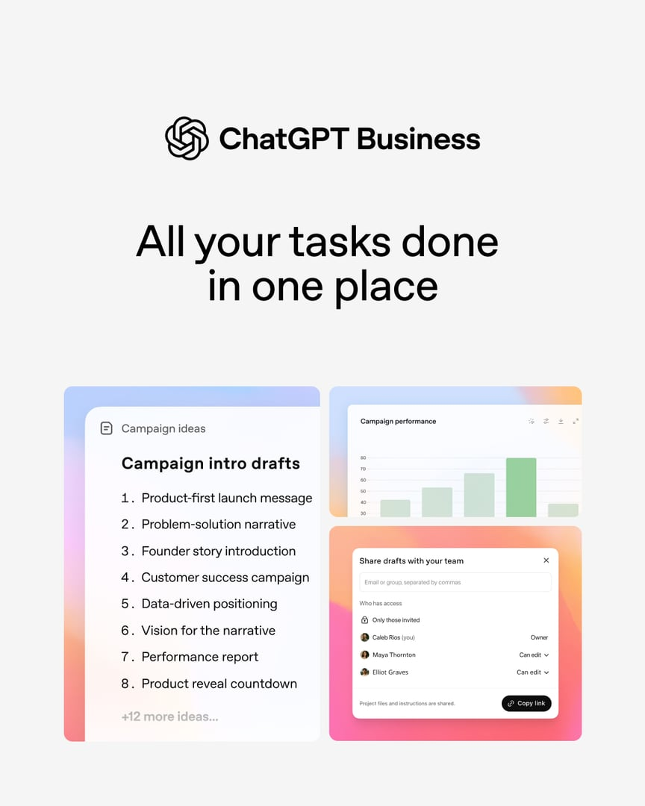
**Why swiped:** Pure product-UI collage — a flat-white board of three overlapping ChatGPT Business interface cards (task list, performance chart, team-share modal) that argues "one place for everything" by simply showing everything at once. · **Format:** 4:5, product-UI-as-hero
**Layout:** centered ChatGPT Business lockup → centered bold headline "All your tasks done in one place" → three overlapping pastel-bordered UI cards: left "Campaign ideas" numbered 1–8 list + "+12 more ideas…" (focal), top-right "Campaign performance" bar chart, bottom-right "Share drafts with your team" access modal ending in a black "Copy link" pill.
**Copy (verbatim):** "All your tasks done in one place" — card list "1. Product-first launch message … 8. Product reveal countdown / +12 more ideas…"; in-mockup CTA "Copy link".
**Visual DNA:** off-white bg `#F9F9F9` · black text · chart green `#82C99B` · peach `#FF9E79` + lavender + pink card-border gradients. Soehne/Helvetica medium-bold. Register: flat-graphic / clean product-UI (Gemini mis-tagged "premium-editorial" — corrected).
**Levers:** S20 product-UI-as-hero (stylized interface mockups carry the entire ad) · S4 offer/capability-stack (numbered 1–8 list + "+12 more ideas…" signals high-volume output) · enterprise-collaboration proof ("Share drafts with your team" modal shows multi-user).
**Weaknesses / trust flags:** no headline-level clickable CTA (only the in-mockup "Copy link"). None fabricated — the chart and roster names are illustrative UI, not claimed real customers.
**So What for Grifon:** Image Ads Gen "flat-white product-UI collage" — 2–3 overlapping interface cards on negative space with a benefit headline; pastel gradient card borders add life without imagery → feeds GP-5, and corroborates the GP-1 offer-stack family.
**Patterns:** corroborates S20 (relies entirely on stylized product UI), S4 (offer/task-stack checklist — the numbered 1–8 list), S15 ("+12 more ideas…" volume proof); new candidate none; contradicts none.

### 2026-07-12 — E53 OpenAI "With ChatGPT Business, we can now create things we were never able to before." (fb-ad-library, AI / consumer + enterprise AI assistant)
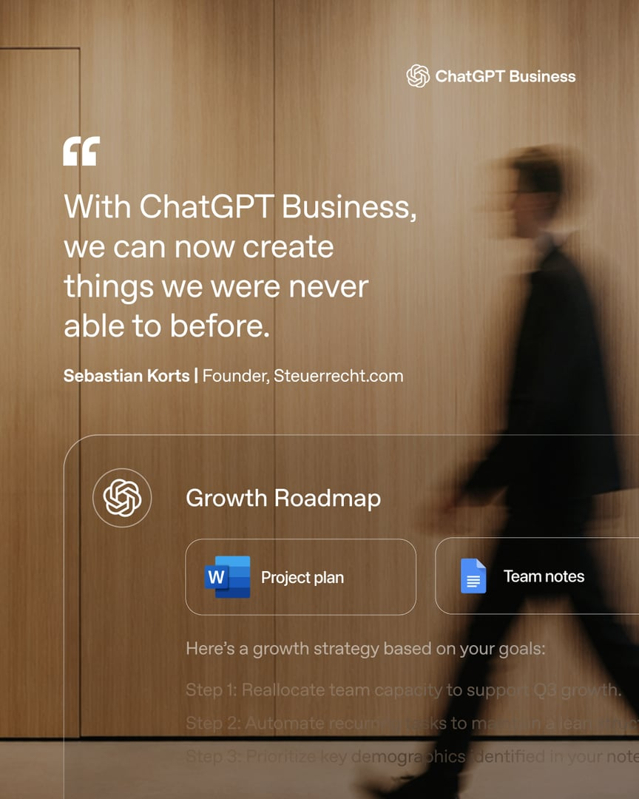
**Why swiped:** The SAME Sebastian Korts testimonial as E51, re-skinned into a premium-editorial 4:5 — warm wood paneling, a motion-blurred exec, and a glassmorphic "Growth Roadmap" UI card. Proof of a deliberate register A/B on identical social-proof copy. · **Format:** 4:5, authority-portrait + product-UI
**Layout:** ChatGPT Business logo top-right → oversized white quote mark → 4-line white testimonial (focal, left) → "Sebastian Korts | Founder, Steuerrecht.com" attribution → glassmorphic UI card bottom ("Growth Roadmap" + Word/Docs tiles + faded Step 1–3 strategy text); motion-blurred businessman anchors the right third.
**Copy (verbatim):** "With ChatGPT Business, we can now create things we were never able to before." — "Sebastian Korts | Founder, Steuerrecht.com"; UI card "Growth Roadmap" / "Step 1: Reallocate team capacity to support Q3 growth…" — no CTA.
**Visual DNA:** warm wood bg `#A17E5A` · white text+UI borders · suit near-black charcoal (Gemini mis-read `#1B365D` navy — corrected); glassmorphic frosted UI card. Soehne/Helvetica, medium-bold. Register: premium-editorial.
**Levers:** S16/S2 borrowed authority / social proof (named founder + company) · S20 product-UI-as-hero ("Growth Roadmap" card visualizes concrete AI output) · premium styling elevates perceived value.
**Weaknesses / trust flags:** motion blur may read too abstract; bottom UI step-text intentionally cut off (implies "more inside"). None fabricated — real attributed founder; Word/Docs icons imply plausible integrations, not a fabricated claim.
**So What for Grifon:** Image Ads Gen "premium-editorial testimonial + glassmorphic output card" — pair a named-customer quote with a frosted UI card that SHOWS the AI deliverable. Corroborates the GP-1 SaaS Offer/Upsell family and, with E51, gives a shippable S18 register A/B → feeds GP-5.
**Patterns:** corroborates S16/S2 (named founder authority), S20 (mock UI showing the product generating business docs), S18 (premium-editorial pole — the E51↔E53 pair IS the axis), S15 (Step 1/2/3 stat-stack); new candidate — "glassmorphic UI-over-lifestyle overlay"; contradicts none.

### 2026-07-12 — E52 OpenAI "आज ChatGPT Business आज़माएं" (fb-ad-library, AI / consumer + enterprise AI assistant)
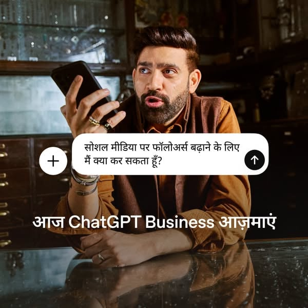
**Why swiped:** Native chat-bubble interrupt — the actual ChatGPT input pill is composited onto a real Indian SMB owner mid-thought, whole ad localized in Hindi. The product UI IS the ad. *(Tripped the GENERIC_OUTPUT gate on a why_it_works count heuristic — kept as the most distinct OpenAI concept; treat as slightly lower confidence.)* · **Format:** 1:1, product-UI-as-hero (lifestyle base)
**Layout:** bearded man in a warm-lit vintage workshop holding a phone, mid-expression → white ChatGPT-style input pill overlaid across his chest (with + and ↑ icons) containing the Hindi prompt (focal point) → bold white Hindi CTA line at the bottom.
**Copy (verbatim):** prompt "सोशल मीडिया पर फॉलोअर्स बढ़ाने के लिए मैं क्या कर सकता हूँ?" ("What can I do to increase my social-media followers?") — CTA "आज ChatGPT Business आज़माएं" ("Try ChatGPT Business today").
**Visual DNA:** white input-pill + CTA text · black pill text/icons · warm brown jacket `#C28E58` + shadow `#1A110B`. Noto Sans Devanagari. Register: native-lifestyle / polished-UGC (Gemini mis-tagged "premium-editorial" — corrected).
**Levers:** S20 product-UI-as-hero (white pill mimics the real ChatGPT mobile input bar) · S30 geo-localized master creative (prompt + CTA fully in Hindi) · high-intent relatable query (follower-growth pain point).
**Weaknesses / trust flags:** no distinct clickable button shape (text-only CTA may soften CTR); relies on the "ChatGPT" wordmark alone. None fabricated — the chat bubble is a genuine product-UI representation, not a fake DM.
**So What for Grifon:** "native chat-bubble interrupt" — composite a Grifon prompt pill onto a real-person lifestyle plate + one localized CTA line. Strong master-creative template (one base, many localized captions) → feeds GP-5, pairs with S30.
**Patterns:** corroborates S20 (real ChatGPT input bar as the central hook), S30 (Hindi-localized master creative), S21 (native-format camouflage — mimics an in-app moment); new candidate none; contradicts none.

### 2026-07-12 — E51 OpenAI "Mit ChatGPT Business können wir heute Dinge umsetzen, die bisher für uns nicht möglich waren." (fb-ad-library, AI / consumer + enterprise AI assistant)
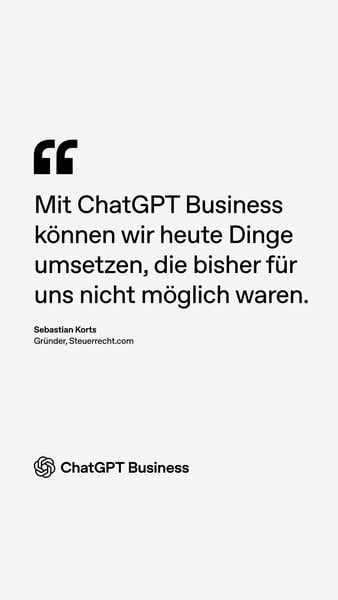
**Why swiped:** Enterprise brand runs a pure text-only anti-design testimonial as a scroll-stopper — proof that a big AI player leans on editorial minimalism, not spectacle. · **Format:** 9:16 story, text-only-callout
**Layout:** top→bottom — oversized black quotation mark → bold 4-line German testimonial (focal point) → tiny author attribution → ChatGPT Business logo lockup bottom-left; extreme off-white negative space.
**Copy (verbatim):** "Mit ChatGPT Business können wir heute Dinge umsetzen, die bisher für uns nicht möglich waren." — "Sebastian Korts / Gründer, Steuerrecht.com"; no CTA button.
**Visual DNA:** bg `#F9F9F9` · text+logo `#000000` (2-color only). Söhne-style grotesk, bold quote vs light metadata. Register: minimal-anti-design.
**Levers:** social proof / testimonial (named founder) · authority bias ("Gründer, Steuerrecht.com") · aspirational outcome hook ("…die bisher für uns nicht möglich waren" = promises net-new capability).
**Weaknesses / trust flags:** no CTA / next step; extreme plainness risks being scrolled past. None fabricated — testimonial attributed to a real named founder + company.
**So What for Grifon:** CMO playbook — a 2-color, image-free testimonial card is a cheap, high-trust B2B format Grifon SMBs can run without design budget. Weak Image Ads Gen template alone (needs the premium sibling E53); together they run the S18 register axis.
**Patterns:** corroborates S9 (flat solid bg, editorial weight of the quote), S2/S16 (borrowed authority of a niche-domain founder); new candidate — "localized minimalist testimonial template" (same quote re-skinned per region — see E53 pair); contradicts none.

### 2026-07-12 — E50 Kylie Skin "LIP BUTTER" × SELF award seal (fb-ad-library, DTC beauty / cosmetics)
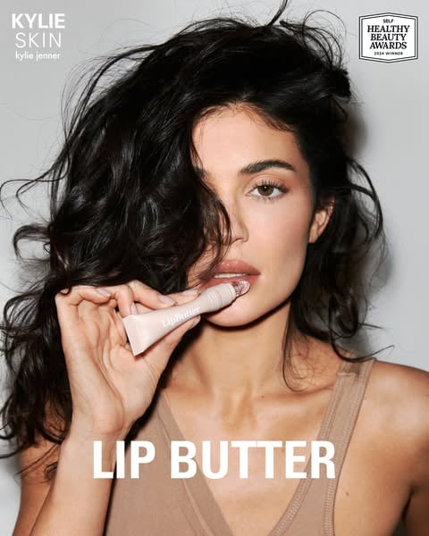
**Why swiped:** AD FILES stash batch 2026-07-12 — Meta Ad Library pull; Downloads folder dies on reboot so ingest now. · **Format:** 4:5 (+9:16 crop variants), authority-portrait product-in-use.
**Layout:** light-gray studio; "KYLIE SKIN kylie jenner" logo top-left; black-and-white "SELF HEALTHY BEAUTY AWARDS 2024 WINNER" seal top-right; Kylie center applying the pale-pink LipButter tube to her lips; giant white caps "LIP BUTTER" across the bottom third over her taupe tank.
**Copy (verbatim):** "LIP BUTTER" — no CTA.
**Visual DNA:** `#D9D9D9` bg, `#F3D3D3` product pink, `#9E8575` taupe, white caps; premium-editorial (S18).
**Levers:** borrowed authority DOUBLED — celebrity founder using the product (S16/S2) + an institutional third-party award seal in the opposite corner (S16's new register: fame + independent validation in one frame).
**Weaknesses / trust flags:** no CTA, no benefit line — pure brand play a cold audience can't act on; the award is real, nothing fabricated.
**So What for Grifon:** the corner award-seal is the most portable honest-proof unit in the batch — Grifon's analog is a REAL badge (press logo, "PayMongo-verified", "trusted by N PH businesses") in the same top-corner slot of GP-4 creatives.
**Patterns:** corroborates S16 (award-badge variant), S2, S18, S19; new candidate none; contradicts none.

### 2026-07-12 — E49 Kylie Cosmetics "SKIN TINT BLURRING ELIXIR" hands-framed portrait (fb-ad-library, DTC beauty / cosmetics)
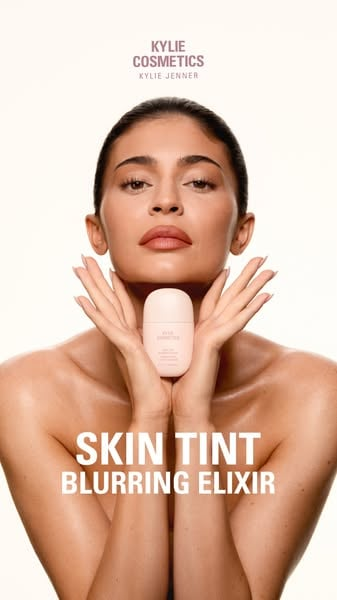
**Why swiped:** AD FILES stash batch 2026-07-12 — Meta Ad Library pull; Downloads folder dies on reboot so ingest now. · **Format:** 9:16 (+4:5 crop), authority-portrait.
**Layout:** off-white studio; "KYLIE COSMETICS / KYLIE JENNER" logo top-center; Kylie's face dead-center, both hands fanned symmetrically to frame her chin, the egg-shaped pink bottle held directly beneath it; bold white caps product name across the chest in the bottom third.
**Copy (verbatim):** "SKIN TINT BLURRING ELIXIR" — no CTA.
**Visual DNA:** `#FAF6F0` bg, `#FCE4D8` product pink, white caps on skin tones; symmetrical, high negative space; premium-editorial (S18).
**Levers:** founder-as-model authority (S2/S16 — her *own* complexion is the product claim) + symmetric hands-frame composition that funnels the eye face → product → product name.
**Campaign beat (folder Kylie Cosmetics_2087290775545988):** shade-trio still — three identical bottles, three spout drips (fair / tan / deep), bilingual EN/FR label, same headline — the shade RANGE as proof (inclusivity as a visual argument). Skipped as a separate entry; same campaign.
**Weaknesses / trust flags:** no CTA, no USP beyond name + face; none fabricated.
**So What for Grifon:** "human frames the product" is a ready GP-4/avatar-hero recipe; the trio beat's variant-range-as-proof ports as "3 output styles from one brief" in a single frame.
**Patterns:** corroborates S2, S16, S18, S19; new candidate: shade-range-as-proof (watch); contradicts none.

### 2026-07-12 — E48 Kylie Cosmetics "WATERMELON LIP BUTTER" macro squeeze (fb-ad-library, DTC beauty / cosmetics)
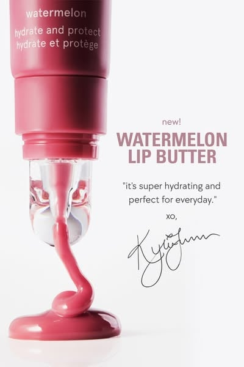
**Why swiped:** AD FILES stash batch 2026-07-12 — Meta Ad Library pull; Downloads folder dies on reboot so ingest now. · **Format:** 4:5-class feed (+9:16 variant), product-hero split.
**Layout:** vertical split — left half is a macro shot of the dusty-pink tube upside down, a thick glossy ribbon of product squeezing from the clear applicator and pooling at the bottom edge; right half is clean white space with "new!", the dusty-rose caps headline, a quote, and "xo," + handwritten Kylie Jenner signature.
**Copy (verbatim):** "new! WATERMELON LIP BUTTER" — ""it's super hydrating and perfect for everyday." — xo, [signature]" — tube label bilingual "hydrate and protect / hydrate et protège".
**Visual DNA:** `#FAF9FA` bg, `#D06A7D` product pink, `#A77989` dusty-rose headline; premium-editorial (S18).
**Levers:** texture-macro sensory hero (the squeeze IS the hydration claim — show, don't say) + founder-quote + signature endorsement stack (reads as a friend's tip, not ad copy).
**Campaign beats (2 folders, same lip-essentials wave, localized):** FR "nouveauté ! LES ESSENTIELS LÈVRES HYDRATANTS" (coconut-water lip stain submerged among water bubbles, French quote + same signature) and IT "novità! ESSENZIALI LABBRA IDRATANTI" (Kylie under a water stream holding the stain; her IT quote says "le mie due nuove formule" — the campaign covers both new lip products). One master system, three languages.
**Weaknesses / trust flags:** no CTA; endorsement is real (her brand) — none fabricated.
**So What for Grifon:** the stash's first physical-product sensory play — Grifon's port is the crisp UI-detail macro (a storyboard card mid-render) as texture. The EN/FR/IT wave is the bigger steal: one master creative, per-market language swap — near-free EN/Taglish variants via `captureToPng`.
**Patterns:** corroborates S16, S18; new candidates S29 (signature stack), S30 (geo-localized master), S31 (texture-macro hero); contradicts none.

### 2026-07-12 — E47 Kylie Cosmetics "PLUMP PREP, BRIGHT FINISH" founder-quote portrait (fb-ad-library, DTC beauty / cosmetics)
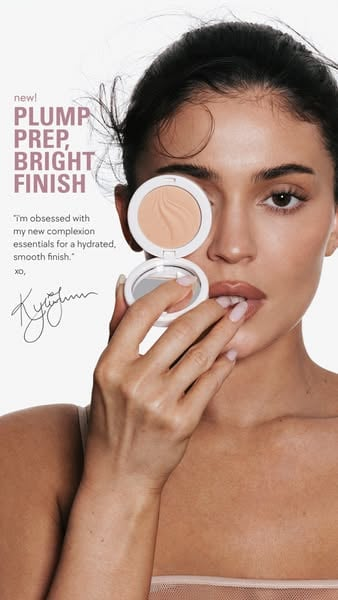
**Why swiped:** AD FILES stash batch 2026-07-12 — Meta Ad Library pull; Downloads folder dies on reboot so ingest now. · **Format:** 9:16 (+1:1 variant), authority-portrait.
**Layout:** asymmetric split — left column text stack ("new!", dusty-rose caps headline, first-person quote, "xo," + handwritten signature); right two-thirds a close-up of Kylie looking to camera, holding the open white compact directly over her right eye.
**Copy (verbatim):** "new! PLUMP PREP, BRIGHT FINISH" — ""i'm obsessed with my new complexion essentials for a hydrated, smooth finish." — xo, [signature]"
**Visual DNA:** `#F6F5F5` bg, `#A37A82` dusty-rose headline, `#E2C4B5` skin/product tones; premium-editorial (S18).
**Levers:** founder-portrait authority (S2/S16) + product-as-monocle framing (compact held over the eye fuses face and product into one focal point) + S29 quote-signature stack.
**Campaign beats (2 folders, same Complexion Essentials launch):** EN "new! COMPLEXION ESSENTIALS" product still-life (brush + compact + Supple Glaze bottles with mirror reflections, benefit body copy) and its Italian twin "novità! MUST-HAVE PER IL VISO" — pixel-identical layout and photography, copy translated (S30 caught red-handed). Skipped as separate entries; same campaign.
**Weaknesses / trust flags:** brand name never spelled out beyond the signature; none fabricated.
**So What for Grifon:** the launch architecture is the steal — every launch ships a founder-portrait creative + a product still-life creative, each localized per market. Grifon: one avatar-hero + one UI-shot per feature launch, EN + Taglish. Honest version of the quote device: real client quote + real signature.
**Patterns:** corroborates S2, S16, S18, S19; new candidates S29, S30; contradicts none.

### 2026-07-12 — E46 Kylie Cosmetics "cosmic kylie jenner intense" monochrome red (fb-ad-library, DTC beauty / cosmetics)
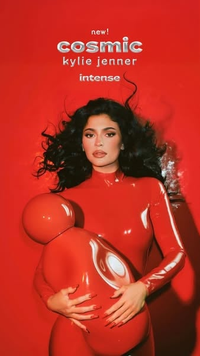
**Why swiped:** AD FILES stash batch 2026-07-12 — Meta Ad Library pull; Downloads folder dies on reboot so ingest now. First beauty/physical-product DTC brand in the file. · **Format:** 9:16 (+1:1 variant), authority-portrait fragrance launch.
**Layout:** solid vibrant-red canvas edge to edge; top-center chrome-silver lowercase "cosmic" over "kylie jenner" and "intense" with a small "new!"; Kylie centered below in a high-gloss red latex bodysuit, cradling an oversized glossy red sculpture of the perfume bottle.
**Copy (verbatim):** "new! cosmic kylie jenner intense" — no CTA.
**Visual DNA:** `#d61c16` monochrome red (background + wardrobe + prop are ONE color), chrome/silver metallic type, white gloss highlights; high-fashion premium-editorial (S18).
**Levers:** total-saturation monochrome scroll-stop (one color, total commitment — the saturation IS the pattern interrupt) + founder-authority portrait (S2's first cross-brand corroboration) + oversized-prop product silhouette for instant shape recall.
**Weaknesses / trust flags:** zero benefit copy, no CTA — pure brand-equity play; none fabricated.
**So What for Grifon:** proof the S2 authority-portrait engine transfers to beauty unchanged — and that the supplement playbook (S8 callouts, S15 stat-stacks) is NOT how Kylie sells: she runs zero stats, pure authority + sensory. The monochrome treatment is the premium sibling of S14's colorway A/B — Grifon's version: an all-gold-everything hero frame for a flagship launch.
**Patterns:** corroborates S2 (cross-brand now), S16, S18, S19; new candidate: monochrome total-saturation (watch under S14); contradicts S15's stat-stack orthodoxy (a winner with zero numbers).

### 2026-07-12 — E45 Cursor "Introducing Grok 4.5" (fb-ad-library, SaaS dev tool / AI code editor)
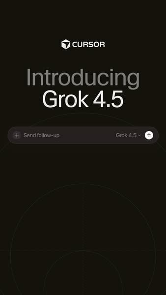
**Why swiped:** AD FILES stash batch 2026-07-12 — Meta Ad Library pull; Downloads folder dies on reboot so ingest now. · **Format:** 9:16 (+1:1 variant), minimal announcement.
**Layout:** near-black canvas; white Cursor logo top-center; centered two-line headline — "Introducing" in muted gray over "Grok 4.5" in white; the REAL prompt-bar UI pill centered below ("+ Send follow-up · Grok 4.5 ∨ · send button"); faint concentric circles radiate from bottom center.
**Copy (verbatim):** "Introducing Grok 4.5" — in-UI "Send follow-up".
**Visual DNA:** `#12100c` bg, white + `#8e8a84` muted text, `#221e1a` UI pill; dark-minimal premium (S18).
**Levers:** external-model-release trend-hijack (S11 — the ad IS the news; xAI's launch becomes Cursor's creative) + product-UI-as-hero (S20 — the model selector showing "Grok 4.5" proves it's live, not promised).
**Weaknesses / trust flags:** reads as an announcement, not an actionable ad; nothing fabricated — the integration is real.
**So What for Grifon:** Cursor turns every frontier-model release into a zero-copy ad: headline = the news, visual = the real picker proving it shipped. Grifon analog: "Kling 3 / [new Gemini] now inside Grifon" with the actual model-picker UI as hero. Announcement-as-ad pairs with E36's partnership-news play.
**Patterns:** corroborates S11, S20, S18, S19; new candidate none; contradicts none.

### 2026-07-12 — E44 Cursor "Meet Composer 2.5." — 3 colorways (fb-ad-library, SaaS dev tool / AI code editor)
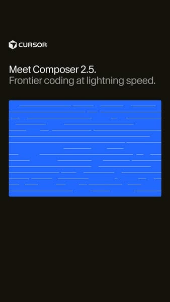
**Why swiped:** AD FILES stash batch 2026-07-12 — Meta Ad Library pull; Downloads folder dies on reboot so ingest now. · **Format:** 9:16 (+1:1 variants), abstract product-hero; ONE concept across 3 stash folders.
**Layout:** dark canvas; logo top-left; left-aligned "Meet Composer 2.5." in white over "Frontier coding at lightning speed." in gray; lower half dominated by a large flat electric-blue block filled with thin horizontal white dashes — a code editor abstracted to iconography.
**Copy (verbatim):** "Meet Composer 2.5." — "Frontier coding at lightning speed."
**Visual DNA:** `#120F0D` bg + `#2B66FF` block + white (primary); colorway variants from sibling folders: cream canvas + orange/gray converging speed-lines (folder 1897…), dark-green canvas + white/teal lines (folder 4482…) — three canvases, one concept.
**Levers:** own-model launch news ("Meet X." framing) + abstracted-UI iconography (code as a clean dash-field — honest as long as it stays schematic, not a fake screenshot) + full-canvas colorway A/B (S14's first SaaS sighting).
**Weaknesses / trust flags:** abstraction may read as decoration to non-devs; no CTA; none fabricated.
**So What for Grifon:** S14 goes cross-niche — the whole-canvas color test is the cheapest variant lever for Grifon's own image ads (Andromeda inventory too, S19). And when the real UI is too dense for an ad, ship the iconic simplification instead of a squint-test screenshot.
**Patterns:** corroborates S14 (cross-niche now), S18, S19; new candidate: abstracted-UI iconography (watch under S20); contradicts none.

### 2026-07-12 — E43 Cursor "Assign Cursor to your Linear issues." (fb-ad-library, SaaS dev tool / AI code editor)
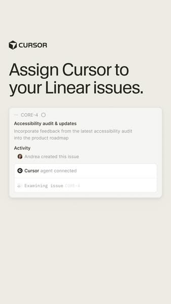
**Why swiped:** AD FILES stash batch 2026-07-12 — Meta Ad Library pull; Downloads folder dies on reboot so ingest now. · **Format:** 9:16 (+1:1 variant), product-UI hero.
**Layout:** warm beige canvas; logo top-left; bold two-line headline; center white rounded card replicating a REAL Linear issue — "CORE-4 · Accessibility audit & updates", body text, Activity feed ("Andrea created this issue", "**Cursor agent connected**", "Examining issue CORE-4" in terminal type); bottom third pure negative space.
**Copy (verbatim):** "Assign Cursor to your Linear issues." — no CTA.
**Visual DNA:** `#F2EFE9` beige, `#1A1A1A` text, white card; premium-editorial restraint (S18).
**Levers:** tool-stack audience callout (S8 with the buyer's STACK as the variable instead of niche/demographic — only Linear users self-identify, the integration IS the targeting) + product-UI-as-hero (S20 — the agent status line is the feature demo).
**Weaknesses / trust flags:** meaningless to non-Linear users (by design); no CTA; mock issue content is plausibly realistic — none fabricated.
**So What for Grifon:** the S8 spin for SaaS: swap "[PH niche] doing [revenue]" for "[tool] users" — "Grifon posts straight to your Meta Ads Manager." Integration ads double as audience filters; cheapest qualified-reach play in the batch. GP-2 variable family.
**Patterns:** corroborates S8 (cross-niche, tool-stack variant), S20, S18, S19; new candidate none; contradicts none.

### 2026-07-12 — E42 Cursor "Review demos, not diffs." + mobile-agent wave (fb-ad-library, SaaS dev tool / AI code editor)
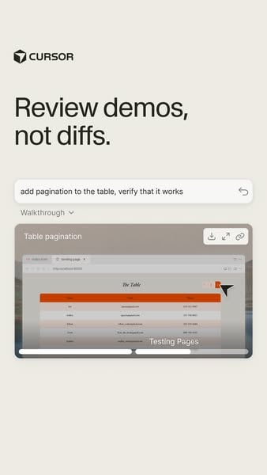
**Why swiped:** AD FILES stash batch 2026-07-12 — Meta Ad Library pull; Downloads folder dies on reboot so ingest now. · **Format:** 9:16 (+1:1 variant), product-UI hero.
**Layout:** warm beige canvas; logo top-left; bold two-line left-aligned headline; prompt pill center ("add pagination to the table, verify that it works"); "Walkthrough ∨" label over a demo-player card ("Table pagination" — browser mockup with an orange-headed data table + video progress bar).
**Copy (verbatim):** "Review demos, not diffs." — prompt "add pagination to the table, verify that it works" — no CTA.
**Visual DNA:** `#F3F0EA` beige, `#121212` text, Cursor-orange accent (~`#E05B35`; Gemini read `#D35400` — my eyeball puts it at the brand orange), white cards; premium-editorial (S18).
**Levers:** format-enemy positioning (S24 ported to SaaS in four words — the enemy is the diff-review ritual, not a competitor) + product-UI-as-hero (S20 — the walkthrough player IS the promise: watch the demo, skip the code).
**Campaign beats (2 folders, same mobile-agent wave, skipped as separate entries):** "Watch your agent's work" (dark 9:16, iPhone showing the agent's finished walkthrough + its written verification note) and "Ship on the go" (dark teal, iPhone with "Ready to Merge · All Required Checks Passed · Squash & Merge" — shipping from your phone). Both S20 heroes.
**Weaknesses / trust flags:** no CTA; the prompt/demo content is realistic — none fabricated.
**So What for Grifon:** the tightest S24 port in the file: "Review ads, not briefs." / "Approve storyboards, not email threads." Three-to-four-word enemy-naming + the actual product screen as proof — headline mechanic AND visual recipe in one ad. GP-1/GP-2 copy rotation.
**Patterns:** corroborates S24 (cross-niche now), S20, S18, S19; new candidate none; contradicts none.

### 2026-07-12 — E41 Cursor "Point and draw to fix" (fb-ad-library, SaaS dev tool / AI code editor)
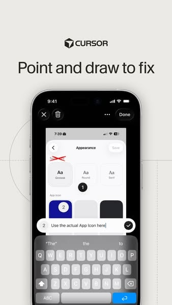
**Why swiped:** AD FILES stash batch 2026-07-12 — Meta Ad Library pull; Downloads folder dies on reboot so ingest now. · **Format:** 9:16 (+1:1 variant), product-UI hero.
**Layout:** light warm-gray canvas with faint blueprint gridlines; logo top-center; bold centered headline; centered iPhone mockup of the annotate flow — red scribble crossing out a "Typo", numbered badges 1/2 pinned to UI elements, live input "Use the actual App Icon here" over an active iOS keyboard.
**Copy (verbatim):** "Point and draw to fix" — no CTA.
**Visual DNA:** `#EBEAE6` bg, black phone frame/text, `#FF3B30` annotation red, `#007AFF` iOS blue; premium-minimal (S18).
**Levers:** product-UI-as-hero (S20 — the feature demo IS the creative) + five-word action headline (verb-verb-outcome, zero jargon). *Corrected a Gemini misread: it filed the iOS-markup look under S21 camouflage — this is a straight feature demo of Cursor's annotate flow, not an ad dressed as organic UI; no S21 count.*
**Weaknesses / trust flags:** no CTA; assumes the viewer recognizes the annotate workflow; none fabricated.
**So What for Grifon:** the demo payload is the steal — the annotation says a REAL thing ("Use the actual App Icon here"), which is what makes the demo credible. Grifon hero screenshots must carry real campaign content, never lorem-ipsum. Direct S20 port for a One-Shot composer hero.
**Patterns:** corroborates S20, S18, S19; new candidate none; contradicts none.

### 2026-07-12 — E40 IM8 "What's Included In Your FREE I·M·8 Kit*" (fb-ad-library, premium DTC supplement)
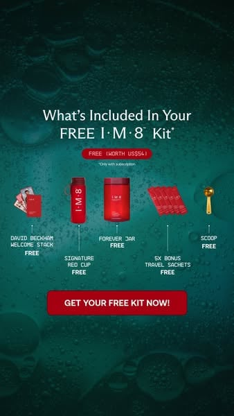
**Why swiped:** AD FILES stash batch 2026-07-12 — Meta Ad Library pull; Downloads folder dies on reboot so ingest now. · **Format:** 9:16 (+1:1 variant), offer-stack breakdown.
**Layout:** deep-teal macro-bubbles bg; serif headline center; red "FREE (WORTH US$54)" lozenge + tiny "*Only with subscription"; horizontal lineup of 5 kit items each labeled FREE (David Beckham welcome stack / signature red cup / forever jar / 5x bonus travel sachets / scoop); red CTA bar bottom.
**Copy (verbatim):** "What's Included In Your FREE I·M·8™ Kit*" — CTA "GET YOUR FREE KIT NOW!"
**Visual DNA:** `#002B24` teal bg, `#C8102E` red accent, `#D4AF37` gold scoop, white text; serif + engraving-style item labels; premium-editorial (S18 premium lane).
**Levers:** value-first lead magnet (S10, the "what's inside" spec sheet of E12's free-kit offer) + itemized offer-stack with per-item FREE tags (S4 — first non-Gadzhi corroboration) + borrowed authority baked into the offer itself ("DAVID BECKHAM WELCOME STACK", S16).
**Weaknesses / trust flags:** the FREE is conditional on subscription, disclosed only in tiny low-contrast print — micro-disclaimer anchoring skirts the trust line. Grifon version states the condition in readable type.
**So What for Grifon:** the E12→E40 pair shows the free-kit offer run as TWO creatives — aspiration (gift box) then specification (itemized contents + $ value). "What's inside your Free plan" itemization ports directly to the Free→Starter ladder. GP-1 #3 / GP-4.
**Patterns:** corroborates S10, S4 (cross-brand now), S16, S18; new candidate none; contradicts none.

### 2026-07-12 — E39 IM8 "You've Been Burned by Joint Supplements Before." (fb-ad-library, premium DTC supplement)
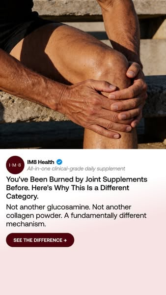
**Why swiped:** AD FILES stash batch 2026-07-12 — Meta Ad Library pull; Downloads folder dies on reboot so ingest now. · **Format:** 9:16 (+1:1 variant), lifestyle + post-card.
**Layout:** top ~55% sunlit photo of weathered hands gripping a knee (pain made visible, no face); bottom blush card styled as a social post — "IM8 Health ✓ *All-in-one clinical-grade daily supplement*" profile header, bold headline, body, dark-crimson CTA pill.
**Copy (verbatim):** "You've Been Burned by Joint Supplements Before. Here's Why This Is a Different Category." — "Not another glucosamine. Not another collagen powder. A fundamentally different mechanism." — CTA "SEE THE DIFFERENCE →"
**Visual DNA:** `#F9EAE9` blush card, `#4E0510` crimson CTA, warm skin-tone photography; premium-editorial (S18).
**Levers:** skepticism-first hook (validate the buyer's past failures BEFORE pitching — the jaded-buyer opener) + category-exit positioning ("not another X, not another Y" villainizes the incumbent ingredients, S24) + verified-post header camouflage (S21, the honest kind — it's their real handle). *Added S21 myself; Gemini's JSON missed the post-header device.*
**Weaknesses / trust flags:** never shows the product or names the mechanism — pure curiosity gap; none fabricated.
**Segment note (2nd creative, same joint segment):** "Daily MSM + CoQ10 — joints intact. 1,500mg MSM + 100mg CoQ10 in one daily ritual" (folder 2090…) — dose-stat proof (S15) + x-ray runner visual. Two registers on one segment, the E25/E26 per-segment-system play again.
**So What for Grifon:** Bryan HAS been burned ("just another AI tool that lies") — "You've been burned by AI marketing tools before. Here's why this is a different category." is a near-verbatim port. The skeptic-first opener belongs in the CMO hook rotation. GP-4.
**Patterns:** corroborates S24, S21, S18, S15 (dose-stat variant); new candidate: skepticism-first hook (watch); contradicts none.

### 2026-07-12 — E38 IM8 "One Daily Ritual" — IM8 vs Old Routine (fb-ad-library, premium DTC supplement)
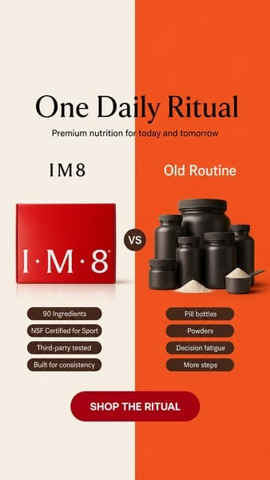
**Why swiped:** AD FILES stash batch 2026-07-12 — Meta Ad Library pull; Downloads folder dies on reboot so ingest now. · **Format:** 9:16 (+1:1 variant), old-way/new-way split.
**Layout:** serif headline + subhead top; canvas splits cream (left, IM8 red box) vs loud orange (right, pile of black pill bottles + powder scoop) with a "VS" seal; four benefit chips per side (90 Ingredients / NSF Certified for Sport / Third-party tested / Built for consistency VS Pill bottles / Powders / Decision fatigue / More steps); crimson CTA pill bottom.
**Copy (verbatim):** "One Daily Ritual" — "Premium nutrition for today and tomorrow" — "IM8 vs Old Routine" — CTA "SHOP THE RITUAL"
**Visual DNA:** `#F6F3EB` cream vs `#F35A22` orange split, `#9E0B14` crimson, `#2C1A11` chips; serif headline + sans chips; premium side literally styled premium, enemy side loud (S18 axis used INSIDE one ad).
**Levers:** format-enemy positioning (the enemy is the multi-bottle ritual — "Decision fatigue. More steps.", S24) + stat chip ("90 Ingredients", S15) + certification proof (NSF, third-party). *Corrected a Gemini misread: its `tier-compare` format guess suggests S3 — this is old-way-vs-new-way, not a pricing-tier compare (same misread it made on E28).*
**Weaknesses / trust flags:** none noted.
**So What for Grifon:** the cleanest us-vs-them template in the file — "One Dashboard" vs "Old Routine: 5 freelancers / 3 tools / brief ping-pong / invoice chaos." Also steal the trick of styling YOUR side premium and the enemy side loud. GP-3/GP-1.
**Patterns:** corroborates S24 (cross-brand now), S15, S18; new candidate: visual-friction comparison (clutter vs one box); contradicts none.

### 2026-07-12 — E37 IM8 "ON A GLP-1? KEEP NUTRITION SIMPLE." (fb-ad-library, premium DTC supplement)
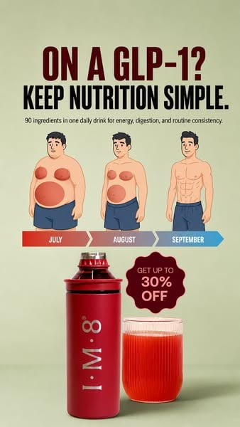
**Why swiped:** AD FILES stash batch 2026-07-12 — Meta Ad Library pull; Downloads folder dies on reboot so ingest now. · **Format:** 9:16 (+1:1 variant), flat-graphic timeline.
**Layout:** sage-green flat canvas with ghosted watermark text; two-line condensed headline top; illustrated 3-stage male transformation center over a JULY→AUGUST→SEPTEMBER arrow timeline; bottle + glass of red drink bottom with "GET UP TO 30% OFF" scalloped roundel.
**Copy (verbatim):** "ON A GLP-1? KEEP NUTRITION SIMPLE." — "90 ingredients in one daily drink for energy, digestion, and routine consistency." — roundel "GET UP TO 30% OFF"
**Visual DNA:** `#D1D9C4` sage bg, `#5C060E` dark-red type, `#A61C2E` product, blue timeline accent; Impact/DIN condensed caps — **IM8 goes flat-graphic (S18 flat lane) for this segment**, mirroring E9 where Grüns went premium: both brands cross the style axis per segment.
**Levers:** audience callout ("ON A GLP-1?", S8) + GLP-1 trend-hijack (S11) + stat proof ("90 ingredients", S15) + discount roundel (Grüns-style component in an IM8 ad).
**Weaknesses / trust flags:** the July→September obese-to-shredded illustration implies a biologically implausible 2-month transformation — even drawn, it's an implied-claim gray zone. Grifon never implies fake timelines.
**So What for Grifon:** the axis-crossing is the strategic steal: match REGISTER to segment, not to brand dogma — loud flat for deal-seeker segments, premium for status segments. GP-3.
**Patterns:** corroborates S8, S11, S15, S18 (axis crossover); new candidate S28 (illustrated transformation timeline, with E31 variants); contradicts none.

### 2026-07-12 — E36 IM8 "IT'S OFFICIAL. THE SQUAD'S DRINK IS IM8." — Inter Miami announcement system (fb-ad-library, premium DTC supplement)
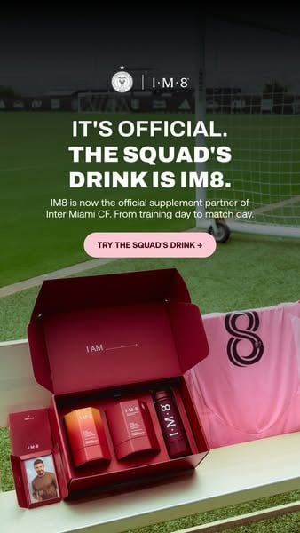
**Why swiped:** AD FILES stash batch 2026-07-12 — Meta Ad Library pull; Downloads folder dies on reboot so ingest now. · **Format:** 9:16 (+1:1 variant), lifestyle announcement.
**Layout:** goalpost/pitch scene; IM8 × Inter Miami co-crest lockup top; caps headline; partnership subhead; pink CTA pill; open red kit box bottom (products + a David Beckham card visible) draped with the pink Inter Miami jersey.
**Copy (verbatim):** "IT'S OFFICIAL. THE SQUAD'S DRINK IS IM8." — "IM8 is now the official supplement partner of Inter Miami CF. From training day to match day." — CTA "TRY THE SQUAD'S DRINK →"
**Visual DNA:** `#4C7031` pitch green, `#5B0612` crimson, `#F4B5C8` Miami-pink CTA (the partner's color IS the CTA color), white caps; premium-editorial (S18).
**Levers:** borrowed authority as NEWS (announcement hook makes the partnership itself the creative, S16). This is E15's concept expanded into a full campaign BEAT — near-match noted, different ad.
**Campaign beats (3 more folders, same announcement wave):** "NOW POWERING INTER MIAMI CF — AND SUNDAY FC." (products on red box, "Replaces the cabinet — now in the group chat."); "INTER MIAMI CF CHOSE IM8. HERE'S WHY →" (five-player squad photo incl. Messi on flat pink — the roster as the whole creative); "WHAT FUELS GIANNIS NOW FUELS THE ENTIRE INTER MIAMI ROSTER." (celebration photo — chains one endorsement into the next).
**Weaknesses / trust flags:** none — the partnership is real.
**So What for Grifon:** an announcement WAVE, not one ad — official-lockup + "it's official" + "here's why" + endorser-chaining, each a separate beat. Grifon analog: "It's official: [known PH brand] runs its ads on Grifon." Adopt the partner-color CTA trick. GP-4.
**Patterns:** corroborates S16, S18, S19 (every beat ships 9:16 + 1:1); new candidate none; contradicts none.

### 2026-07-12 — E35 IM8 × Giannis "GIANNIS COULD AFFORD ANYTHING. HE CHOSE A $2.61/DAY DRINK." (fb-ad-library, premium DTC supplement)
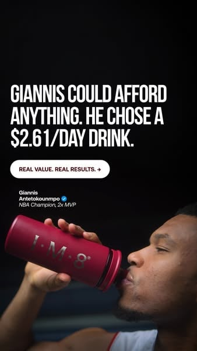
**Why swiped:** AD FILES stash batch 2026-07-12 — Meta Ad Library pull; Downloads folder dies on reboot so ingest now. · **Format:** 9:16 (+ court-floor product layout variant, same headline), authority-portrait.
**Layout:** black canvas; caps headline top; white "REAL VALUE. REAL RESULTS. →" pill; "Giannis Antetokounmpo ✓ *NBA Champion, 2x MVP*" attribution card; bottom = Giannis drinking from the crimson IM8 bottle (variant: avatar chip + bottle beside basketball on court floor).
**Copy (verbatim):** "GIANNIS COULD AFFORD ANYTHING. HE CHOSE A $2.61/DAY DRINK." — "REAL VALUE. REAL RESULTS. →"
**Visual DNA:** `#000000` bg, white condensed caps (Bebas/DIN class), `#9E1B32` bottle, `#1DA1F2` verified badge; premium-editorial (S18).
**Levers:** wealth-contrast price anchor (a billionaire's *choice* at $2.61/day collapses the "premium = expensive" objection — the strongest single copy idea in the batch) + borrowed authority (S16) + verified-handle attribution card mimicking platform UI (S21 — honest: real partner, real credential).
**Weaknesses / trust flags:** none — price math and endorsement are real.
**So What for Grifon:** "Agencies charge ₱30,000/month. Grifon is ₱XX/day." — anchor against the daily-cost reframe, endorser optional. The credential-line format ("NBA Champion, 2x MVP") ports to client proof ("₱2M in tracked sales"). GP-1 #4 / GP-4.
**Patterns:** corroborates S16, S18, S21; new candidate S27 (wealth-contrast price anchor); contradicts none.

### 2026-07-12 — E34 IM8 × Giannis "90 INGREDIENTS. ONE DAILY DRINK. THAT'S GIANNIS'S STANDARD." (fb-ad-library, premium DTC supplement)
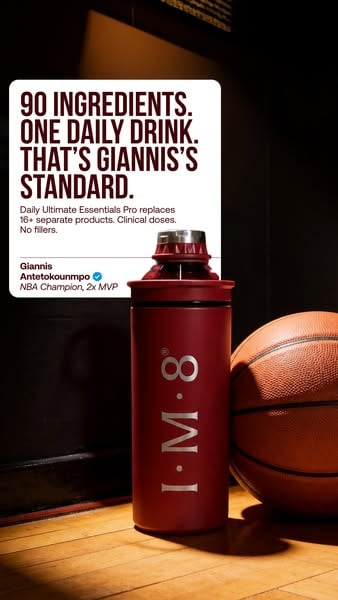
**Why swiped:** AD FILES stash batch 2026-07-12 — Meta Ad Library pull; Downloads folder dies on reboot so ingest now. · **Format:** 9:16 (+bleachers-photo colorway, same headline), product-hero.
**Layout:** dark court-side scene; white card upper-left with caps headline + "replaces 16+ separate products. Clinical doses. No fillers."; "Giannis Antetokounmpo ✓ *NBA Champion, 2x MVP*" attribution card; crimson bottle beside a basketball on hardwood.
**Copy (verbatim):** "90 INGREDIENTS. ONE DAILY DRINK. THAT'S GIANNIS'S STANDARD." — "Daily Ultimate Essentials Pro replaces 16+ separate products. Clinical doses. No fillers." — no on-creative CTA.
**Visual DNA:** `#7A1C1C` crimson, white card on `#111111` bg, basketball orange accent; condensed caps; premium-editorial (S18).
**Levers:** stat-stack proof (90 ingredients / 16+ products / clinical doses, S15) + borrowed authority framed as the athlete's STANDARD (his rigor, not just his face — S16) + consolidation enemy ("replaces 16+ separate products", S24).
**Campaign beats (3 more folders, same Giannis wave):** "82 GAMES. ZERO DAYS OFF FROM NUTRITION." (consistency stat); "MOST SUPPLEMENTS UNDERDOSE. GIANNIS'S DOESN'T." (category-critique, S24); "WOULD A PROFESSIONAL ATHLETE TAKE SOMETHING THAT ISN'T TESTED?" (rhetorical question + NSF certification proof). Every beat carries the same verified attribution card (S21).
**Weaknesses / trust flags:** no on-creative CTA on several beats; nothing fabricated.
**So What for Grifon:** "X's standard" reframes endorsement as due diligence — "would a CFO approve a tool that can't show receipts?" rhetorical-question beat ports directly. Pair with E36: IM8 chains one athlete wave into the next (Giannis → Inter Miami roster). GP-4.
**Patterns:** corroborates S15, S16, S18, S21, S24 (underdose beat); new candidate none; contradicts none.

### 2026-07-12 — E33 IM8 "IF IT DIDN'T WORK, THE SQUAD WOULDN'T TAKE IT." (fb-ad-library, premium DTC supplement)
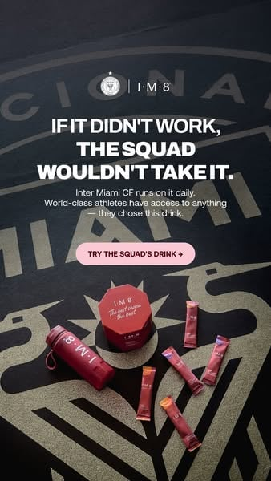
**Why swiped:** AD FILES stash batch 2026-07-12 — Meta Ad Library pull; Downloads folder dies on reboot so ingest now. · **Format:** 9:16 (+1:1 variant), product-hero on crest.
**Layout:** black-and-gold Inter Miami crest floor; co-crest lockup top; three-line caps headline; two-line logic subhead; pink CTA pill; scattered flat-lay of octagonal travel tin + bottle + sachets below.
**Copy (verbatim):** "IF IT DIDN'T WORK, THE SQUAD WOULDN'T TAKE IT." — "Inter Miami CF runs on it daily. World-class athletes have access to anything — they chose this drink." — CTA "TRY THE SQUAD'S DRINK →"
**Visual DNA:** `#1A1A1A` bg + muted-gold crest, `#A62B38` crimson products, `#F9B2C4` pink CTA; premium-editorial (S18).
**Levers:** skeptic-flip syllogism (states the doubter's test and lets the endorsement pass it — "access to anything — they chose this") — the reasoned version of S16, aimed at buyers who distrust paid endorsements.
**Campaign beats (2 more folders, same proof wave):** "Inter Miami's New Drink. **95% Felt More Energy.**" (survey-stat lead + "Try it for up to 90 days, money-back" + "MSM 1,500mg · CoQ10 100mg" — S15 + S1); "The Drink Behind the 90 That Matters Most." (career-length wordplay + "co-founded by Beckham, Clinically Proven").
**Weaknesses / trust flags:** "95% Felt More Energy" cites no source/sample on-creative — usable only with the real study behind it.
**So What for Grifon:** write the skeptic's own logic INTO the ad: "If it made generic ads, [brand] wouldn't run it. They can hire anyone — they use Grifon." Argument-as-headline beats badge-as-headline for jaded buyers. GP-4.
**Patterns:** corroborates S16, S18, S15 + S1 (95%/money-back beat); new candidate: skeptic-flip syllogism (watch, pairs with E39's skepticism-first hook); contradicts none.

### 2026-07-12 — E32 IM8 "The Drink Inter Miami CF Trusts. Now Yours To Try." (fb-ad-library, premium DTC supplement)
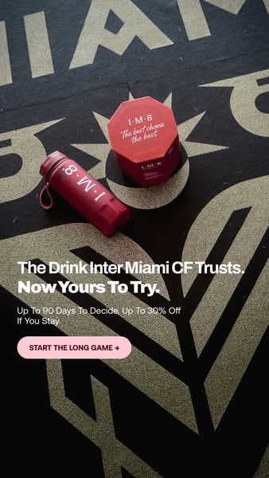
**Why swiped:** AD FILES stash batch 2026-07-12 — Meta Ad Library pull; Downloads folder dies on reboot so ingest now. · **Format:** 9:16 (+1:1 variant), product-hero on crest.
**Layout:** black-and-gold crest floor; overhead shot of crimson bottle + octagonal tin ("The best choose the best" lid); two-line headline lower third — line 2 underlined; trial subhead; pink CTA pill.
**Copy (verbatim):** "The Drink Inter Miami CF Trusts. Now Yours To Try." — "Up To 90 Days To Decide. Up To 30% Off If You Stay." — CTA "START THE LONG GAME →"
**Visual DNA:** `#1A1A1A` bg + muted-gold crest, `#C83239` products, `#F9C2D1` pink CTA, white text; premium-editorial (S18).
**Levers:** "theirs → now yours" accessibility bridge (elite proof, then hands the buyer the same object: "Now Yours To Try" / "Available To You." / "— Now Yours.") + 90-day risk-reversal trial (S1) + retention-framed discount ("30% Off **If You Stay**" — the discount rewards commitment, not desperation).
**Campaign beats (4 more folders, same offer wave):** "Tried by the World's Best. Try It Yourself." (sachet flat-lay, "START YOUR 90 DAYS →"); "Inter Miami's Premium Daily Ritual — Now Yours." (Beckham kit box + jersey, "100+ ingredients in one drink replaces 26 separate supplements"); "Trusted By Inter Miami CF. Available To You." ("ONE DRINK, WHOLE HOUSE →"); "The Squad's Daily Drink. Up to 30% Off." (stadium storefront, subscription discount).
**Weaknesses / trust flags:** none — trial and discount terms are stated plainly.
**So What for Grifon:** the full BOF wave to E36's TOF announcement — same campaign, offer layer. Port: "The ad engine [brand] trusts. Now yours to try. 14 days to decide. 20% off if you stay." The if-you-stay framing is the single best discount line in the file. GP-1 #1 / GP-4.
**Patterns:** corroborates S16, S1, S18, S19; new candidate: "theirs→now-yours" bridge + retention-framed discount (watch under S16/S1); contradicts none.

### 2026-07-12 — E31 IM8 "The bloat dissolving" (fb-ad-library, premium DTC supplement)
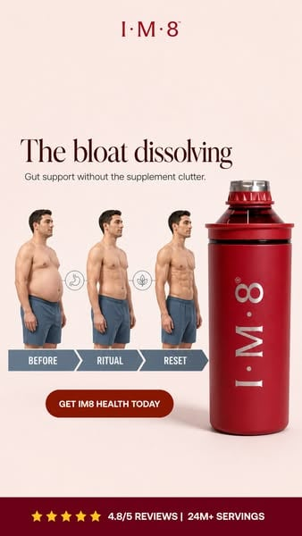
**Why swiped:** AD FILES stash batch 2026-07-12 — Meta Ad Library pull; Downloads folder dies on reboot so ingest now. · **Format:** 9:16 + 1:1, product-hero with transformation strip.
**Layout:** cream canvas; logo top; serif headline + subhead; left = photo 3-stage male torso progression over a slate arrow banner BEFORE → RITUAL → RESET; right = large crimson shaker bottle; crimson CTA pill; crimson footer bar "★★★★★ 4.8/5 REVIEWS | 24M+ SERVINGS".
**Copy (verbatim):** "The bloat dissolving" — "Gut support without the supplement clutter." — CTA "GET IM8 HEALTH TODAY"
**Visual DNA:** `#F9EFEA` cream bg, `#801818` crimson, `#FFC72C` gold stars, slate accents; Playfair-class serif + sans; premium-editorial (S18 premium lane).
**Levers:** 3-stage transformation TIMELINE (BEFORE→RITUAL→RESET names the product as the middle step — process, not miracle) + anti-clutter positioning ("without the supplement clutter", S24) + review-scale footer (4.8/5 | 24M+ servings, S15).
**Weaknesses / trust flags:** transformation imagery (even staged/illustrated) implies a body-change claim — gray zone; keep Grifon transformations to real artifacts (before/after AD, not body).
**Variants (same headline, 2 more folders):** dark-red ILLUSTRATED version, chip row "😴 DEEPER SLEEP ✅ ALL-DAY ENERGY ✨ SHARPER FOCUS", stages HEAVY→BALANCED→READY; and a dark spotlight photo version ("A simpler morning ritual for digestion support.") — cream vs dark-red full-canvas A/B = S14 caught cross-brand.
**So What for Grifon:** the named-stages strip ports honestly: BRIEF → GRIFON → LAUNCHED with real screenshots at each stage. The E27-style insight repeats: one concept, three renders (photo-light / illustrated-dark / photo-dark). GP-4.
**Patterns:** corroborates S14 (cross-brand now), S15, S18, S24; new candidate S28 (illustrated transformation timeline, with E37); contradicts none.

### 2026-07-12 — E30 Grüns "F*CK YOU, HAIR LOSS" (fb-ad-library, DTC supplement / greens gummies)

**Why swiped:** AD FILES stash batch 2026-07-12 — Meta Ad Library pull; Downloads folder dies on reboot so ingest now. · **Format:** 4:5, hand-illustrated product-hero.
**Layout:** the entire ad is a green marker doodle on white — huge hand-lettered headline top, benefit subhead + FDA fine print center, hand-drawn pouch bottom with 7 gummy bears peeking over its top edge.
**Copy (verbatim):** "F*CK YOU, HAIR LOSS" — "SUPPORT HEALTHY HAIR WITH ESSENTIAL NUTRIENTS LIKE BIOTIN, IRON, ZINC AND VITAMIN D*" — no CTA.
**Visual DNA:** `#00682B` doodle green + `#FFF200` logo yellow on plain white; zero photography, everything hand-lettered; loud flat-graphic register (S18 flat lane).
**Levers:** aggressive-empathy profanity hook (says the buyer's inner monologue verbatim) + mascot repetition (bears over the pouch lip, S13).
**Weaknesses / trust flags:** profanity risks ad-account/brand-safety flags; nothing fabricated.
**So What for Grifon:** the register is off-brand, but "print the user's inner monologue verbatim" ports cleanly (the cleaned-up "sayang ang ₱15K boost" energy). GP-3 family.
**Patterns:** corroborates S13, S18 (flat lane); new candidates S25 (hand-made creative), S26 (taboo register); contradicts none.

### 2026-07-12 — E29 Grüns "HOW I FEEL WHEN I POOP ONCE A WEEK / …FIBERMAXXING AND POOPING ONCE A DAY" (fb-ad-library, DTC supplement / greens gummies)

**Why swiped:** AD FILES stash batch 2026-07-12 — Meta Ad Library pull; Downloads folder dies on reboot so ingest now. · **Format:** 4:5, meme split-comparison.
**Layout:** white seamless bg; twin headlines top-left/top-right; left = frazzled Barbie doll clutching a bloated belly with a poop emoji on it; right = glam Barbie in sunglasses holding the green Grüns pack.
**Copy (verbatim):** "HOW I FEEL WHEN I POOP ONCE A WEEK" / "HOW I FEEL WHEN I'M FIBERMAXXING AND POOPING ONCE A DAY" — no CTA.
**Visual DNA:** `#FFFFFF` bg, `#E51A82` Barbie-pink outfits, Grüns-green pack; deadpan studio toy photography.
**Levers:** fibermaxxing trend-hijack (S11) + before/after transformation in one frame + meme-native format.
**Weaknesses / trust flags:** none — the doll makes the "transformation" honest (no fake human testimonial).
**So What for Grifon:** meme before/after is the cheapest honest transformation proof. Variant folder runs the same doll device against powders ("STOP PUNISHING YOURSELF WITH POWDERS." — gagging Barbie with green shake vs happy gummy Barbie), doubling as S24. GP-3.
**Patterns:** corroborates S11, S12 (meme interrupt); new candidates S25, S24 (via powders variant); contradicts none.

### 2026-07-12 — E28 Grüns "STOP CHOKING DOWN GRASS IN A GLASS." (fb-ad-library, DTC supplement / greens gummies)

**Why swiped:** AD FILES stash batch 2026-07-12 — Meta Ad Library pull; Downloads folder dies on reboot so ingest now. · **Format:** 9:16, old-way/new-way split.
**Layout:** top half black — headline + green-juice glass with a big red ✗ + pain-loop micro-copy; bottom half green — "INSTEAD TRY" + "GUMMY BEARS WITH BENEFITS.*" + gummy bear with green ✓.
**Copy (verbatim):** "STOP CHOKING DOWN GRASS IN A GLASS." — "Measure. Blend. Gag. Scrub. Repeat tomorrow." — "INSTEAD TRY GUMMY BEARS WITH BENEFITS.*"
**Visual DNA:** `#000000`/`#009E49` split canvas, `#F3D03B` yellow display type, `#E30613` red ✗; flat-graphic lane.
**Levers:** format-enemy positioning (villainize the incumbent ritual, not a brand) + pain-loop micro-copy (four verbs of drudgery) + ✗/✓ binary contrast. *Corrected a Gemini misread: it matched S3 (tier compare) — this is old-way-vs-new-way, not a pricing-tier compare; filed under new candidate S24 instead.*
**Weaknesses / trust flags:** none noted.
**So What for Grifon:** writes itself — "Stop choking down agency retainers. Brief. Wait. Revise. Repeat next month." Grifon's format-enemy is the retainer/DIY all-nighter. GP-3/GP-2 angle.
**Patterns:** corroborates S13; new candidate S24; contradicts none.

### 2026-07-12 — E27 Grüns × Popsicle "This new flavor took me back to my childhood." (fb-ad-library, DTC supplement / greens gummies)

**Why swiped:** AD FILES stash batch 2026-07-12 — Meta Ad Library pull; Downloads folder dies on reboot so ingest now. Campaign spans 6 stash folders: flavor-picker graphic ("CHOOSE YOUR FLAVOR"), "YOUR GLP-1'S NEW BESTIE" raspberry-lemonade red flat, "SHOP OUR 4TH OF JULY SALE," beach UGC, a crying stick-figure meme ("how do u even taste like my childhood???" — that variant failed the specificity gate 2×, logged), and a text-only "WE'RE SORRY…" sellout note (device filed under E24). · **Format:** 4:5, UGC hand-held product still.
**Layout:** hand holds the red/white/blue Grüns × Popsicle Firecracker pouch over a lawn; two white caption cards — question top, lament right.
**Copy (verbatim):** "This new flavor took me back to my childhood. How are these greens gummies?" — "So sad they are a limited edition 😭" — no CTA.
**Visual DNA:** Popsicle co-brand `#E52325` red + `#1D70B8` blue on `#4E8752` grass; native-UGC register (S21).
**Levers:** nostalgia collab (borrowed childhood-brand equity kills the "healthy tastes bad" objection) + limited-drop scarcity. *Gemini flagged "manufactured scarcity" — cross-checked against the companion sellout note ("one of our fastest-moving flavors ever, and we're not making more"): the scarcity reads REAL. Trust line: usable only while true.*
**Weaknesses / trust flags:** benefits copy illegible at pouch bottom; no on-creative CTA.
**So What for Grifon:** a real limited drop (founding-member cohort, launch-window pricing) run as a full campaign SYSTEM — graphic + UGC + meme + signed note, one message. GP-4/GP-3.
**Patterns:** corroborates S11 (seasonal/nostalgia wave), S12; new candidates S21, S23; contradicts none.

### 2026-07-12 — E26 Grüns "POSTPARTUM?" iceberg (fb-ad-library, DTC supplement / greens gummies)

**Why swiped:** AD FILES stash batch 2026-07-12 — Meta Ad Library pull; Downloads folder dies on reboot so ingest now. · **Format:** 4:5, benefit-anatomy on a visual metaphor.
**Layout:** sky/sea scene; headline top; iceberg center — above the waterline chips "Poor sleep / Growing a new human / Tiredness"; below the waterline the hidden bulk + long copy; pouch + yellow "UP TO 61% OFF + FREE GIFTS" starburst bottom.
**Copy (verbatim):** "POSTPARTUM?" — "But it's also hair shedding, feeling foggy, occasional constipation, bones working harder, and immune changes." — "Support your body with 21 vitamins and minerals, every single day.*"
**Visual DNA:** `#5FA8D3` sky / `#0F4C81` deep water, `#FFD166` badge, green pouch; flat-graphic lane.
**Levers:** audience callout (postpartum moms, S8) + iceberg hidden-problem metaphor (surface symptoms vs what's really going on) + stat proof (S15).
**Weaknesses / trust flags:** none noted.
**Variants (same audience, 2 more folders):** "Dear Postpartum Mom," letter-format on sky (empathetic long-copy note, green CTA pill) and "not a prenatal" repeat-text wallpaper with a **30-DAY Money-back badge** (S1).
**So What for Grifon:** the iceberg surface-vs-hidden layout is a ready template — "Ads not converting? [surface] But it's also the hook, the offer, the targeting… [hidden]." Grüns runs 3 distinct creatives on ONE segment — per-segment mini-campaigns, not one-off ads. GP-4.
**Patterns:** corroborates S8, S15, S1 (variant badge); new candidate none (metaphor-infographic layout worth watching); contradicts none.

### 2026-07-12 — E25 Grüns "Perimenopause impacting sexual desire?" (fb-ad-library, DTC supplement / greens gummies)

**Why swiped:** AD FILES stash batch 2026-07-12 — Meta Ad Library pull; Downloads folder dies on reboot so ingest now. · **Format:** 4:5, lifestyle photo.
**Layout:** photo of a couple's bare feet entwined in bed fills the frame; gold headline lower third; two body lines below; two green gummies "spooning" bottom-right mirror the couple; FDA fine print.
**Copy (verbatim):** "Perimenopause impacting sexual desire?" — "Zinc helps support healthy sexual function and intimacy.*" — "Support your body with essential nutrients." — no CTA.
**Visual DNA:** muted blue-gray linens `#8FA9C4`, `#F5C134` gold headline; quieter, photo-led register than the flat Grüns lane.
**Levers:** taboo-direct audience callout (midlife women, S8) + product-staging metaphor (the gummies act out the promise).
**Weaknesses / trust flags:** none noted.
**Variants (same segment, 2 more folders):** "Support Your Body Through Perimenopause" benefit-chip graphic (B vitamins / fiber / vitamin E / D3&K2 + "55k+ 5 star reviews") and "MIDLIFE NIGHT SWEATS HIT HARD" illustrated night scene — provocative photo + chips + illustration = one segment, three creative systems.
**So What for Grifon:** name the awkward pain the audience won't say out loud, tastefully — and build a per-segment creative SYSTEM (S8 playbook + GP-4), not a single ad.
**Patterns:** corroborates S8, S13, S15 (chips variant); new candidate none; contradicts none.

### 2026-07-12 — E24 Grüns "We're back." (fb-ad-library, DTC supplement / greens gummies)

**Why swiped:** AD FILES stash batch 2026-07-12 — Meta Ad Library pull; Downloads folder dies on reboot so ingest now. · **Format:** 4:5, text-only-callout.
**Layout:** near-black canvas; centered 😬 emoji, bold headline, four-line body, signed "— Grüns". No product, no logo lockup, no CTA button.
**Copy (verbatim):** "We're back." — "And we're giving you 61% OFF your first order plus free gifts, because that's the least we can do for your gut'" — "— Grüns"
**Visual DNA:** `#0B1511` near-black, white sans text; the emoji is the only color. Pure anti-design (S9).
**Levers:** pattern-interrupt personal note (reads as an announcement, not an ad) + compensatory-discount framing (the discount has a *reason*).
**Weaknesses / trust flags:** zero brand recall if you don't read; typo/stray apostrophe in body ("your gut'") — shipped anyway.
**Variant (same device):** "WE'RE SORRY… but we underestimated how much you'd love Popsicle® Firecracker" — the same signed text-only black note as the E27 campaign's sellout apology (also corroborates E7's apology hook, S12).
**So What for Grifon:** 2nd brand running text-only anti-design → S9 is now cross-brand. The signed-note format ("— Grifon") is a near-free, high-trust announcement template for launches/comebacks; give every discount a stated reason.
**Patterns:** corroborates S9 (2nd brand), S12; new candidate none; contradicts S5 (deliberately, like E5).

### 2026-07-12 — E23 Grüns "2 KINDS OF GREENS." golfing bear (fb-ad-library, DTC supplement / greens gummies)

**Why swiped:** AD FILES stash batch 2026-07-12 — Meta Ad Library pull; Downloads folder dies on reboot so ingest now. · **Format:** 4:5, 3D mascot scene.
**Layout:** golf-course photo; hook line top-left; giant cream numeral "2" left; 3D-rendered gummy bear in white cap + green polo mid-swing over a golf ball; yellow display line lower third; two-line sign-off bottom.
**Copy (verbatim):** "60+ ingredients, including the greens you're definitely not eating out here." — "2 KINDS OF GREENS." — "Grüns handles the nutrition.* You handle the short game."
**Visual DNA:** `#F2C938` yellow display + `#FDF6E2` cream on course greens; premium 3D mascot render.
**Levers:** mascot-as-character activation (S13 upgraded from motif to actor) + "greens" double-meaning wordplay + contextual hobby targeting (golfers — S8-adjacent interest callout).
**Weaknesses / trust flags:** none noted.
**So What for Grifon:** dropping the mascot INTO the buyer's world creates interest-targeted ad sets with zero new offer work — the griffin mark could golf/cook/close deals the same way (S13's noted under-use).
**Patterns:** corroborates S13 (as actor), S15 ("60+ ingredients"); new candidate none; contradicts none.

### 2026-07-12 — E22 Grüns "we see you, copycats." feat. Lisa Rinna (fb-ad-library, DTC supplement / greens gummies)

**Why swiped:** AD FILES stash batch 2026-07-12 — Meta Ad Library pull; Downloads folder dies on reboot so ingest now. · **Format:** 4:5, color-block quadrant grid.
**Layout:** green/yellow quadrants; lowercase headline top-left; top-right photo of Lisa Rinna inspecting a gummy through a magnifying glass with script "Lisa Rinna" annotation + arrow; two giant gummies left; copy right; grüns logotype bottom-right.
**Copy (verbatim):** "we see you, copycats." — "Keep it coming." — "No one does greens gummies better."
**Visual DNA:** `#00723F` green + `#FCD116` yellow color-block (S14 family); flat-graphic lane.
**Levers:** borrowed authority (celebrity, S16 — 2nd brand after IM8's Inter Miami) + category-king flex (acknowledging copycats frames you as the original).
**Weaknesses / trust flags:** none noted.
**Variants (same confidence campaign, 3 more folders):** chat-bubble timeline "we'd copy us too." (receipts-style origin story); strikethrough "'Gummies are BS, and would never work'" → "We hereby accept your apology." (objection-crush flex); Rinna Miranda-parody "You have the right to remain healthy. Anything you blend can and will be used against you."
**So What for Grifon:** category-king flex is a LATER-stage play (you must be the leader first) — but the objection-strikethrough device ("AI ads look generic" struck through, red pen) is usable now. GP-3.
**Patterns:** corroborates S16 (2nd brand), S12, S13; new candidate S22; contradicts none.

### 2026-07-12 — E21 Grüns "RABBIT POOPS?" (fb-ad-library, DTC supplement / greens gummies)

**Why swiped:** AD FILES stash batch 2026-07-12 — Meta Ad Library pull; Downloads folder dies on reboot so ingest now. · **Format:** 4:5, product-hero with shock prop.
**Layout:** dark-green canvas; cream display headline top; centered studio photo of a pile of rabbit-pellet-like poops; bottom row = pouch thumbnail + two-line fix + green CTA pill.
**Copy (verbatim):** "RABBIT POOPS?" — "You may need more fiber. Try Grüns and get 6g of fiber daily." — CTA "Get up to 61% off + free gifts" (green pill `#008543`).
**Visual DNA:** `#1E3020` canvas, `#F5EFE4` cream type; deadpan premium product-photography treatment of a gross subject — the contrast IS the joke.
**Levers:** gross-out visceral pattern-interrupt (show the symptom as an object instead of saying it) + stat proof ("6g of fiber daily", S15-adjacent).
**Weaknesses / trust flags:** none — symptom depiction is honest, no fake claims.
**Variant:** white/photo-canvas re-skin ("if your poop looks like this… you probably need more fiber", UGC hand of gummies below) — same concept, opposite canvas = the full-canvas color A/B (S14) caught in the wild.
**So What for Grifon:** "make the invisible problem visible as an object" ports without the crudeness — e.g. the stack of 47 seen-zoned customer DMs as the hero image. GP-3.
**Patterns:** corroborates S12, S13, S14; new candidate S26; contradicts none.

### 2026-07-12 — E20 Grüns "DON'T GHOST YOUR BALLS." (fb-ad-library, DTC supplement / greens gummies)

**Why swiped:** AD FILES stash batch 2026-07-12 — Meta Ad Library pull; Downloads folder dies on reboot so ingest now. · **Format:** 4:5, photo-led shock callout.
**Layout:** close-crop photo of a seated man's athletic shorts (crotch-level, deliberately suggestive) fills the canvas; stacked centered type mid-frame — white line 1, yellow line 2; subhead below; green CTA pill; grüns logo; FDA fine print bottom.
**Copy (verbatim):** "DON'T GHOST YOUR BALLS." — "THEY NEED VITAMINS TOO." — "Support male reproductive health with daily nutrition.*" — CTA "GET UP TO 61% OFF + FREE GIFTS" (`#0F8A5F` pill).
**Visual DNA:** `#4A5335` olive shorts as full-bleed canvas, `#F4D03F` yellow payoff line; photo + big type, flat lane.
**Levers:** taboo anatomical humor as scroll-stop + hyper-specific audience callout (men ignoring reproductive health, S8) + discount CTA.
**Weaknesses / trust flags:** brand-safety risk; nothing fabricated.
**So What for Grifon:** the real signal is SEGMENT-OPENING — Grüns uses a taboo hook to unlock a brand-new audience (men/fertility) for the same product. The segmentation move is the steal, not the register. GP-3.
**Patterns:** corroborates S8; new candidate S26; contradicts none.

### 2026-07-12 — E19 Grüns fake-AMA story "Any tips for a guy trying to have a kid?" (fb-ad-library, DTC supplement / greens gummies)

**Why swiped:** AD FILES stash batch 2026-07-12 — Meta Ad Library pull; Downloads folder dies on reboot so ingest now. · **Format:** 9:16, native IG-story replica.
**Layout:** full fake IG story — "glp_matt" handle + green Close-Friends star badge top; white AMA sticker "Ask me anything!" + question card upper third; shirtless guy holding the green pouch beside his face; three white caption cards stacked over the lower half answering the question.
**Copy (verbatim):** "Any tips for a guy trying to have a kid?" — "Yeah dude, my gf kept telling me nutrition matters a lot. Apparently sperm takes like 74 days to develop, so what you're eating now actually counts." — "…selenium, zinc, antioxidants… support male reproductive health." — "You can get up to 61% off + free gifts rn"
**Visual DNA:** `#1B7A43` pouch green + `#FCD116` mascot yellow; `#00E676` Close-Friends badge — platform-UI mimicry is the aesthetic (S21).
**Levers:** native Q&A-sticker camouflage (ad disguised as an organic story reply) + male-fertility audience callout (S8) + specificity proof ("sperm takes like 74 days to develop").
**Weaknesses / trust flags:** the Q&A interaction is MANUFACTURED — a staged sticker dressed as organic. S7-class: steal the format, never fake the interaction.
**So What for Grifon:** the honest version = screenshot a REAL community/support question (with permission) and answer it in-story as Zam/Neil. Also note: paired with E20, Grüns attacks the same new segment (male fertility) in two registers at once.
**Patterns:** corroborates S7 (3rd corroboration — anti-pattern confirmed cross-brand), S8, S13; new candidate S21; contradicts none.

### 2026-07-12 — E18 Cursor "Choose the best model for every task." (fb-ad-library, SaaS dev tool)

**Why swiped:** first tool-ingested entry (static-autopsy pipeline verification) + Cursor is a top-tier SaaS advertiser in Grifon's own category register. · **Format:** 9:16 story, product-hero/feature-showcase.
**Layout:** dark-gray abstract 3D geometric background; white Cursor logo top-center; centered white sans-serif headline below it; a floating light-gray dropdown-menu UI card dead-center listing five AI models with "Composer 2.5" highlighted in orange + checkmark. All text inside the 9:16 central safe band.
**Copy (verbatim):** "Choose the best model for every task." — no CTA on-creative (relies on the platform button).
**Visual DNA:** `#E05B35` orange accent (active selection) on grays (`#EAEAEA` card, `#2B2B2B` shadow, white text); SF-Pro/Inter-class type, mixed case, medium weight; symmetrical centered composition, generous negative space; premium-editorial register (S18 premium lane).
**Levers:** model-optionality promise ("Choose the best model for every task.") + name-dropping recognizable model families (Opus, GPT, Sonnet, Codex) to ride the AI wave. *Corrected a Gemini misread: it flagged the version numbers as "speculative/future-pacing" — they're real current models; the lever is optionality + trend-riding, not future-pacing.*
**Weaknesses / trust flags:** no on-creative CTA; too abstract for non-technical buyers. Trust flags: none.
**Variant (stash 2026-07-12, folder Cursor_2084029272486793):** the same creative on a flat near-black canvas (no 3D-cube texture) — a dark colorway A/B of this concept (S14-class); E18's stored image stands, variant not re-ingested.
**So What for Grifon:** the product's real UI as the ad's hero is the honest-proof version of a product shot — Grifon can run its own One-Shot composer / wizard UI as the hero of an image ad (fits the trust line: show the actual product). Premium-editorial gray+accent also shows S18's premium lane works with a non-gold accent — Grifon keeps gold.
**Patterns:** corroborates S11 (AI trend-riding via model names), S19 (9:16 safe-band discipline); new candidate: **S20 product-UI-as-hero**; contradicts: none.

### 2026-06-20 — E6 Grüns "We NEVER do this!" (IG, DTC supplement / greens gummies)
**Levers:** pattern-interrupt curiosity hook (S12) + discount roundel ("61% OFF + FREE GIFTS") + scarcity bar ("ENDING SOON") + product pouch hero + gummy-bear mascot (S13) on flat green (S14).
**So What:** GP-3 flat-graphic. The "we never do this" curiosity hook is platform- and vertical-agnostic — reusable for a Grifon limited-offer. **Patterns:** S12, S13, S14, S6 (scarcity bar).

### 2026-06-20 — E7 Grüns "WE'RE SO SORRY!" (IG, DTC supplement)
**Levers:** fake-apology pattern-interrupt (S12) + reciprocity ("make it right" → 61% off) + education (serving = 12 cups raw broccoli fiber) + GLP-1 trend-hijack (S11).
**So What:** the apology-reframe is a strong cold hook; GP-3. **Patterns:** S11, S12.

### 2026-06-20 — E8 Grüns "Help keep your sh*t moving on GLP-1" (IG, DTC supplement)

**Levers:** crude/relatable problem callout + **audience callout "on GLP-1"** (S8) + GLP-1 trend (S11) + benefit anatomy (✅ more fiber than 2 cups broccoli / 20+ vitamins / 20 cal, S15) + "52% OFF" bar + FDA fine print.
**So What:** this *is* the existing **Benefit Anatomy** template, premium-ized → GP-3 upgrades it. **Patterns:** S8, S11, S15.

### 2026-06-20 — E9 Grüns "Ozempic's New Bestie" (IG, DTC supplement — premium variant)
**Levers:** trend-association headline (S11) + premium minimal aesthetic (beige, green serif, single giant gummy hero) + crude humor ("1 pack a day → More 💩").
**So What:** proves even Grüns goes *premium* for a segment → the style axis (S18). GP-4-adjacent. **Patterns:** S11, S18 (premium).

### 2026-06-20 — E10 Grüns "Shedding pounds? Don't shed your nutrition." (IG, DTC supplement)
**Levers:** wordplay hook + weight-loss/GLP-1 trend (S11) + stat-stack ("21 vitamins. 20 cal. 1 net carb.", S15) on flat yellow (S14).
**So What:** stat-stack proof transfers cleanly to SaaS ("3 modules. 1 ad. 0 agency."). GP-3. **Patterns:** S11, S14, S15.

### 2026-06-20 — E11 Grüns "Postpartum hair shedding is a whole thing" (IG, DTC supplement)
**Levers:** **hyper-specific audience callout** (postpartum moms, S8) + ingredient education (biotin/zinc/iron/A/D) + "61% off + free gifts" + **30-DAY money-back badge** (S1) on flat blue (S14).
**So What:** audience callout corroborates S8; guarantee badge is a reusable component. GP-3. **Patterns:** S8, S1, S14.

### 2026-06-20 — E12 IM8 "Claim Your FREE Starter Kit" (IG, premium DTC supplement)
**Levers:** reciprocity / tripwire (free starter kit, S10) + premium gifting (red box + gold bow) + aspirational context (gym) + white serif restraint.
**So What:** free-starter TOF offer in the *premium* lane → GP-4. **Patterns:** S10, S1 (free), S18 (premium).

### 2026-06-20 — E13 IM8 "The Daily Foundation for Women 40+" (IG, premium DTC supplement)
**Levers:** **audience callout** (Women 40+, S8) + relatable-model-as-authority (target holds product, smiles) + single orange "SHOP NOW" pill on red gradient.
**So What:** audience callout (3rd brand → S8 now proposed). Model-as-proof = a Grifon avatar holding the "result." GP-4. **Patterns:** S8, S18.

### 2026-06-20 — E14 IM8 "Every Nutrient Your GLP-1 Depletes. Zero Nausea." (IG, premium DTC supplement)
**Levers:** trend-hijack (S11) + problem/solution (depletes → replenishes) + detailed benefit anatomy (✅ D3 250% DV, B12, Mg, Zn/Ca/Fe, probiotics, MSM, S15) + objection-handling ("zero nausea") + red CTA.
**So What:** premium **Benefit Anatomy** for an informed buyer → GP-4. **Patterns:** S8 (GLP-1 audience), S11, S15.

### 2026-06-20 — E15 IM8 "The Squad Has a New Daily Drink" (IG, premium DTC — Inter Miami CF)
**Levers:** **borrowed authority** (official partner of Inter Miami CF / Messi's club, S16) + announcement/news hook + premium product duo on dark.
**So What:** social proof by association → Grifon = client logos / testimonials / "trusted by N PH businesses." GP-4. **Patterns:** S16, S18.

### 2026-06-20 — E16 IM8 "Imagine Your GLP-1 Journey, Without the Side Effects" (IG, premium DTC supplement)
**Levers:** **"Imagine…" future-pace** + objection-handling (S17) + benefit chips (Gut feels normal / Energy stays / Hair full / Weight loss continues / Skin firm) + GLP-1 audience (S8/S11) + airy hands-passing-pen lifestyle.
**So What:** the "Imagine… without [pain]" hook + chip-row layout is a strong GP-4 template — maps to "Imagine launching an ad without the ₱30K agency." **Patterns:** S17, S11, S8.

### 2026-06-20 — E17 IM8 "The End of 'I'm Too Tired'" (IG, premium DTC supplement)
**Levers:** pain-state callout ("I'm too tired") + outcome ("smooth sustained energy, natural, all day") + **risk-reversal** ("TRY IM8 RISK-FREE", S1) on premium stone lifestyle.
**So What:** name-the-bleeding-neck hook + risk-free = a GP-4 template; for Grifon, name Bryan's pain directly. **Patterns:** S1, S18.

### 2026-06-20 — E5 Sabri Suby / King Kong "Scaling Roadmap" niche callout (FB/IG, B2B lead-gen) — 3 niche variants
**Why swiped:** Neil flagged it as a best-performing, long-running **active** ad from the Sabri Suby / King Kong stable (Sabri Suby = *Sell Like Crazy*, already canon in `grifon-cmo`). Long duration + still live = proven. **Format:** 4:5 / 1:1 feed static, text-only.
**Layout:** flat navy background, **no imagery, no logo, no CTA button**; one centered white sans paragraph; the **niche** and the **revenue qualifier** bolded. Observed variants (same creative, one swapped variable): "*machining* or *CNC business*," "*gutter installation company*," "*SEO agency*" — each "…doing $1M+ a year, we made this Scaling Roadmap for you."
**Levers:** Specificity + Self-identification (Sabri Suby dream-buyer callout) + Pattern-interrupt (looks like a personal message, not an ad) + Value-first lead magnet (free Scaling Roadmap).
**Weaknesses:** zero brand recall; rides entirely on copy; flat design conflicts with a cinematic brand.
**So What for Grifon:** the `Niche Callout` template (GP-2). The copy mechanic is pure CMO gold and matches rules we already run — spin per PH niche for Bryan's sub-segments. Decide cinematic-render vs bare pattern-interrupt at build.
**Patterns:** new candidates S8, S9, S10; corroborates the Sabri Suby specificity canon CMO already uses. Contradicts S5 (anti-design vs gold-on-black) — recorded as a deliberate brand decision, not an accident.

### 2026-06-20 — E1 Iman Gadzhi "Kick-Off in 5 Days or Money Back" (IG Sponsored, AI workshop/info-product)
**Why swiped:** long-running scaled upsell for a software/workshop offer; warm-audience retarget ("You already committed to watching the workshop…"). **Format:** 4:5 feed static.
**Layout:** authority portrait (arms crossed, glasses, black blazer) on gold-spotlit black → gold "AI INCOME [VIP] WORKSHOP" lozenge → headline "Get Your AI Online Business Ready to **Kick-Off in 5 Days** or **I Give All Your Money Back**" → gold-gradient pill CTA "UPGRADE TO VIP BEFORE IT'S TOO LATE" → gold "Learn more" bar.
**Levers:** Authority (portrait) + Risk-reversal (money back) + Urgency ("before it's too late").
**So What for Grifon:** the `Guarantee Hero` template (GP-1 #1). Risk-reversal headline > feature headline for warm upsell. Keep urgency only if a real deadline exists.
**Patterns:** S1, S2, S5, S6 (gold CTA); urgency edge of S7 (keep real).

### 2026-06-20 — E2 Iman Gadzhi "I'll Give All Your Money Back" + checklist (IG Sponsored)
**Why swiped:** pure risk-reversal + bonus-stack variant of the same campaign. **Format:** 4:5 feed static.
**Layout:** portrait (gray tee, open-hand shrug) → headline "**I'll give all your money back** if you're not 100% with the VIP Experience:" → ✅ list (Upgrade to VIP / Attend the 5 Implementation Calls / Get your business running / Compete for 5 MacBooks + 5 FaceTime Calls) → "💸 Still wasn't worth it? Get every single penny back" → gold-glow CTA "Click the button and upgrade now" → **green** "Learn more" bar.
**Levers:** Risk-reversal (dominant) + Reciprocity (MacBook bonuses) + Commitment (checklist).
**So What for Grifon:** the `Offer Stack Checklist` template (GP-1 #3). Note the green CTA bar — confirms they A/B CTA-bar color (S6); wire it as a variant field. Our bonuses must be real.
**Patterns:** S1, S2, S4, S5, S6 (green CTA).

### 2026-06-20 — E3 Iman Gadzhi "Choose What You Want — Free vs VIP Ticket" (IG Sponsored, @corybored repost)
**Why swiped:** the cleanest tier-anchoring creative in the set. **Format:** 4:5 feed static.
**Layout:** "CHOOSE WHAT YOU WANT WITH THIS WORKSHOP" → **FREE TICKET** card (dark/glass: "Learn the step-by-step / Do it yourself, no close guidance") → **VIP TICKET** card (gold, glowing: "We build your AI Business together, live / all the templates and workflows / ready to kick-off in 5 days / all your money back if not 100% satisfied") → "Click the button below to upgrade to VIP" → gold "Learn more" bar.
**Levers:** Anchoring/contrast (dull free vs gold VIP) + Commitment-consistency + Risk-reversal (in the VIP card).
**So What for Grifon:** the `Ticket Compare` template (GP-1 #2). Maps 1:1 onto Free → Pro → Business. The paid card must out-glow the free card (gold border + glow). No unlimited promises.
**Patterns:** S1 (in card), S3, S5, S6 (gold CTA).

### 2026-06-20 — E4 Iman Gadzhi "I'm Selecting a Few People" (IG Sponsored, reel-format static)
**Why swiped:** the scarcity/close creative — and the **anti-pattern** we record to NOT copy. **Format:** vertical reel still.
**Layout:** big gold "AI INCOME VIP WORKSHOP" logotype + arms-wide portrait → "I'M SELECTING A **FEW PEOPLE** to join me in **5 Private Implementation Calls**" → **mock DM / calendar invite** ("JANUARY 11 -12PM EST, Meeting ID…, Join Now") + "You've got pre-approved. All upside. No risk." → **blue** "Learn more" bar (Messenger-style).
**Levers:** Scarcity ("few people") + Social proof ("pre-approved") + Liking ("join me") — but executed via a **fabricated DM/invite**.
**So What for Grifon:** take the *cohort-offer layout* into `Authority Promise` (GP-1 #4) — but **strip the fake DM and "pre-approved."** Scarcity only as a real seat cap. This is S7, do-not-replicate. Blue CTA bar = third color in the A/B set (S6).
**Patterns:** S2, S5, S6 (blue CTA), **S7 (anti-pattern)**.
